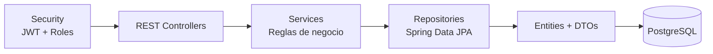
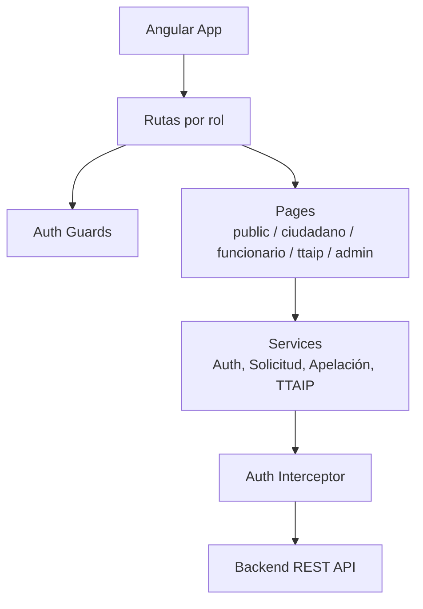
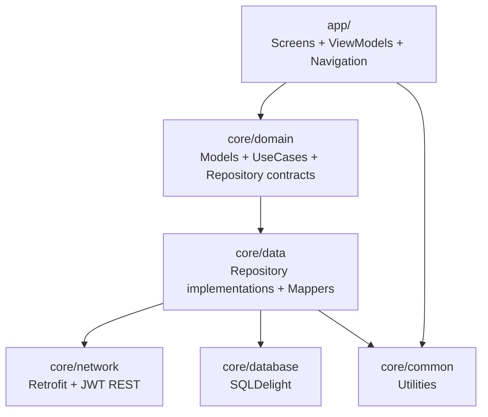
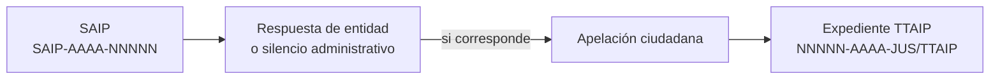
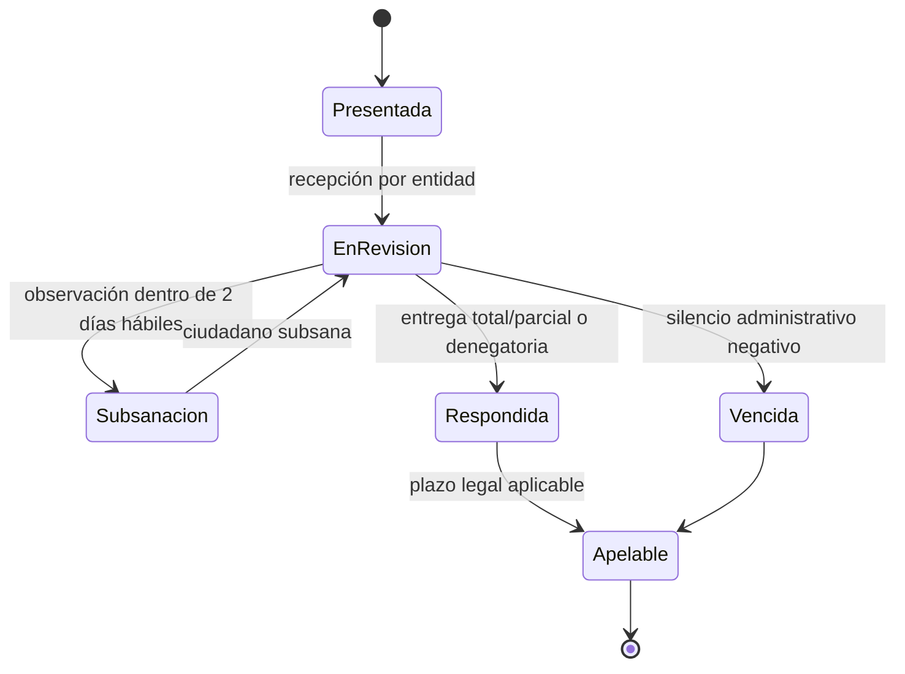
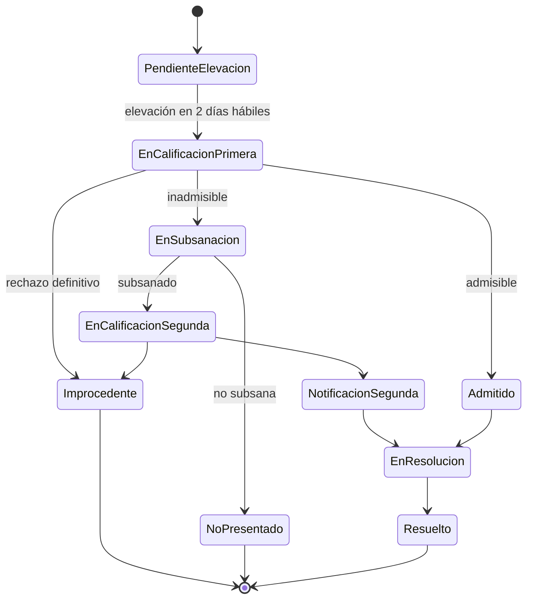
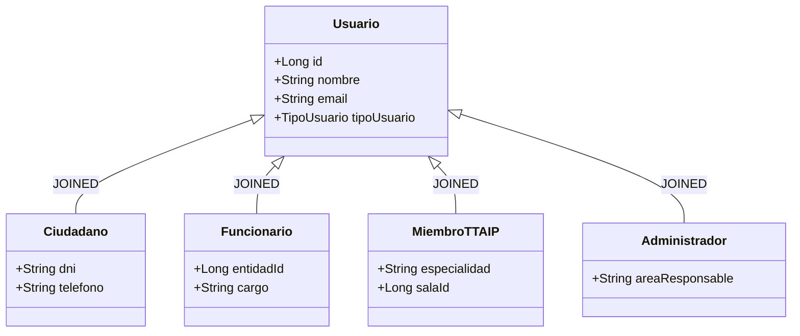
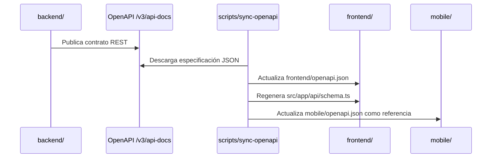
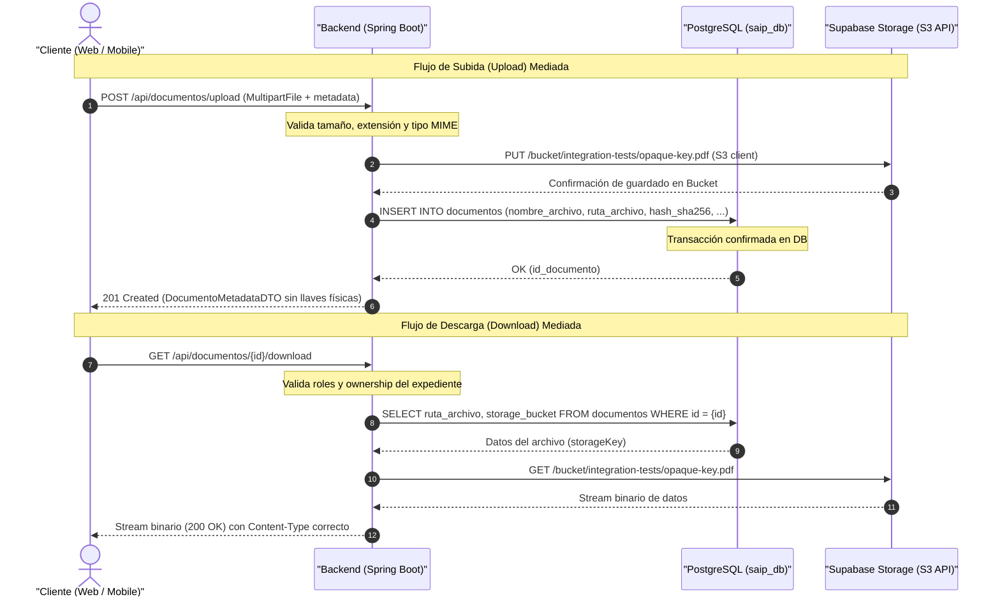
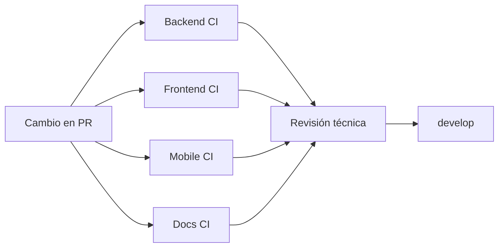

# Plataforma SAIP y Apelaciones TTAIP

> Plataforma integral para gestionar Solicitudes de Acceso a la Información Pública (SAIP), respuestas de entidades públicas y apelaciones ante el Tribunal de Transparencia y Acceso a la Información Pública (TTAIP), alineada al marco de la Ley N.° 27806 del Perú.

[](backend/)
[](frontend/)
[](frontend/)
[](frontend/)
[](mobile/)
[](docs/)
[](LICENSE)

La plataforma modela el ciclo completo de transparencia pública: el ciudadano solicita información, la entidad responde dentro de los plazos legales y, si corresponde, el TTAIP califica y resuelve la apelación. El repositorio está organizado como un monorepo con backend, frontend web, app mobile, documentación, base de datos, colecciones de API y automatización de contrato OpenAPI.

> Este proyecto es una iniciativa académica y tecnológica. No representa ni está afiliado oficialmente a ninguna entidad gubernamental.

## Tabla de contenidos

- [Visión del producto](#visión-del-producto)
- [Co-creadores](#co-creadores)
- [Arquitectura general](#arquitectura-general)
- [Stack tecnológico](#stack-tecnológico)
- [Estructura del monorepo](#estructura-del-monorepo)
- [Módulos principales](#módulos-principales)
- [Modelo de dominio](#modelo-de-dominio)
- [Infraestructura de datos y persistencia](#infraestructura-de-datos-y-persistencia)
- [Contrato API y sincronización](#contrato-api-y-sincronización)
- [Hitos de ingeniería recientes](#hitos-de-ingeniería-recientes)
- [Seguridad y roles](#seguridad-y-roles)
- [Gestión de Almacenamiento Seguro (Supabase S3 API)](#gestión-de-almacenamiento-seguro-supabase-s3-api)
- [Ejecución local](#ejecución-local)
- [Validación y CI](#validación-y-ci)
- [Documentación y herramientas](#documentación-y-herramientas)
- [Licencia](#licencia)

## Visión del producto

Plataforma SAIP centraliza la gestión digital de solicitudes de acceso a la información pública y apelaciones TTAIP con una arquitectura preparada para tres experiencias independientes:

| Superficie | Usuario principal | Objetivo |
| --- | --- | --- |
| Web pública | Ciudadano | Presentar SAIP, consultar estado, registrar apelaciones y subsanar observaciones. |
| Web interna | Funcionarios, TTAIP, administradores | Gestionar expedientes, responder solicitudes, calificar apelaciones, emitir resoluciones y revisar indicadores. |
| Mobile Android | Ciudadano y operadores | Consultar y operar flujos clave desde una aplicación nativa con sincronización local. |

El backend es la fuente de verdad del dominio y expone el contrato REST formal. El frontend Angular y la app Android consumen el mismo contrato, pero evolucionan como clientes independientes.

## Co-creadores

| Nombre | Rol en el proyecto | Contribucion principal |
| --- | --- | --- |
| **Kelly Medalit De La Cruz Lopez** | Co-creadora, Analista Funcional | Ideación del producto, levantamiento funcional, reglas de negocio, flujo SAIP/TTAIP, criterios de validación y modelado del dominio. |
| **Daniel Angel Leon Salazar** | Co-creador, Arquitecto de Software | Arquitectura técnica, backend Spring Boot, frontend Angular, app Android nativa, integración API, seguridad, automatización y despliegue técnico. |

## Arquitectura general

La arquitectura prioriza separación de responsabilidades, contrato API versionable, clientes desacoplados y validación independiente por módulo.


### Decisiones arquitectónicas

| Decisión | Razón |
| --- | --- |
| Backend como source of truth | Centraliza reglas legales, seguridad, persistencia y transiciones de estado. |
| OpenAPI como contrato formal | Permite sincronizar frontend y mobile sin compartir código fuente. |
| Monorepo modular | Facilita consistencia técnica, CI por paths y versionado coordinado. |
| Clientes desacoplados | Web y mobile consumen la API de forma independiente y pueden desplegarse por separado. |
| Documentación viva | `docs/` y `README.md` explican arquitectura, dominio, operación y decisiones clave. |

## Stack tecnológico

### Backend

| Área | Tecnología |
| --- | --- |
| Runtime | Java 25 |
| Framework | Spring Boot 4.0.0 |
| API | Spring Web MVC, REST JSON |
| Persistencia | Spring Data JPA, Hibernate, PostgreSQL 16+ (Supabase) |
| Almacenamiento de objetos | Supabase Storage — API compatible con AWS S3 para gestión de buckets |
| Documentos | Metadatos en PostgreSQL + `StorageProvider` con providers `LOCAL` y `S3_COMPATIBLE` |
| Programación de tareas | `@Scheduled` cron para auditoría diaria de plazos legales |
| Seguridad | Spring Security, JWT (`jjwt`), CORS configurable |
| Validación | Jakarta Bean Validation |
| Documentación API | springdoc-openapi, Swagger UI |
| Build y testing | Maven Wrapper, Spring Boot Test, H2 para escenarios de prueba |

### Frontend web

| Área | Tecnología |
| --- | --- |
| Framework | Angular 22.1.x |
| Lenguaje | TypeScript 6.0.x |
| UI | Tailwind CSS 4.1, Lucide Angular, GSAP |
| SSR | Angular SSR con Express 5 |
| Formularios | Angular Reactive Forms (tipados y defensivos) |
| API contract | `openapi-typescript` con indexación dinámica en `schema.ts` |
| Testing | Vitest + Angular unit test builder (179 tests unitarios) |
| Package manager | pnpm 12.3.x (mandatorio en gobernanza de arquitectura) |

### Mobile Android

| Área | Tecnología |
| --- | --- |
| Lenguaje | Kotlin 2.3.x |
| UI | Jetpack Compose + Material 3 |
| Arquitectura | Clean Architecture + MVVM |
| Navegación | Navigation 3 |
| DI | Koin 4.1 |
| Datos locales | SQLDelight 2.2 |
| Red | Retrofit 3, OkHttp 5 |
| Sincronización / jobs | Coroutines, Flow, WorkManager |
| Firebase | FCM exclusivamente para push notifications |
| Build | Gradle 9.x, Android Gradle Plugin 9.x |

### Documentación y automatización

| Área | Tecnología |
| --- | --- |
| Docs | Astro 6, Starlight, Mermaid |
| API collections | Postman collection operativa |
| Database migrations | Flyway versioned migrations (V1 DDL and V2 local seed in `backend/src/main/resources/db/`) |
| CI/CD | GitHub Actions por módulo |
| OpenAPI sync | `scripts/sync-openapi.ps1` y `scripts/sync-openapi.sh` |

## Estructura del monorepo

```text
plataforma-saip-apelaciones/
├── backend/              # API REST Spring Boot 4 + Java 25
├── frontend/             # Aplicación web Angular 22 + SSR
├── mobile/               # App Android Kotlin + Jetpack Compose
├── docs/                 # Documentación Astro + Starlight
├── database/             # Scripts SQL de apoyo y datos seed
├── postman/              # Colección operativa de API
├── scripts/              # Sincronización OpenAPI y utilidades
├── .github/workflows/    # CI independiente por módulo
├── AGENTS.md             # Instrucciones locales para Codex
├── LICENSE               # Apache License 2.0
└── README.md             # Visión técnica y funcional del proyecto
```

## Módulos principales

### `backend/` - API REST y dominio transaccional

El backend implementa las reglas centrales del sistema: solicitudes SAIP, respuestas de entidades, apelaciones TTAIP, calificación, resolución, estadísticas, reportes y autenticación.



Controladores principales:

| Controller | Responsabilidad |
| --- | --- |
| `AuthRestController` | Login, registro y usuario autenticado. |
| `SolicitudRestController` | Ciclo SAIP y consultas de solicitudes. |
| `RespuestaRestController` | Respuestas de funcionarios a solicitudes. |
| `ApelacionRestController` | Presentación y seguimiento de apelaciones. |
| `TTAIPRestController` | Calificación, subsanación y resolución TTAIP. |
| `EntidadRestController` | Gestión de entidades públicas. |
| `CiudadanoRestController` | Operaciones del ciudadano. |
| `FuncionarioRestController` | Operaciones de funcionarios. |
| `EstadisticasRestController` | Indicadores operativos. |
| `ReportesRestController` | Generación de reportes. |

### `frontend/` - Web Angular multirol

El frontend entrega la experiencia web pública e interna. La aplicación está organizada por rol y consume servicios HTTP tipados hacia el backend.



Áreas de interfaz:

| Carpeta | Alcance |
| --- | --- |
| `pages/public/` | Consulta pública y ayuda. |
| `pages/auth/` | Login y registro del ciudadano. |
| `pages/ciudadano/` | Panel, nueva SAIP, detalle, apelación y subsanación. |
| `pages/funcionario/` | Panel de entidad, detalle y respuesta de solicitud. |
| `pages/ttaip/` | Bandeja TTAIP, calificaciones, resolución y procesos disciplinarios. |
| `pages/admin/` | Administración general del sistema. |

### `mobile/` - Android nativo

La app mobile está construida con Kotlin, Jetpack Compose, arquitectura limpia y persistencia local. Su objetivo es ofrecer una experiencia nativa desacoplada del frontend web.



| Módulo Gradle | Responsabilidad |
| --- | --- |
| `app/` | Presentación, tema, navegación, ViewModels y pantallas. |
| `core/domain/` | Modelos de dominio, casos de uso e interfaces. |
| `core/data/` | Repositorios concretos y mapeadores. |
| `core/network/` | Cliente Retrofit, DTOs, JWT y comunicación REST con backend. |
| `core/database/` | SQLDelight y persistencia local. |
| `core/common/` | Utilidades compartidas. |

### `docs/` - Documentación técnica y funcional

Sitio de documentación construido con Astro + Starlight. Complementa este README con contenido navegable, diagramas y material técnico/funcional extendido.

### `database/`, `postman/` y `scripts/`

| Carpeta | Uso |
| --- | --- |
| `database/` | Script SQL de apoyo para inicialización o pruebas locales. |
| `postman/` | Colección operativa para validar flujos API end-to-end. |
| `scripts/` | Sincronización del contrato OpenAPI hacia consumidores. |

## Modelo de dominio

### Conceptos clave

| Concepto | Definición |
| --- | --- |
| SAIP | Solicitud de Acceso a la Información Pública. Es primera instancia y usa formato `SAIP-AAAA-NNNNN`. |
| Entidad pública | Organismo que posee o administra la información solicitada. |
| Funcionario | Usuario interno de entidad pública encargado de evaluar y responder SAIP. |
| Apelación | Recurso presentado por el ciudadano cuando la respuesta no satisface o no existe respuesta. |
| Expediente TTAIP | Contenedor de segunda instancia. Solo existe cuando hay apelación y usa formato `NNNNN-AAAA-JUS/TTAIP`. |
| TTAIP | Tribunal que califica y resuelve apelaciones. |
| Resolución | Decisión formal emitida durante calificación o resolución final. |
| Cédula de notificación | Documento que acredita notificación en el procedimiento. |

### Distinción crítica

SAIP no es expediente. La SAIP pertenece a la primera instancia ante la entidad pública. El expediente TTAIP solo nace cuando el ciudadano apela.



### Flujo SAIP



Reglas principales:

| Regla | Criterio |
| --- | --- |
| Plazo SAIP | 10 días hábiles desde el día hábil siguiente a la recepción. |
| Subsanación | Solo dentro de los 2 primeros días hábiles. |
| Liquidación de costos | Debe notificarse antes del vencimiento del plazo legal. |
| Silencio administrativo | Aplica si la entidad no responde dentro del plazo. |
| Apelación | Ante denegatoria expresa aplica el plazo legal que se defina con criterio legal/producto; ante silencio administrativo negativo no existe plazo perentorio. |

### Flujo TTAIP



Reglas principales:

| Etapa | Plazo / criterio |
| --- | --- |
| Elevación | 2 días hábiles para remitir el recurso al TTAIP. |
| Primera calificación | 7 días hábiles para calificar admisibilidad. |
| Subsanación | 2 días hábiles cuando el recurso es inadmisible. |
| Segunda calificación | Determina admisión posterior o improcedencia. |
| Notificación | La segunda calificación debe notificarse antes de iniciar resolución final. |
| Resolución final | 10 días hábiles para emitir decisión final. |

Decisiones de resolución final:

| Decisión | Resultado |
| --- | --- |
| Fundado | Ordena entregar la información. |
| Fundado en parte | Ordena entrega parcial. |
| Infundado | Confirma la decisión o conducta de la entidad. |
| Infundado en parte | Confirma parcialmente. |
| Improcedente | Rechazo por causal formal o de fondo. |
| Conclusión por sustracción de la materia | La entidad entrega información durante el trámite. |
| Conclusión por desistimiento | El ciudadano desiste del recurso. |

## Infraestructura de datos y persistencia

### PostgreSQL centralizado (Supabase)

Toda la lógica transaccional del sistema persiste en una instancia PostgreSQL 16+ alojada en Supabase. El esquema relacional implementa herencia por tabla compartida mediante `InheritanceType.JOINED` en la jerarquía de usuarios:



Esta estrategia permite que la tabla base `usuarios` centralice los campos comunes (credenciales, email, tipo, fechas de auditoría) mientras que cada subtipo extiende con sus campos específicos en tablas dedicadas (`ciudadanos`, `funcionarios`, `miembros_ttaip`, `administradores`). Las consultas polimórficas de Spring Data JPA resuelven automáticamente el `JOIN` necesario según el tipo discriminador.

### Almacenamiento de objetos (Supabase Storage)

Los binarios del sistema (PDFs de solicitudes, imágenes de constancias, resoluciones TTAIP y documentos de subsanación) se persisten en Supabase Storage, un servicio de almacenamiento de objetos que opera mediante una API compatible con el protocolo AWS S3. El backend actúa como proxy inverso: los clientes web y mobile nunca se conectan directamente con Supabase. Las credenciales S3 (`access-key`, `secret-key`, `endpoint`, `bucket-name`) se inyectan exclusivamente mediante variables de entorno.

```text
Cliente (Web/Mobile) → Backend (Spring Boot) → Supabase Storage (S3 API)
                                ↕
                         PostgreSQL (metadatos)
```

La sección [Gestión de Almacenamiento Seguro](#gestión-de-almacenamiento-seguro-supabase-s3-api) documenta en detalle el flujo mediado, la matriz de variables y la configuración defensiva del bucket.

## Contrato API y sincronización

El backend publica el contrato OpenAPI en `/v3/api-docs`. Ese contrato se sincroniza hacia el frontend y mobile para mantener consistencia entre clientes.



Sincronización en Windows:

```powershell
.\scripts\sync-openapi.ps1
```

Sincronización en Linux/macOS:

```bash
./scripts/sync-openapi.sh
```

Regla operativa: si cambian endpoints, DTOs o modelos de API en `backend/`, sincronizar OpenAPI y validar los consumidores impactados.

Tras el endurecimiento del contrato OpenAPI con `@Schema(allowableValues)` en los DTOs del backend, la regeneración de tipos TypeScript produce enums estrictos en `schema.ts`. Los modelos del frontend (`apelacion.model.ts`, `resolucion.model.ts`) importan estos tipos desde `types.ts`, que los indexa dinámicamente mediante `NonNullable<DTO['campo']>`, eliminando la necesidad de mantener string unions manuales sincronizadas con el backend.

## Hitos de ingeniería recientes

Esta sección documenta las capacidades de ingeniería integradas en la rama base tras las últimas iteraciones de desarrollo.

### Backend — Motor de auditoría de plazos legales

El componente `PlazoAlertaScheduler` implementa una tarea programada con `@Scheduled(cron = "0 0 6 * * ?")` que ejecuta una auditoría diaria de plazos legales a las 06:00 AM. El proceso recupera todas las solicitudes SAIP en estados activos (`RECEPCIONADA`, `EN_REVISION`, `PENDIENTE_INFORMACION`), calcula la fecha de vencimiento legal (10 días hábiles peruanos) y transiciona automáticamente a `VENCIDA` las solicitudes que superaron su plazo. Al detectar un vencimiento, el motor dispara una notificación push al ciudadano informando la habilitación de su derecho a recurso de apelación y encola alertas por correo para los funcionarios de la entidad responsable.

### Backend — Control defensivo contra ataques IDOR

`AutorizacionRecursosService` centraliza la verificación de ownership y acceso a recursos en 26+ métodos dedicados. Antes de que cualquier controlador ejecute una operación sobre una solicitud, respuesta, apelación, expediente TTAIP, elevación o documento, el servicio verifica que el usuario autenticado (extraído de `SecurityContextHolder`) tiene relación legítima con el recurso solicitado. Las verificaciones cubren: ciudadano propietario, funcionario de la entidad asignada, miembro TTAIP con jurisdicción, y administrador con privilegios globales. Cualquier intento de acceso no autorizado resulta en una excepción `AccessDeniedException` con respuesta HTTP 403.

### Backend — Endurecimiento del contrato OpenAPI

Los DTOs y Records expuestos por los controladores REST (`ApelacionDTO`, `ApelacionResumenDTO`, `ApelacionInfoDTO`, `ResolucionDTO`, `DescargoEntidadTtaipDTO`, `CumplimientoResolucionTtaipDTO`, `CrearApelacionExternaRequest`) fueron enriquecidos con anotaciones `@Schema(allowableValues = {...})` de springdoc-openapi. Esto fuerza al generador de especificaciones a exportar los campos de estado, calificación, tipo de origen, tipo de denegatoria, tipo de resolución y decisión como enums estrictos con valores explícitos, en lugar de cadenas genéricas.

### Frontend — Gestión reactiva con Signals nativos

Los componentes de detalle del funcionario utilizan `computed()` de Angular Signals para derivar propiedades reactivas a partir del estado de la solicitud. Por ejemplo, `idApelacion` se calcula como un signal derivado que extrae el ID del expediente TTAIP desde el historial de la solicitud, habilitando la navegación interactiva hacia la vista de apelación sin suscripciones manuales ni pipes asíncronos.

### Frontend — Interconexión de rutas SAIP ↔ TTAIP con SSR

Se registró la ruta `/funcionario/apelaciones/:expediente` en el router de Angular y se configuró como `RenderMode.Client` en las rutas del servidor (`app.routes.server.ts`). Esta decisión previene errores de pre-renderización durante la compilación SSR, ya que la ruta depende de parámetros dinámicos que solo existen en tiempo de ejecución del navegador. El componente de detalle del funcionario incluye `routerLink` interactivos con transiciones visuales que permiten navegar directamente del expediente SAIP al expediente TTAIP cuando la solicitud ha sido apelada.

### Frontend — Saneamiento del contrato TypeScript

El archivo `types.ts` del frontend ahora indexa dinámicamente los tipos de enums desde los DTOs generados por OpenAPI mediante el patrón `NonNullable<DTO['campo']>`, eliminando las declaraciones manuales de string unions y los comentarios `// TODO` que solicitaban endurecimiento del backend. Los tipos `EstadoApelacion`, `CalificacionApelacion`, `TipoOrigenApelacion`, `TipoDenegatoriaApelacion`, `TipoResolucion` y `DecisionResolucion` se derivan directamente del esquema auto-generado.

### Frontend — Actualización a Angular 22.1, TypeScript 6.0 y gobernanza mandatoria con pnpm 12

El frontend web se actualizó a las versiones estables más recientes del ecosistema Angular: Angular CLI, `@angular/build` y `@angular/ssr` en versión `22.1.7`, con el framework core en `22.1.5` y TypeScript `~6.0.3`. Se migró integralmente el gestor de paquetes a **`pnpm 12.3.x`**, estableciéndose en la gobernanza arquitectural (`AGENTS.md`, `frontend/AGENTS.md` y workflows) como el único gestor permitido para herramientas web. Para compatibilidad nativa con las directivas de seguridad de pnpm v12, se configuró `pnpm-workspace.yaml` mediante `allowBuilds` aprobando explícitamente los paquetes con scripts de construcción nativos (`@parcel/watcher`, `core-js`, `esbuild`, `lmdb`, `msgpackr-extract`). El pipeline de CI en GitHub Actions (`frontend-ci.yml`) fue adaptado con `pnpm/action-setup@v4`, verificación de tipos con `tsc --noEmit` y suite completa de pruebas ejecutada al 100% (179 pruebas unitarias exitosas en Vitest) con compilación limpia de producción en modo SSR.

### Frontend — Experiencia integral del Módulo del Administrado y trazabilidad SAIP/TTAIP

Se consolidó la experiencia digital completa para el Administrado / Ciudadano bajo los lineamientos de la Ley N.° 27806:
- **Resiliencia en la consulta y detalle SAIP (`solicitud-detalle.component`)**: Se optimizó la evaluación reactiva del estado y se integró un mecanismo de respaldo con datos procesales estructurados, garantizando que el administrado visualice de forma ininterrumpida el expediente, sus metadatos y estado legal.
- **Estructura procesal de 3 pestañas dinámicas**:
  - `01 · Solicitud`: Identificación del solicitante (persona natural con DNI o persona jurídica con RUC), modalidad de entrega seleccionada y repositorio de documentos probatorios con visor in-situ (`RemoteDocPreview`) y descarga segura.
  - `02 · Respuesta de la entidad`: Visualización clara del pronunciamiento institucional, causal y fundamento legal en caso de denegatoria total o parcial, y descarga de la respuesta formal.
  - `03 · Apelación / Resoluciones y cédulas`: Seguimiento del recurso ante el TTAIP por etapas procesales (`1.ª Calificación`, `2.ª Calificación` y `Resolución Final`), con doble numeración expeditiva (SAIP de primera instancia y TTAIP de segunda instancia).
- **Línea de tiempo procesal**: Trazabilidad completa mediante `buildCitizenTimeline` con orden cronológico inverso, destacando el hito activo con animación pulsante y cálculo de plazos legales.
- **Flujos procesales normativos**: Incorporación de `PrecisionFormComponent` para la atención oportuna de pedidos de aclaración en primera instancia (plazo de 2 días hábiles) y `ComplianceTrackingComponent` para el seguimiento del cumplimiento de las resoluciones emitidas por el Tribunal.

### Mobile — Transmisión multipart para subsanación binaria

El flujo de subsanación en la app Android fue refactorizado de texto plano a una petición `@Multipart` de Retrofit. El endpoint `POST /api/apelaciones/{id}/subsanacion` ahora transmite los fundamentos como `RequestBody` de tipo `text/plain` y el archivo adjunto (PDF/PNG) como `MultipartBody.Part`. La captura de metadatos del archivo utiliza `ContentResolver` con `OpenableColumns.DISPLAY_NAME` para obtener el nombre real del archivo seleccionado por el ciudadano, y todos los descriptores de flujo (`InputStream`) se cierran de forma hermética mediante el operador `.use` de Kotlin para prevenir fugas de recursos.

## Seguridad y roles

La autenticación principal se resuelve con JWT emitido por el backend. El frontend usa guards e interceptor de autenticación. Mobile consume el backend con Retrofit y conserva Firebase Cloud Messaging exclusivamente para push notifications.

| Rol | Enum | Superficie principal | Capacidades |
| --- | --- | --- | --- |
| Ciudadano | `CIUDADANO` | Web pública, mobile | Registro, login, SAIP, consulta, apelación y subsanación. |
| Funcionario | `FUNCIONARIO` | Web interna | Gestionar solicitudes de su entidad y emitir respuestas. |
| TTAIP | `TTAIP` | Web interna | Calificar, admitir, resolver y revisar expedientes. |
| Administrador | `ADMIN` / `ADMINISTRADOR` | Web interna | Gestión de usuarios, entidades, reportes e indicadores. |

Principios de seguridad:

- Validar entradas en backend con Jakarta Bean Validation.
- Proteger endpoints con Spring Security y roles.
- Usar CORS configurable por entorno.
- Mantener secretos fuera del repositorio y usar variables de entorno.
- Validar tamaño, extensión y tipo de archivos cargados.
- Evitar logs con tokens, credenciales o información sensible.

### Motor común de notificaciones

El backend persiste intentos de notificación para SAIP y TTAIP. El modo `MOCK` se usa en desarrollo local y Newman; el modo `SMTP` habilita correo real mediante variables de entorno. `CASILLA_ELECTRONICA` cuenta con un adaptador preparado que responde explícitamente como no disponible hasta contar con el contrato API oficial. Mobile registra, renueva y revoca tokens FCM contra endpoints autenticados; el adapter de envío FCM permanece preparado pero reporta explícitamente que falta la integración Firebase Admin. No existe fallback automático entre canales.

Para despliegues productivos, activar `SPRING_PROFILES_ACTIVE=prod`. Ese perfil usa `SMTP` por defecto, rechaza `MOCK`, exige configuración externa de base de datos, JWT, CORS y SMTP, desactiva inicialización automática del seed y mantiene OpenAPI/Swagger deshabilitados salvo habilitación operativa explícita.

## 📦 Gestión de Almacenamiento Seguro (Supabase S3 API)

La plataforma SAIP y Apelaciones TTAIP delega la persistencia de los archivos binarios (PDFs, imágenes de constancias, resoluciones y subsanaciones) en un Object Storage externo, utilizando la API compatible con S3 de Supabase.

### 1. Arquitectura del Flujo Mediado (Aislamiento de Infraestructura)

Por directivas de ciberseguridad y de diseño defensivo (AppSec), **el Frontend Web y la App Móvil Android jamás se conectan directamente con Supabase o S3**. Todo el acceso de lectura y escritura es mediado por el Backend (Spring Boot), el cual actúa como un proxy inverso y orquestador transaccional.



**Ventajas de Seguridad del Flujo Mediado:**
*   **Llaves ocultas:** Las credenciales maestras de AWS/Supabase, nombres físicos de buckets y tokens de API no se exponen al cliente.
*   **URLs efímeras/ocultas:** No se generan URLs públicas directas ni firmadas accesibles desde el exterior. El cliente descarga y sube a través de `/api/documentos`.
*   **Aislamiento de metadata:** La API responde con `DocumentoMetadataDTO`, el cual oculta explícitamente los campos sensibles `storageKey`, `storageBucket`, `storageProvider` y cualquier URL física. El cliente solo recibe un identificador seguro y el nombre original del archivo.

### 2. Matriz de Variables de Entorno para Almacenamiento

El backend de Spring Boot se configura mediante las siguientes propiedades del sistema y variables de entorno para activar la persistencia S3/Supabase en el perfil de `staging`:

| Propiedad Spring / Variable de Entorno | Descripción | Ejemplo de Valor | Requerido |
| --- | --- | --- | --- |
| `pe.gob.saip.storage.provider`<br>`APP_STORAGE_PROVIDER` | Define el proveedor de almacenamiento local o remoto. | `S3_COMPATIBLE` (o `LOCAL`) | Sí |
| `pe.gob.saip.storage.s3.endpoint`<br>`SUPABASE_S3_ENDPOINT` | URL del Endpoint compatible con S3 provisto por Supabase. | `https://uxgawcsqkxgscx.supabase.co/storage/v1/s3` | Sí (si provider=S3) |
| `pe.gob.saip.storage.s3.bucket-name`<br>`SUPABASE_S3_BUCKET_NAME` | Nombre del Bucket creado en Supabase. | `saip-documents` | Sí (si provider=S3) |
| `pe.gob.saip.storage.s3.access-key`<br>`SUPABASE_S3_ACCESS_KEY` | Clave de acceso generada en Supabase (S3 Access Key). | `88c2b7...` | Sí (si provider=S3) |
| `pe.gob.saip.storage.s3.secret-key`<br>`SUPABASE_S3_SECRET_KEY` | Clave secreta generada en Supabase (S3 Secret Key). | `df92c1a...` | Sí (si provider=S3) |
| `pe.gob.saip.storage.s3.region`<br>`AWS_REGION` | Región AWS virtual del servicio. | `us-east-1` | Sí (si provider=S3) |

> [!WARNING]
> **REGLA DE ORO DE APPSEC:** Está estrictamente prohibido escribir llaves, credenciales, tokens o secretos en duro (*hardcoded*) dentro de los archivos `application.properties`, YAML o en cualquier archivo bajo control de versiones. Toda credencial de infraestructura debe ser inyectada dinámicamente mediante variables de entorno o gestores de secretos.

### 3. Guía de Configuración Defensiva en la Consola de Supabase

Para aislar por completo la infraestructura de almacenamiento y evitar accesos públicos anónimos a través de la API REST nativa de Supabase, el Bucket debe ser configurado defensivamente:

1.  **Bucket Privado:** Al crear el bucket en el panel de control de Supabase (`Storage` -> `New Bucket`), la casilla de verificación **Public** debe establecerse como **False** (Bucket estrictamente privado).
2.  **Desactivación de Políticas de Acceso Público (RLS):** No crees políticas RLS que permitan accesos `select`, `insert`, `update` o `delete` para roles anónimos (`anon`) o usuarios autenticados directamente en el cliente de Supabase (`authenticated`). El backend se conecta de forma externa utilizando credenciales S3 (Access/Secret Key) con privilegios administrativos dedicados, haciendo que el almacenamiento de Supabase sea invisible al exterior del backend.

### 4. Guía de Ejecución y Verificación Local (Paso a Paso)

Para arrancar el backend Spring Boot localmente apuntando a Supabase y verificar el funcionamiento de las subidas y descargas mediadas:

#### Paso 1: Iniciar el backend con el runner de Staging
Para automatizar la carga de las variables de entorno definidas en tu archivo `backend/.env` e iniciar la aplicación de forma segura sin exponer credenciales en la terminal:

*   **En Windows (PowerShell):**
    Ejecuta el script runner provisto en el repositorio (el cual lee automáticamente las variables de `backend/.env` e inicia la aplicación en perfil `staging`):
    ```powershell
    .\backend\scripts\run-staging.ps1
    ```

*   **En Linux/macOS:**
    Puesto que en este momento solo se provee el runner de PowerShell (`.ps1`), para entornos Unix puedes arrancar cargando el archivo `.env` antes del comando de ejecución:
    ```bash
    export $(grep -v '^#' backend/.env | xargs) && cd backend && ./mvnw spring-boot:run
    ```

#### Paso 2: Iniciar el backend Spring Boot
```bash
cd backend
./mvnw spring-boot:run
```

#### Paso 3: Simular una carga multipart utilizando `curl`
El contrato de carga exige mapear el documento a una relación de negocio específica. Por ejemplo, vinculando el archivo a una solicitud SAIP (con `solicitudId`):

```bash
curl -X POST http://localhost:8080/api/documentos/upload \
  -H "Authorization: Bearer <tu-token-jwt>" \
  -F "file=@/ruta/a/tu/archivo.pdf" \
  -F "tipoDocumento=SOLICITUD_ORIGINAL" \
  -F "solicitudId=1"
```

*(El backend validará la extensión, cargará el archivo a Supabase, registrará la entrada en la base de datos de PostgreSQL y retornará el `DocumentoMetadataDTO` con el ID autogenerado del documento).*

#### Paso 4: Simular una descarga/stream seguro desde el backend
Utilizando el ID de documento retornado en el paso anterior, realiza la petición GET de descarga:

```bash
curl -O -J -L http://localhost:8080/api/documentos/1/download \
  -H "Authorization: Bearer <tu-token-jwt>"
```

*(El backend descargará el archivo desde Supabase S3 en memoria y lo transmitirá al cliente en un flujo continuo o stream, sin almacenar copias físicas locales ni exponer URLs internas).*

## Ejecución local

### Requisitos

| Herramienta | Uso |
| --- | --- |
| Java 25 | Backend Spring Boot. |
| JDK 17 | Build Android. |
| PostgreSQL 16+ | Base de datos `saip_db` y cliente `psql`. |
| Node.js 22 | Frontend Angular y docs Astro. |
| pnpm 12.x | Gestor de paquetes obligatorio para el frontend web. |
| npm 11.x | Documentación técnica en `docs/` y tooling de apoyo. |
| Android Studio / SDK | Build y ejecución mobile. |
| PowerShell o Bash | Scripts de sincronización OpenAPI. |

### Base de datos local (Inicialización)

Antes de iniciar el backend, se debe crear la base de datos PostgreSQL localmente en blanco. Ya no es necesario ejecutar manualmente ningún script SQL complejo; **Flyway** se encarga de crear el esquema de tablas (V1) y poblar los datos semilla de prueba (V2) automáticamente en el primer arranque del servidor.

**Paso 1: Crear la base de datos vacía**
Ejecuta uno de los siguientes comandos según las herramientas instaladas en tu terminal:

* Usando la herramienta CLI de PostgreSQL:
  ```bash
  createdb -U postgres saip_db
  ```
* O conectándote directamente mediante `psql`:
  ```bash
  psql -U postgres -c "CREATE DATABASE saip_db;"
  ```

> [!NOTE]
> El archivo `database/postgres/script_saip_db_postgres.sql` que se usaba anteriormente para inicialización manual se mantiene en el repositorio únicamente para consulta de referencia histórica. El mecanismo oficial activo ahora son las migraciones Flyway ubicadas en `backend/src/main/resources/db/`.

### Configuración de Variables de Entorno (`.env`)

El directorio `backend/` incluye una plantilla `backend/.env.example` para gestionar secretos e integraciones de infraestructura de forma limpia. 

Para habilitar el perfil de `staging` (integración con Supabase S3 y Firebase), copia la plantilla y configúrala localmente:
```bash
cp backend/.env.example backend/.env
```
*(Nota: Nunca guardes ni subas el archivo `backend/.env` al control de versiones de Git).*

Este archivo incluye la configuración para:
* **Perfil activo de Spring Boot**: `SPRING_PROFILES_ACTIVE` (define el perfil a ejecutar, ej. `staging`)
* **Credenciales S3 de Supabase**: `SUPABASE_S3_ENDPOINT`, `SUPABASE_S3_BUCKET_NAME`, `SUPABASE_S3_ACCESS_KEY` y `SUPABASE_S3_SECRET_KEY`
* **Región AWS virtual**: `AWS_REGION`

> [!IMPORTANT]
> Este paso es **estrictamente opcional** y solo se requiere para ejecutar el perfil `staging` (con integraciones de nube activas). Para el desarrollo local estándar (`default`/`local`), el backend arranca de forma autónoma con almacenamiento local y base de datos local sin necesidad de crear el archivo `.env`.

### Backend

```powershell
cd backend
.\mvnw.cmd spring-boot:run
```

Comandos útiles:

```powershell
cd backend
.\mvnw.cmd compile
.\mvnw.cmd test
.\mvnw.cmd package -DskipTests
```

Variables relevantes:

| Variable | Default local |
| --- | --- |
| `DB_URL` | `jdbc:postgresql://localhost:5432/saip_db` |
| `DB_USERNAME` | `postgres` |
| `DB_PASSWORD` | Vacío; definir externamente |
| `JWT_SECRET` | Solo desarrollo local |
| `JWT_EXPIRATION_MS` | `86400000` |
| `CORS_ALLOWED_ORIGIN_PATTERNS` | Orígenes locales y Postman |
| `APP_STORAGE_PROVIDER` | `local` |
| `APP_STORAGE_LOCAL_BASE_PATH` | `${user.home}/.saip-storage`; configurar externamente en producción |
| `APP_STORAGE_S3_ENDPOINT` | Obligatoria con `APP_STORAGE_PROVIDER=s3`; URL S3-compatible |
| `APP_STORAGE_S3_REGION` | `us-east-1` |
| `APP_STORAGE_S3_BUCKET` | Obligatoria con provider `s3` |
| `APP_STORAGE_S3_ACCESS_KEY` | Obligatoria con provider `s3`; secreto externo |
| `APP_STORAGE_S3_SECRET_KEY` | Obligatoria con provider `s3`; secreto externo |
| `APP_STORAGE_S3_FORCE_PATH_STYLE` | `true` |
| `APP_STORAGE_MAX_FILE_SIZE` | `10485760` bytes |
| `APP_STORAGE_MAX_REQUEST_SIZE` | `11534336` bytes para archivo y overhead multipart |
| `APP_STORAGE_ALLOWED_CONTENT_TYPES` | PDF, PNG, JPEG y texto plano |

PostgreSQL almacena únicamente metadatos documentales. Los binarios se escriben
fuera del repositorio mediante `StorageProvider`. `local` sigue siendo el
default y genera claves opacas sin nombres originales ni datos personales.
El provider `s3` usa AWS SDK v2 contra endpoints S3-compatible, incluido
Supabase Storage cuando exista un bucket aprovisionado externamente. El backend
no crea buckets, no devuelve URLs públicas y exige endpoint, bucket y
credenciales mediante variables externas.

### Validación S3-compatible opt-in

La comprobación contra un bucket real de staging no corre dentro de la suite
normal. El bucket debe existir previamente en Supabase Storage o en el proveedor
S3-compatible elegido; el backend y los scripts no crean buckets ni cambian sus
permisos. El endpoint debe copiarse de la configuración S3 del proveedor, sin
hardcodearlo ni versionarlo.

Definir en la sesión o gestor de secretos:

- `RUN_S3_STORAGE_INTEGRATION_TESTS=true`
- `APP_STORAGE_PROVIDER=s3`
- `APP_STORAGE_S3_ENDPOINT`
- `APP_STORAGE_S3_REGION`
- `APP_STORAGE_S3_BUCKET`
- `APP_STORAGE_S3_ACCESS_KEY`
- `APP_STORAGE_S3_SECRET_KEY`
- `APP_STORAGE_S3_FORCE_PATH_STYLE`
- `APP_STORAGE_S3_TEST_PREFIX` opcional; default `integration-tests`

Ejecutar desde la raíz:

```powershell
.\scripts\storage\validate-s3-storage.ps1
```

```bash
bash ./scripts/storage/validate-s3-storage.sh
```

La prueba sube un texto controlado con una key opaca bajo el prefijo de pruebas,
valida existencia, descarga, contenido y SHA-256, y elimina el objeto en la
misma ejecución. No usa archivos de ciudadanos, no guarda binarios en
PostgreSQL y no imprime credenciales, bucket ni endpoint.

### Newman reproducible

La colección Newman crea datos runtime para validar flujos reales. Si el entorno
local acumuló fixtures, recrear explícitamente la base local y volver a cargar el
seed oficial:

```powershell
.\scripts\reset-local-db.ps1 -ConfirmReset
$env:APP_NOTIFICATIONS_MODE='MOCK'
cd backend
.\mvnw.cmd spring-boot:run
```

En otra terminal:

```powershell
cd postman
npm run test:api:diagnostic
```

> [!NOTE]
> Para la correcta ejecución de los tests Newman que involucran subida de archivos
> (carga de binarios y subsanación), es necesario configurar el **Working Directory**
> de tu entorno local de Postman. Consulta la guía detallada de configuración de
> Postman Desktop en el archivo [postman/README.md](postman/README.md) para prevenir
> errores de tipo `ENOENT`.

El script bloquea hosts remotos, exige confirmación explícita y no se ejecuta de
forma automática. Newman usa variables dinámicas y tokens JWT vacíos en el
environment versionado.

### Frontend

```powershell
cd frontend
pnpm install
pnpm start
```

Comandos útiles:

```powershell
cd frontend
pnpm test --watch=false
pnpm run build
pnpm run generate:api
pnpm run generate:api:live
```

### Mobile

```powershell
cd mobile
.\gradlew.bat assembleDebug
```

Comandos útiles:

```powershell
cd mobile
.\gradlew.bat clean compileDebugKotlin
.\gradlew.bat test
.\gradlew.bat clean compileDebugKotlin test
```

> Para Firebase Cloud Messaging, colocar el archivo `google-services.json` requerido por el módulo Android correspondiente.
> Restringir la API key Android preexistente desde Firebase Console por package name y certificado SHA. No editar ni mover `google-services.json` como parte de esta configuración.

### Docs

```powershell
cd docs
npm ci
npm start
npm run build
```

Para publicar la documentación con sitemap canónico:

```powershell
$env:DOCS_SITE_URL='https://docs.misaip.gob.pe'
cd docs
npm run build
```

## Validación y CI

Cada módulo tiene validaciones independientes. Esto reduce acoplamiento y permite que los cambios se revisen por superficie.

| Módulo afectado | Validación local recomendada |
| --- | --- |
| `backend/` | `cd backend; .\mvnw.cmd test` |
| `frontend/` | `cd frontend; pnpm test --watch=false; pnpm run build` |
| `mobile/` | `cd mobile; .\gradlew.bat clean compileDebugKotlin test` |
| `docs/` | `cd docs; npm run build` |
| API contract | Backend corriendo + `.\scripts\sync-openapi.ps1` |

Pipelines de GitHub Actions:

| Workflow | Trigger por paths | Validación |
| --- | --- | --- |
| `backend-ci.yml` | `backend/**` | Compile, test, package y export OpenAPI. |
| `frontend-ci.yml` | `frontend/**`, `.github/workflows/frontend-ci.yml` | `pnpm/action-setup@v4`, Node 22, caché de `pnpm-lock.yaml`, compilación estricta (`tsc --noEmit`), suite completa de 179 pruebas unitarias en Vitest y build de producción Angular 22 con SSR. |
| `mobile-ci.yml` | `mobile/**` | Gradle wrapper validation, debug APK y tests. |
| `docs-ci.yml` | `docs/**` | Build del sitio Astro/Starlight. |



## Documentación y herramientas

| Recurso | Descripción |
| --- | --- |
| `docs/` | Sitio técnico y funcional con Astro + Starlight. |
| `postman/SAIP-API-Collection-Complete.json` | Colección completa para validar autenticación, SAIP, apelaciones, TTAIP, estadísticas y reportes. |
| `backend/src/main/resources/db/` | Directorio de migraciones Flyway (V1 esquema DDL y V2 seed local). El script original `database/postgres/script_saip_db_postgres.sql` se conserva en el repo únicamente para referencia histórica. |
| `StorageProvider` | Abstracción backend para mantener binarios fuera de PostgreSQL y del repositorio. |
| `AGENTS.md` | Reglas locales para asistentes de IA en el repositorio. |

## Roadmap técnico sugerido

| Área | Próxima mejora |
| --- | --- |
| Backend | Validar el provider S3-compatible contra staging aprovisionado externamente. |
| Frontend | Continuar auditoría responsive, refinamiento visual y mejoras de accesibilidad. |
| Mobile | Profundizar modo offline-first, sincronización incremental y manejo de conflictos. |
| Docs | Publicar arquitectura, ADRs, contratos API y guías de despliegue. |
| DevOps | Incorporar release automation, coverage reports y quality gates por módulo. |

## Licencia

Este proyecto está licenciado bajo **Apache License 2.0**.

Copyright 2025-2026 Kelly Medalit De La Cruz Lopez y Daniel Angel Leon Salazar.

Consulta el archivo [LICENSE](LICENSE) para los términos completos.
