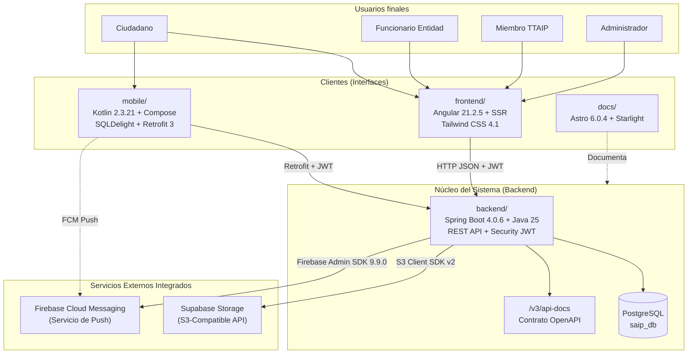
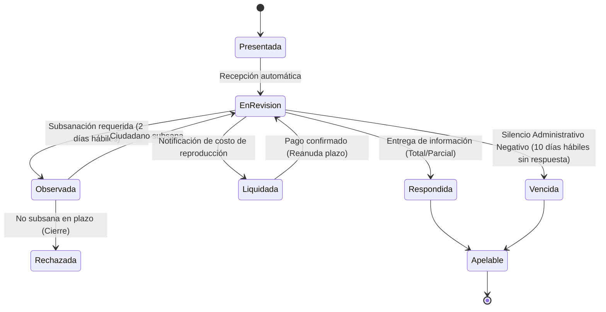
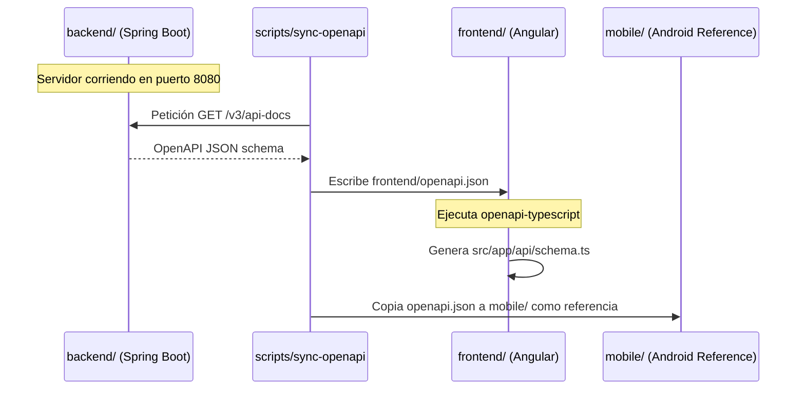

# Plataforma SAIP y Apelaciones TTAIP

> Plataforma integral y segura para gestionar Solicitudes de Acceso a la Información Pública (SAIP), respuestas de entidades públicas y apelaciones ante el Tribunal de Transparencia y Acceso a la Información Pública (TTAIP), alineada al marco de la Ley N.° 27806 (Ley de Transparencia y Acceso a la Información Pública) de la República del Perú.

[](backend/)
[](frontend/)
[](mobile/)
[](docs/)
[](LICENSE)

La plataforma modela el ciclo completo de transparencia pública: el ciudadano solicita información, la entidad responde dentro de los plazos legales y, si corresponde, el TTAIP califica y resuelve la apelación. El repositorio está organizado como un monorepo con backend API, frontend web, app móvil nativa, documentación técnica, base de datos, colecciones de validación de API (Newman) y automatización de contratos OpenAPI.

> [!IMPORTANT]
> Este proyecto es una iniciativa académica y tecnológica de alto nivel. No representa ni está afiliado oficialmente a ninguna entidad gubernamental de la República del Perú.

---

## 📋 Tabla de Contenidos

- [Visión del Producto](#-visión-del-producto)
- [Co-Creadores](#-co-creadores)
- [Arquitectura General del Sistema](#-arquitectura-general-del-sistema)
- [Stack Tecnológico por Módulo](#-stack-tecnológico-por-módulo)
- [Estructura del Monorepo](#-estructura-del-monorepo)
- [Módulos Principales](#-módulos-principales)
- [Modelo de Dominio y Reglas Legales](#-modelo-de-dominio-y-reglas-legales)
- [Contrato API y Sincronización OpenAPI](#-contrato-api-y-sincronización-openapi)
- [Seguridad y Control de Accesos](#-seguridad-y-control-de-accesos)
- [📦 Gestión de Almacenamiento Seguro (Supabase S3 API)](#-gestión-de-almacenamiento-seguro-supabase-s3-api)
- [🔥 Integración y Configuración de Firebase Cloud Messaging (FCM)](#-integración-y-configuración-de-firebase-cloud-messaging-fcm)
- [🗄️ Persistencia de Datos (PostgreSQL)](#️-persistencia-de-datos-postgresql)
- [📮 Validación End-to-End con Newman / Postman](#-validación-end-to-end-con-newman--postman)
- [🚀 Ejecución Local Paso a Paso](#-ejecución-local-paso-a-paso)
- [🧪 Validación y Pipelines de CI/CD](#-validación-y-pipelines-de-cicd)
- [Roadmap Técnico y Próximas Mejoras](#-roadmap-técnico-y-próximas-mejoras)
- [Licencia](#-licencia)

---

## 👁️ Visión del Producto

La plataforma centraliza la gestión digital de solicitudes de acceso a la información pública y apelaciones TTAIP bajo una arquitectura multi-inquilino y multi-superficie:

| Superficie | Usuario Principal | Propósito Operativo |
| --- | --- | --- |
| **Web Pública** | Ciudadano / Persona Natural | Presentar SAIP, realizar consultas de estado, registrar recursos de apelación y subsanar inadmisibilidades. |
| **Web Interna** | Funcionarios Públicos / Miembros TTAIP | Evaluar solicitudes, emitir respuestas, calificar recursos, adjuntar resoluciones, cédulas de notificación y administrar el sistema. |
| **App Móvil Nativa** | Ciudadano | Seguimiento transaccional en tiempo real, recepción de notificaciones push de estado y consulta offline mediante caché local. |

El backend es el único motor del dominio y expone un contrato REST formal. El frontend web y la aplicación móvil consumen este contrato de forma independiente, garantizando el desacoplamiento técnico absoluto.

---

## 👥 Co-Creadores

| Nombre | Rol de Ingeniería | Contribución Principal |
| --- | --- | --- |
| **Kelly Medalit De La Cruz Lopez** | Analista Funcional Senior / PO | Modelado de dominio legal, reglas de negocio bajo Ley N.° 27806, diseño de flujos de apelación, especificación funcional y validación de aceptación. |
| **Daniel Angel Leon Salazar** | Arquitecto de Software / Tech Lead | Diseño de la arquitectura de software, implementación del backend Spring Boot, desarrollo del frontend Angular, app nativa Android (Kotlin), AppSec, CI/CD y despliegue local. |

---

## 🏗️ Arquitectura General del Sistema

La arquitectura implementa patrones modernos de diseño de sistemas orientados a servicios REST, con interfaces desacopladas, persistencia transaccional y delegación controlada de servicios periféricos.



---

## 🛠️ Stack Tecnológico por Módulo

### Backend (API REST)
* **Runtime:** Java 25
* **Framework:** Spring Boot 4.0.6 (Spring Starter Parent)
* **Acceso a Datos:** Spring Data JPA / Hibernate (DDL-Auto: `validate`)
* **Base de Datos:** PostgreSQL (Runtime) / H2 en memoria (Modo PostgreSQL para CI local/OpenAPI build)
* **Seguridad:** Spring Security 6.x, JWT (`jjwt` v0.12.6), CORS dinámico
* **Motor Documental:** Abstracción `StorageProvider` (Soporte local en filesystem / S3-Compatible vía AWS SDK S3 v2.46.9)
* **Notificaciones:** Motor de notificaciones configurable (Modos: `MOCK`, `SMTP` vía Spring Mail, y `FCM` para Push)
* **Integración Push:** Firebase Admin SDK v9.9.0
* **API Documentation:** springdoc-openapi-starter-webmvc-ui v3.0.2

### Frontend Web (Angular App)
* **Framework:** Angular 21.2.5
* **Lenguaje:** TypeScript 5.9.3
* **Estilos & UI:** Tailwind CSS 4.1.12, Lucide Angular v1.14.0, GSAP v3.14.2 (Animaciones interactivas)
* **Arquitectura de UI:** Componentes reactivos, Reactive Forms, SSR con Express 5.1.0
* **Consumo de API:** Tipado estático generado mediante `openapi-typescript` v7.8.0
* **Testing:** Vitest v4.0.8, JSDOM v27.1.0

### App Móvil (Android Nativo)
* **Lenguaje:** Kotlin 2.3.21
* **Android Gradle Plugin (AGP):** v9.2.1
* **UI Framework:** Jetpack Compose (Compose BOM 2026.05.01)
* **Navigation:** Jetpack Navigation 3 (v1.1.2)
* **Inyección de Dependencias:** Koin v4.2.1
* **Caché Local / Offline:** SQLDelight v2.3.2
* **Red:** Retrofit v3.0.0, OkHttp v5.3.2
* **Tareas en segundo plano:** WorkManager v2.11.2
* **Seguridad:** Android Security Crypto v1.1.0 (EncryptedSharedPreferences para FCM token y credenciales)
* **Push Client:** Firebase Messaging BOM v34.13.0
* **Testing:** JUnit v4.13.2, MockK v1.14.9, Turbine v1.2.1 (Flow testing)

### Documentación
* **Engine:** Astro 6.0.4 + Starlight 0.38.1
* **Diagramas:** Astro-Mermaid v1.3.1 + Mermaid 11.13.0

---

## 📂 Estructura del Monorepo

```text
plataforma-saip-apelaciones/
├── .github/workflows/    # Pipelines de CI/CD independientes por módulo
├── .agents/              # Configuración y skills locales para Codex
├── .codex/               # Wrappers resumidos de agentes Codex
├── backend/              # API REST Spring Boot 4.0.6 + Java 25
├── frontend/             # Aplicación web Angular 21 + SSR
├── mobile/               # App móvil Android nativa (Kotlin + Compose)
│   ├── app/              # Código fuente de la interfaz (Presentación / UI)
│   ├── core/             # Módulos comunes, red, base de datos SQLDelight y dominio
│   └── firebase-setup/   # Scripts y utilidades de configuración de base de datos Firebase
├── docs/                 # Documentación técnica Astro + Starlight
├── database/             # Scripts SQL PostgreSQL y auditorías de base de datos
├── postman/              # Pruebas automatizadas de API mediante Newman y colecciones Postman
├── scripts/              # Scripts de automatización (Reset de DB, Sync OpenAPI, etc.)
├── AGENTS.md             # Instrucciones principales de gobernanza de IA
└── README.md             # Documentación principal del monorepo
```

---

## 📦 Módulos Principales

### `backend/` - Dominio Transaccional y API REST
Implementa todas las reglas legales y transiciones de estado de las solicitudes SAIP y apelaciones TTAIP.
- **`config/`**: Contiene la inicialización de Firebase App, almacenamiento S3, CORS, seguridad JWT y converters.
- **`controller/`**: Expone endpoints REST validados mediante anotaciones Jakarta Validation.
- **`service/`**: Contiene las reglas del negocio (plazos, cálculo de días hábiles, autorizaciones de descarga).
- **`storage/`**: Gestiona el ciclo de vida de binarios abstrayendo el filesystem local y la API S3.

### `frontend/` - Cliente Web Multirol
- **`src/app/pages/public/`**: Landing y consultas de estado no autenticadas.
- **`src/app/pages/ciudadano/`**: Panel personal, radicación de solicitudes, apelaciones y subsanaciones.
- **`src/app/pages/funcionario/`**: Dashboard de la entidad pública, carga de respuestas y liquidación de costos.
- **`src/app/pages/ttaip/`**: Tablero del Tribunal, calificación de admisibilidad, expedición de resoluciones y generación de cédulas de notificación.

### `mobile/` - Cliente Móvil Android
Estructura modularizada bajo Clean Architecture:
- **`:core:domain`**: Contiene entidades puras y Casos de Uso (UseCases).
- **`:core:data`**: Implementa repositorios y mapeadores de datos.
- **`:core:network`**: Clientes Retrofit configurados con interceptores de seguridad JWT.
- **`:core:database`**: Definiciones SQLDelight para la base de datos local cifrada.
- **`:app`**: Pantallas declarativas en Jetpack Compose y ViewModels reactivos controlados con Koin.

---

## ⚖️ Modelo de Dominio y Reglas Legales

El flujo está regulado estrictamente bajo el TUO de la Ley N.° 27806.

### Primera Instancia: SAIP
La Solicitud de Acceso a la Información Pública (SAIP) se tramita directamente ante la Entidad Pública. Formato identificador: `SAIP-AAAA-NNNNN`.
- **Plazo de atención:** 10 días hábiles desde el día hábil siguiente a la presentación.
- **Subsanación por observaciones:** Si la solicitud carece de requisitos, la entidad notifica la observación dentro de los primeros 2 días hábiles. El ciudadano cuenta con 2 días hábiles para subsanar.
- **Costo de reproducción:** Si aplica, el funcionario debe liquidar los costos y notificar al ciudadano antes del vencimiento del plazo legal. El plazo de entrega se suspende hasta el pago correspondiente.



### Segunda Instancia: Apelación ante el TTAIP
Si la entidad deniega la solicitud o incurre en silencio administrativo negativo, el ciudadano puede apelar ante el Tribunal (TTAIP). Al presentarse la apelación, se genera el Expediente TTAIP con formato: `NNNNN-AAAA-JUS/TTAIP`.

- **Plazo de elevación:** La entidad pública debe elevar el recurso al TTAIP en un plazo máximo de 2 días hábiles.
- **Etapa de Calificación (Admisibilidad):** El TTAIP tiene 7 días hábiles para evaluar el recurso:
  - **Admisible:** El expediente pasa directamente a la etapa de resolución final.
  - **Inadmisible:** Se requiere subsanación. El ciudadano tiene 2 días hábiles para corregir.
  - **Improcedente:** Rechazo de plano (duplicidad, fuera de plazo, materia no regulada).
- **Notificación Obligatoria:** La admisión del recurso debe notificarse tanto al recurrente como a la entidad pública antes de resolver el fondo.
- **Resolución Final:** El TTAIP cuenta con 10 días hábiles para emitir la resolución final.
- **Cédulas de Notificación:** Toda resolución del TTAIP requiere emitir dos cédulas independientes (una para el ciudadano, otra para la entidad pública). La única excepción es el auto de inadmisibilidad, que se notifica únicamente al ciudadano apelante.

---

## 🔄 Contrato API y Sincronización OpenAPI

El backend actúa como el Single Source of Truth del contrato REST, publicando la especificación OpenAPI v3 en `/v3/api-docs`. Los scripts de sincronización permiten descargar este contrato y compilar los tipos de TypeScript para el frontend Angular.



### Comandos de Sincronización (Ejecutar desde la raíz)

**En Windows (PowerShell):**
```powershell
.\scripts\sync-openapi.ps1
```

**En Linux / macOS (Bash):**
```bash
./scripts/sync-openapi.sh
```

---

## 🔒 Seguridad y Control de Accesos

La plataforma implementa un diseño defensivo que se adhiere a las prácticas líderes en AppSec:

1. **Aislamiento de Infraestructura:** El frontend y la app móvil jamás interactúan directamente con bases de datos ni buckets de almacenamiento externo. Todo pasa por el backend Spring Boot.
2. **Validación de Archivos:** Las cargas multipart se validan estrictamente en el backend por:
   - **Tamaño:** Límite máximo de 10 MB.
   - **Extensión:** Coincidencia exacta con lista blanca (`.pdf`, `.png`, `.jpg`, `.jpeg`).
   - **Tipo MIME real:** Inspección del Content-Type de la cabecera.
3. **Firmas de Commits (GPG):** Gobernanza estricta. Todo commit en el flujo del proyecto debe estar firmado con GPG por los desarrolladores y seguir las convenciones de Gitmoji y Conventional Commits.
4. **Protección de Tokens FCM:** Los tokens de notificaciones push de los terminales móviles se almacenan encriptados en base de datos (`AES-GCM-256`) y localmente en `EncryptedSharedPreferences`.

---

## 📦 Gestión de Almacenamiento Seguro (Supabase S3 API)

Los documentos presentados por los ciudadanos y las resoluciones del TTAIP se persisten en el Object Storage privado de Supabase utilizando su API compatible con AWS S3.

### Arquitectura de Subida/Descarga Mediada (Proxy Seguro)

El cliente interactúa únicamente con el backend. El backend gestiona el flujo de streams binarios hacia el storage sin exponer URLs públicas directas ni credenciales maestras.

```mermaid
sequenceDiagram
    autonumber
    actor Cliente as Cliente (Web / App)
    participant API as Backend (Spring Boot)
    database DB as PostgreSQL
    participant Storage as Supabase Storage (S3 API)

    Note over Cliente, Storage: Carga de Archivo (Upload)
    Cliente->>API: POST /api/documentos/upload (Multipart file)
    Note over API: Valida tamaño, extensión y MIME
    API->>Storage: PUT /integration-tests/opaque-uuid-key.pdf
    Storage-->>API: 200 OK (Upload Success)
    API->>DB: INSERT INTO documentos (storage_key, hash_sha256, ...)
    DB-->>API: OK (documento_id)
    API-->>Cliente: 201 Created (DocumentoMetadataDTO sin credenciales)

    Note over Cliente, Storage: Descarga Segura (Download)
    Cliente->>API: GET /api/documentos/{id}/download
    Note over API: Verifica credenciales JWT y posesión del expediente
    API->>DB: SELECT storage_key, storage_bucket FROM documentos WHERE id = {id}
    DB-->>API: Retorna llaves de ubicación
    API->>Storage: GET /integration-tests/opaque-uuid-key.pdf
    Storage-->>API: Stream binario (archivo)
    API-->>Cliente: Stream binario (200 OK) con Content-Type
```

### Matriz de Configuración del Almacenamiento

El backend carga las siguientes variables de entorno para habilitar el motor compatible con S3 cuando el perfil activo es `staging` o `prod`:

| Variable de Entorno | Propiedad de Spring | Propósito | Ejemplo / Valor |
| --- | --- | --- | --- |
| `APP_STORAGE_PROVIDER` | `pe.gob.saip.storage.provider` | Define el backend de almacenamiento | `S3_COMPATIBLE` (Default: `LOCAL`) |
| `SUPABASE_S3_ENDPOINT` | `pe.gob.saip.storage.s3.endpoint` | URL de conexión S3 de Supabase | `https://[id-proyecto].supabase.co/storage/v1/s3` |
| `SUPABASE_S3_BUCKET_NAME`| `pe.gob.saip.storage.s3.bucket-name`| Nombre del bucket privado | `saip-documents` |
| `SUPABASE_S3_ACCESS_KEY` | `pe.gob.saip.storage.s3.access-key` | Credencial de acceso (S3 Key) | `9cf931ac87...` |
| `SUPABASE_S3_SECRET_KEY` | `pe.gob.saip.storage.s3.secret-key` | Secreto de firma (S3 Secret) | `afb8901cb...` |
| `AWS_REGION` | `pe.gob.saip.storage.s3.region` | Región AWS virtual | `us-east-1` |

### Guía de Configuración en Supabase Console
1. **Creación del Bucket:** Vaya a **Storage** -> **New Bucket**. Defina el nombre del bucket (ej. `saip-documents`).
2. **Establecer Privacidad:** Configure el interruptor **Public** en **False** (Bucket privado).
3. **Obtención de Llaves S3:** Navegue a **Project Settings** -> **API** -> **S3 Access Keys**. Genere un nuevo par de llaves y guarde de forma segura el *Access Key* y el *Secret Key*.
4. **Políticas de Acceso (RLS):** Mantenga el bucket sin políticas RLS habilitadas para clientes externos (`anon`, `authenticated`). El backend utilizará la credencial administrativa S3 directamente.

---

## 🔥 Integración y Configuración de Firebase Cloud Messaging (FCM)

La aplicación móvil Android recibe notificaciones push sobre actualizaciones críticas de sus trámites mediante Firebase Cloud Messaging.

### Ciclo de Registro de Tokens FCM en Dispositivos

El backend expone un endpoint seguro `/api/push/tokens` para registrar los identificadores de dispositivo de los ciudadanos autenticados de manera segura.

```mermaid
sequenceDiagram
    participant Device as App Móvil (Android)
    participant FCM as Firebase Cloud Messaging
    participant API as Backend (Spring Boot)
    database DB as PostgreSQL

    Note over Device: Inicio de aplicación
    Device->>FCM: Solicita token de terminal
    FCM-->>Device: Retorna token de registro FCM
    Note over Device: Valida sesión activa
    Device->>API: POST /api/push/tokens (Cuerpo con token encriptado)
    Note over API: Valida roles de usuario
    Note over API: Cifra el token con AES-GCM-256
    API->>DB: INSERT/UPDATE push_token (user_id, token_encriptado, ...)
    DB-->>API: Confirmación de guardado
    API-->>Device: 200 OK (Registro exitoso)
```

### Guía de Configuración de Firebase
1. **Crear Proyecto en Firebase Console:** Ingrese a [Firebase Console](https://console.firebase.google.com/), cree un proyecto y asígnele el nombre `misaip`.
2. **Registrar Aplicación Móvil Android:** En el asistente, registre las aplicaciones con los package names correspondientes a los flavors del proyecto:
   - Ciudadano: `com.gestion.misaip.ciudadano`
   - Funcionario: `com.gestion.misaip.funcionario`
   - TTAIP: `com.gestion.misaip.ttaip`
3. **Descargar Archivo de Servicios:** Descargue el archivo `google-services.json` correspondiente a su aplicación de Firebase y colóquelo dentro de la carpeta: `mobile/app/`.
4. **Generar Archivo de Credenciales del Servidor:**
   - Ingrese a Firebase Console, vaya a **Configuración del Proyecto** -> **Cuentas de Servicio**.
   - Haga clic en **Generar nueva clave privada**. Se descargará un archivo JSON (Service Account Credentials).
5. **Configuración de Variables de Entorno en el Backend:**
   - Habilite el motor push: `APP_NOTIFICATIONS_PUSH_ENABLED=true`
   - Establezca la clave secreta de cifrado de tokens (32 bytes en Base64): `FCM_TOKEN_ENCRYPTION_KEY_BASE64=[tu-clave-base64]`
   - Configure las credenciales de Firebase en el backend inyectando el JSON descargado directamente en formato string de una sola línea:
     `FIREBASE_CREDENTIALS_JSON={"type": "service_account", "project_id": "misaip", ...}`

---

## 🗄️ Persistencia de Datos (PostgreSQL)

La plataforma utiliza PostgreSQL como motor principal de base de datos relacional. El esquema oficial se encuentra versionado en la carpeta `database/`.

* **Esquema Inicial y Datos Semilla:** El script completo de creación de tablas, índices y datos iniciales (entidades públicas, tipos de documentos preestablecidos, usuarios de prueba) está ubicado en:
  `database/postgres/script_saip_db_postgres.sql`

* **Restablecimiento Rápido de Base de Datos:** Si necesita restaurar la base de datos local a su estado inicial para realizar pruebas limpias, ejecute desde la raíz del monorepo:
  - **En Windows (PowerShell):**
    ```powershell
    .\scripts\reset-local-db.ps1 -ConfirmReset
    ```
  - **En Linux / macOS (Bash):**
    ```bash
    ./scripts/reset-local-db.sh --confirm
    ```

---

## 📮 Validación End-to-End con Newman / Postman

El monorepo cuenta con una suite completa de pruebas de regresión automatizadas de API escritas para Postman y ejecutadas en consola utilizando Newman. Las pruebas cubren el ciclo transaccional completo: autenticación, creación de solicitudes, subsanaciones, resoluciones y generación de cédulas de notificación.

### Ejecución de Pruebas Newman

Las pruebas requieren que el backend Spring Boot esté levantado localmente en el puerto `8080` utilizando el modo de notificaciones `MOCK` para evitar envíos de correos reales.

**Paso 1: Levantar el backend con perfil local y notificaciones MOCK**
```bash
$env:APP_NOTIFICATIONS_MODE="MOCK" # PowerShell
# export APP_NOTIFICATIONS_MODE="MOCK" # Bash
cd backend
./mvnw spring-boot:run
```

**Paso 2: Ejecutar los tests de Newman**
En una nueva terminal, diríjase al directorio `postman` y corra las pruebas:
```bash
cd postman
npm install
npm run test:api:diagnostic
```

El script verificará el estado de las aserciones e imprimirá un reporte detallado en consola. Puede cambiar a `npm run test:api:bail` si desea que la ejecución se detenga ante la primera aserción fallida.

---

## 🚀 Ejecución Local Paso a Paso

### Prerrequisitos de Software
- **Java SE Development Kit (JDK) 25** (Recomendado: Eclipse Temurin JDK 25)
- **Node.js v22** (con npm v11.x)
- **Android Studio** (Koala o superior) con SDK de Android compatible y Emulador
- **PostgreSQL v16** instalado y corriendo en puerto `5432`

---

### Iniciar Base de Datos Local
1. Cree la base de datos `saip_db` en su instancia local de PostgreSQL.
2. Ejecute el script de inicialización oficial en su base de datos:
   ```bash
   psql -U postgres -d saip_db -f database/postgres/script_saip_db_postgres.sql
   ```

---

### Iniciar Backend (Spring Boot)
Diríjase a la carpeta del backend y arranque la aplicación (la base de datos se conectará usando credenciales locales por defecto):
```bash
cd backend
./mvnw spring-boot:run
```
*La API estará disponible en `http://localhost:8080`. Puede inspeccionar la documentación interactiva en `http://localhost:8080/swagger-ui.html`.*

---

### Iniciar Frontend (Angular)
Abra una nueva terminal, instale las dependencias locales y arranque el servidor de desarrollo de Angular:
```bash
cd frontend
npm install
npm start
```
*El sitio web estará disponible en `http://localhost:4200`.*

---

### Iniciar App Móvil (Android)
1. Abra la carpeta `mobile/` en **Android Studio**.
2. Deje que Gradle sincronice las dependencias descritas en el archivo Version Catalog (`libs.versions.toml`).
3. Compile y despliegue el flavor de la app deseado (ej. `ciudadanoDebug`) en su terminal o emulador ejecutando:
   ```bash
   ./gradlew :app:assembleCiudadanoDebug
   ```

---

### Iniciar Sitio de Documentación (Astro)
Si desea visualizar el portal de documentación de la plataforma localmente:
```bash
cd docs
npm install
npm start
```
*El sitio estará disponible en `http://localhost:4321`.*

---

## 🧪 Validación y Pipelines de CI/CD

El repositorio implementa flujos de integración continua independientes en GitHub Actions que se ejecutan automáticamente al realizar peticiones de Pull Request hacia la rama `develop` o confirmaciones directas en `main`.

| Pipeline | Ruta Desencadenadora | Alcance de Validación |
| --- | --- | --- |
| **Backend CI** | `backend/**` | Compilación, tests unitarios en memoria (H2), empaquetado JAR y exportación automática del contrato OpenAPI. |
| **Frontend CI** | `frontend/**` | Instalación de dependencias con `npm ci`, verificación de compilación estática de TypeScript (`tsc --noEmit`), tests unitarios Angular con Vitest y build productivo de distribución. |
| **Mobile CI** | `mobile/**` | Validación de firmas del Gradle Wrapper, linting estático, compilación de APKs de prueba de los flavors y ejecución de tests unitarios de Kotlin. |
| **Docs CI** | `docs/**` | Instalación limpia de dependencias y build estático del sitio Astro / Starlight. |

---

## 🗺️ Roadmap Técnico y Próximas Mejoras

* **Capa de Datos:** Implementar migraciones incrementales versionadas con Liquibase o Flyway en `backend/` para reemplazar el DDL autogenerado.
* **Seguridad:** Configurar un pipeline de escaneo de vulnerabilidades estáticas (SAST) y análisis de dependencias (Dependency-Check) para evitar la introducción de secretos al repositorio.
* **Mobile Offline:** Fortalecer el motor de WorkManager en el cliente móvil para habilitar resincronizaciones automáticas de peticiones de subsanación cuando se recupere la conectividad a Internet.
* **DevOps:** Integrar generación automática de reportes de cobertura de código (JaCoCo para backend, LCOV para frontend) directamente en las interfaces de GitHub Actions.

---

## 📄 Licencia

Este software se distribuye bajo los términos de la licencia **Apache License 2.0**.

Copyright 2025-2026 Kelly Medalit De La Cruz Lopez y Daniel Angel Leon Salazar.

Consulte el archivo [LICENSE](LICENSE) para obtener detalles específicos sobre los derechos, restricciones y atribuciones del software.
