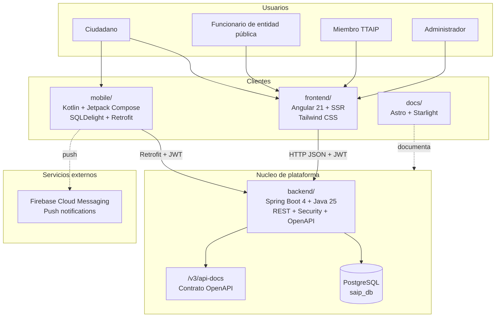
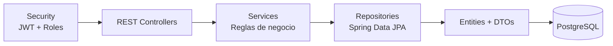
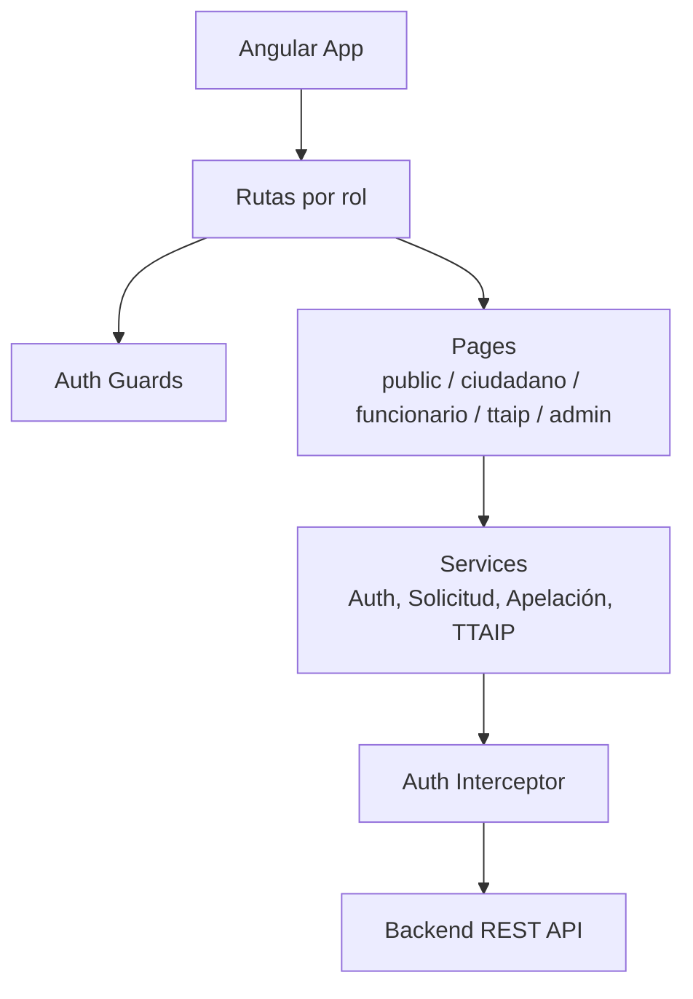
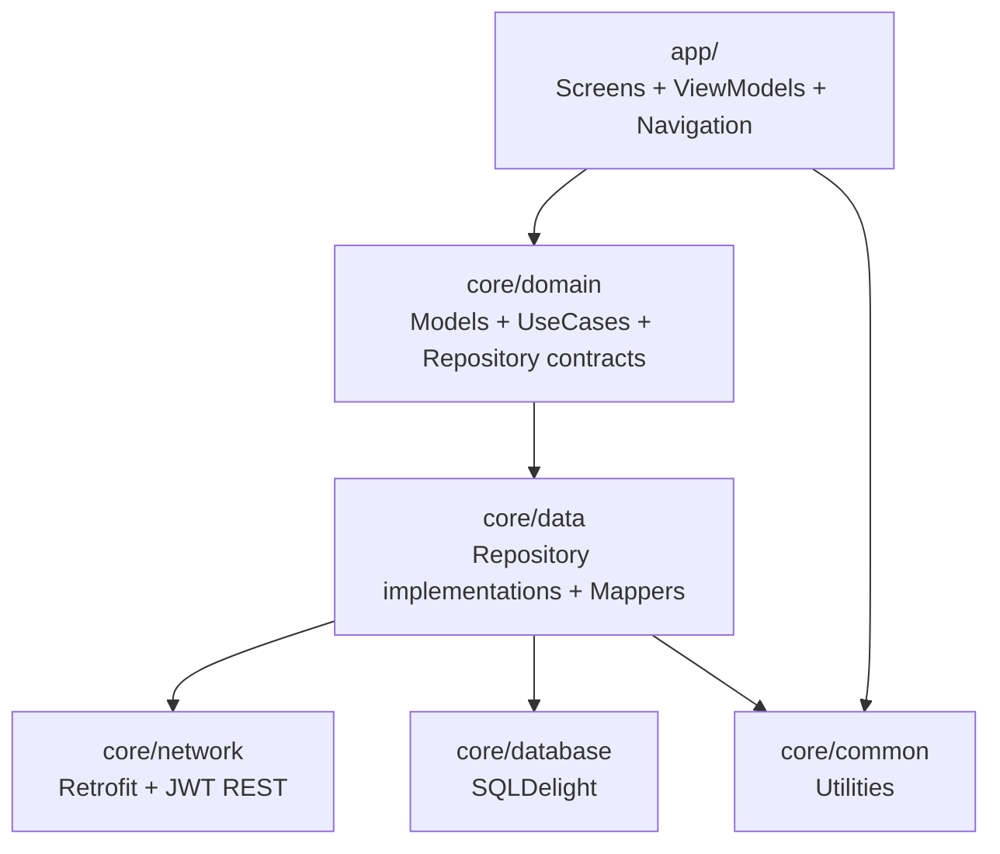
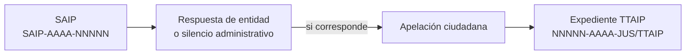
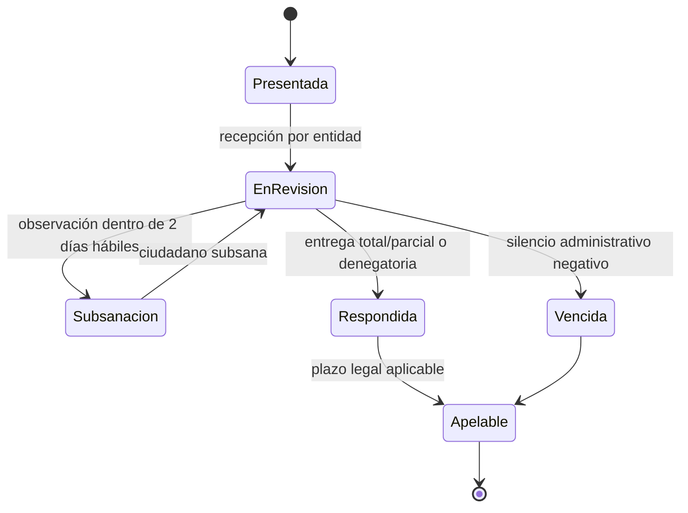
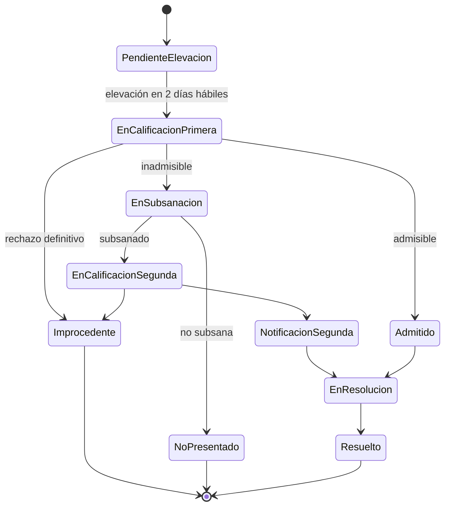
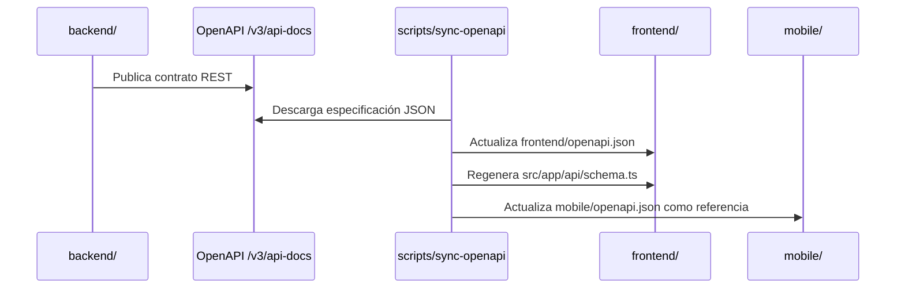
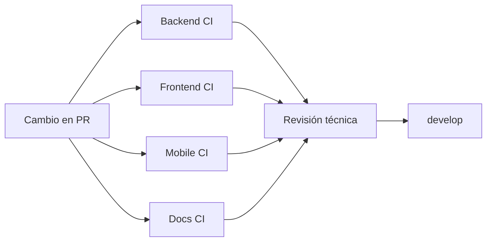

# Plataforma SAIP y Apelaciones TTAIP

> Plataforma integral para gestionar Solicitudes de Acceso a la Información Pública (SAIP), respuestas de entidades públicas y apelaciones ante el Tribunal de Transparencia y Acceso a la Información Pública (TTAIP), alineada al marco de la Ley N.° 27806 del Perú.

[](backend/)
[](frontend/)
[](mobile/)
[](docs/)
[](LICENSE)

La plataforma modela el ciclo completo de transparencia pública: el ciudadano solicita información, la entidad responde dentro de los plazos legales y, si corresponde, el TTAIP califica y resuelve la apelación. El repositorio está organizado como un monorepo con backend, frontend web, app mobile, documentación, base de datos, colecciones de API y automatización de contrato OpenAPI.

> Este proyecto es una iniciativa académica y tecnológica. No representa ni está afiliado oficialmente a ninguna entidad gubernamental.

## Tabla de contenidos

- [Visión del producto](#visión-del-producto)
- [Co-creadores](#co-creadores)
- [Arquitectura general](#arquitectura-general)
- [Stack tecnológico](#stack-tecnológico)
- [Estructura del monorepo](#estructura-del-monorepo)
- [Módulos principales](#módulos-principales)
- [Modelo de dominio](#modelo-de-dominio)
- [Contrato API y sincronización](#contrato-api-y-sincronización)
- [Seguridad y roles](#seguridad-y-roles)
- [Gestión de Almacenamiento Seguro (Supabase S3 API)](#gestión-de-almacenamiento-seguro-supabase-s3-api)
- [Ejecución local](#ejecución-local)
- [Validación y CI](#validación-y-ci)
- [Documentación y herramientas](#documentación-y-herramientas)
- [Licencia](#licencia)

## Visión del producto

Plataforma SAIP centraliza la gestión digital de solicitudes de acceso a la información pública y apelaciones TTAIP con una arquitectura preparada para tres experiencias independientes:

| Superficie | Usuario principal | Objetivo |
| --- | --- | --- |
| Web pública | Ciudadano | Presentar SAIP, consultar estado, registrar apelaciones y subsanar observaciones. |
| Web interna | Funcionarios, TTAIP, administradores | Gestionar expedientes, responder solicitudes, calificar apelaciones, emitir resoluciones y revisar indicadores. |
| Mobile Android | Ciudadano y operadores | Consultar y operar flujos clave desde una aplicación nativa con sincronización local. |

El backend es la fuente de verdad del dominio y expone el contrato REST formal. El frontend Angular y la app Android consumen el mismo contrato, pero evolucionan como clientes independientes.

## Co-creadores

| Nombre | Rol en el proyecto | Contribucion principal |
| --- | --- | --- |
| **Kelly Medalit De La Cruz Lopez** | Co-creadora, Analista Funcional | Ideación del producto, levantamiento funcional, reglas de negocio, flujo SAIP/TTAIP, criterios de validación y modelado del dominio. |
| **Daniel Angel Leon Salazar** | Co-creador, Arquitecto de Software | Arquitectura técnica, backend Spring Boot, frontend Angular, app Android nativa, integración API, seguridad, automatización y despliegue técnico. |

## Arquitectura general

La arquitectura prioriza separación de responsabilidades, contrato API versionable, clientes desacoplados y validación independiente por módulo.



### Decisiones arquitectónicas

| Decisión | Razón |
| --- | --- |
| Backend como source of truth | Centraliza reglas legales, seguridad, persistencia y transiciones de estado. |
| OpenAPI como contrato formal | Permite sincronizar frontend y mobile sin compartir código fuente. |
| Monorepo modular | Facilita consistencia técnica, CI por paths y versionado coordinado. |
| Clientes desacoplados | Web y mobile consumen la API de forma independiente y pueden desplegarse por separado. |
| Documentación viva | `docs/` y `README.md` explican arquitectura, dominio, operación y decisiones clave. |

## Stack tecnológico

### Backend

| Área | Tecnología |
| --- | --- |
| Runtime | Java 25 |
| Framework | Spring Boot 4.0.0 |
| API | Spring Web MVC, REST JSON |
| Persistencia | Spring Data JPA, Hibernate, PostgreSQL 16+ |
| Documentos | Metadatos en PostgreSQL + `StorageProvider` local configurable |
| Seguridad | Spring Security, JWT (`jjwt`), CORS configurable |
| Validación | Jakarta Bean Validation |
| Documentación API | springdoc-openapi, Swagger UI |
| Build y testing | Maven Wrapper, Spring Boot Test, H2 para escenarios de prueba |

### Frontend web

| Área | Tecnología |
| --- | --- |
| Framework | Angular 21.2.x |
| Lenguaje | TypeScript 5.9 |
| UI | Tailwind CSS 4.1, Lucide Angular, GSAP |
| SSR | Angular SSR con Express 5 |
| Formularios | Angular Forms / Reactive Forms |
| API contract | `openapi-typescript` |
| Testing | Vitest + Angular unit test builder |
| Package manager | npm 11.6.x |

### Mobile Android

| Área | Tecnología |
| --- | --- |
| Lenguaje | Kotlin 2.3.x |
| UI | Jetpack Compose + Material 3 |
| Arquitectura | Clean Architecture + MVVM |
| Navegación | Navigation 3 |
| DI | Koin 4.1 |
| Datos locales | SQLDelight 2.2 |
| Red | Retrofit 3, OkHttp 5 |
| Sincronización / jobs | Coroutines, Flow, WorkManager |
| Firebase | FCM exclusivamente para push notifications |
| Build | Gradle 9.x, Android Gradle Plugin 9.x |

### Documentación y automatización

| Área | Tecnología |
| --- | --- |
| Docs | Astro 6, Starlight, Mermaid |
| API collections | Postman collection operativa |
| Database schema/seed | `database/postgres/script_saip_db_postgres.sql` |
| CI/CD | GitHub Actions por módulo |
| OpenAPI sync | `scripts/sync-openapi.ps1` y `scripts/sync-openapi.sh` |

## Estructura del monorepo

```text
plataforma-saip-apelaciones/
├── backend/              # API REST Spring Boot 4 + Java 25
├── frontend/             # Aplicación web Angular 21 + SSR
├── mobile/               # App Android Kotlin + Jetpack Compose
├── docs/                 # Documentación Astro + Starlight
├── database/             # Scripts SQL de apoyo y datos seed
├── postman/              # Colección operativa de API
├── scripts/              # Sincronización OpenAPI y utilidades
├── .github/workflows/    # CI independiente por módulo
├── AGENTS.md             # Instrucciones locales para Codex
├── LICENSE               # Apache License 2.0
└── README.md             # Visión técnica y funcional del proyecto
```

## Módulos principales

### `backend/` - API REST y dominio transaccional

El backend implementa las reglas centrales del sistema: solicitudes SAIP, respuestas de entidades, apelaciones TTAIP, calificación, resolución, estadísticas, reportes y autenticación.



Controladores principales:

| Controller | Responsabilidad |
| --- | --- |
| `AuthRestController` | Login, registro y usuario autenticado. |
| `SolicitudRestController` | Ciclo SAIP y consultas de solicitudes. |
| `RespuestaRestController` | Respuestas de funcionarios a solicitudes. |
| `ApelacionRestController` | Presentación y seguimiento de apelaciones. |
| `TTAIPRestController` | Calificación, subsanación y resolución TTAIP. |
| `EntidadRestController` | Gestión de entidades públicas. |
| `CiudadanoRestController` | Operaciones del ciudadano. |
| `FuncionarioRestController` | Operaciones de funcionarios. |
| `EstadisticasRestController` | Indicadores operativos. |
| `ReportesRestController` | Generación de reportes. |

### `frontend/` - Web Angular multirol

El frontend entrega la experiencia web pública e interna. La aplicación está organizada por rol y consume servicios HTTP tipados hacia el backend.



Áreas de interfaz:

| Carpeta | Alcance |
| --- | --- |
| `pages/public/` | Consulta pública y ayuda. |
| `pages/auth/` | Login y registro del ciudadano. |
| `pages/ciudadano/` | Panel, nueva SAIP, detalle, apelación y subsanación. |
| `pages/funcionario/` | Panel de entidad, detalle y respuesta de solicitud. |
| `pages/ttaip/` | Bandeja TTAIP, calificaciones, resolución y procesos disciplinarios. |
| `pages/admin/` | Administración general del sistema. |

### `mobile/` - Android nativo

La app mobile está construida con Kotlin, Jetpack Compose, arquitectura limpia y persistencia local. Su objetivo es ofrecer una experiencia nativa desacoplada del frontend web.



| Módulo Gradle | Responsabilidad |
| --- | --- |
| `app/` | Presentación, tema, navegación, ViewModels y pantallas. |
| `core/domain/` | Modelos de dominio, casos de uso e interfaces. |
| `core/data/` | Repositorios concretos y mapeadores. |
| `core/network/` | Cliente Retrofit, DTOs, JWT y comunicación REST con backend. |
| `core/database/` | SQLDelight y persistencia local. |
| `core/common/` | Utilidades compartidas. |

### `docs/` - Documentación técnica y funcional

Sitio de documentación construido con Astro + Starlight. Complementa este README con contenido navegable, diagramas y material técnico/funcional extendido.

### `database/`, `postman/` y `scripts/`

| Carpeta | Uso |
| --- | --- |
| `database/` | Script SQL de apoyo para inicialización o pruebas locales. |
| `postman/` | Colección operativa para validar flujos API end-to-end. |
| `scripts/` | Sincronización del contrato OpenAPI hacia consumidores. |

## Modelo de dominio

### Conceptos clave

| Concepto | Definición |
| --- | --- |
| SAIP | Solicitud de Acceso a la Información Pública. Es primera instancia y usa formato `SAIP-AAAA-NNNNN`. |
| Entidad pública | Organismo que posee o administra la información solicitada. |
| Funcionario | Usuario interno de entidad pública encargado de evaluar y responder SAIP. |
| Apelación | Recurso presentado por el ciudadano cuando la respuesta no satisface o no existe respuesta. |
| Expediente TTAIP | Contenedor de segunda instancia. Solo existe cuando hay apelación y usa formato `NNNNN-AAAA-JUS/TTAIP`. |
| TTAIP | Tribunal que califica y resuelve apelaciones. |
| Resolución | Decisión formal emitida durante calificación o resolución final. |
| Cédula de notificación | Documento que acredita notificación en el procedimiento. |

### Distinción crítica

SAIP no es expediente. La SAIP pertenece a la primera instancia ante la entidad pública. El expediente TTAIP solo nace cuando el ciudadano apela.



### Flujo SAIP



Reglas principales:

| Regla | Criterio |
| --- | --- |
| Plazo SAIP | 10 días hábiles desde el día hábil siguiente a la recepción. |
| Subsanación | Solo dentro de los 2 primeros días hábiles. |
| Liquidación de costos | Debe notificarse antes del vencimiento del plazo legal. |
| Silencio administrativo | Aplica si la entidad no responde dentro del plazo. |
| Apelación | Ante denegatoria expresa aplica el plazo legal que se defina con criterio legal/producto; ante silencio administrativo negativo no existe plazo perentorio. |

### Flujo TTAIP



Reglas principales:

| Etapa | Plazo / criterio |
| --- | --- |
| Elevación | 2 días hábiles para remitir el recurso al TTAIP. |
| Primera calificación | 7 días hábiles para calificar admisibilidad. |
| Subsanación | 2 días hábiles cuando el recurso es inadmisible. |
| Segunda calificación | Determina admisión posterior o improcedencia. |
| Notificación | La segunda calificación debe notificarse antes de iniciar resolución final. |
| Resolución final | 10 días hábiles para emitir decisión final. |

Decisiones de resolución final:

| Decisión | Resultado |
| --- | --- |
| Fundado | Ordena entregar la información. |
| Fundado en parte | Ordena entrega parcial. |
| Infundado | Confirma la decisión o conducta de la entidad. |
| Infundado en parte | Confirma parcialmente. |
| Improcedente | Rechazo por causal formal o de fondo. |
| Conclusión por sustracción de la materia | La entidad entrega información durante el trámite. |
| Conclusión por desistimiento | El ciudadano desiste del recurso. |

## Contrato API y sincronización

El backend publica el contrato OpenAPI en `/v3/api-docs`. Ese contrato se sincroniza hacia el frontend y mobile para mantener consistencia entre clientes.



Sincronización en Windows:

```powershell
.\scripts\sync-openapi.ps1
```

Sincronización en Linux/macOS:

```bash
./scripts/sync-openapi.sh
```

Regla operativa: si cambian endpoints, DTOs o modelos de API en `backend/`, sincronizar OpenAPI y validar los consumidores impactados.

## Seguridad y roles

La autenticación principal se resuelve con JWT emitido por el backend. El frontend usa guards e interceptor de autenticación. Mobile consume el backend con Retrofit y conserva Firebase Cloud Messaging exclusivamente para push notifications.

| Rol | Enum | Superficie principal | Capacidades |
| --- | --- | --- | --- |
| Ciudadano | `CIUDADANO` | Web pública, mobile | Registro, login, SAIP, consulta, apelación y subsanación. |
| Funcionario | `FUNCIONARIO` | Web interna | Gestionar solicitudes de su entidad y emitir respuestas. |
| TTAIP | `TTAIP` | Web interna | Calificar, admitir, resolver y revisar expedientes. |
| Administrador | `ADMIN` / `ADMINISTRADOR` | Web interna | Gestión de usuarios, entidades, reportes e indicadores. |

Principios de seguridad:

- Validar entradas en backend con Jakarta Bean Validation.
- Proteger endpoints con Spring Security y roles.
- Usar CORS configurable por entorno.
- Mantener secretos fuera del repositorio y usar variables de entorno.
- Validar tamaño, extensión y tipo de archivos cargados.
- Evitar logs con tokens, credenciales o información sensible.

### Motor común de notificaciones

El backend persiste intentos de notificación para SAIP y TTAIP. El modo `MOCK` se usa en desarrollo local y Newman; el modo `SMTP` habilita correo real mediante variables de entorno. `CASILLA_ELECTRONICA` cuenta con un adaptador preparado que responde explícitamente como no disponible hasta contar con el contrato API oficial. Mobile registra, renueva y revoca tokens FCM contra endpoints autenticados; el adapter de envío FCM permanece preparado pero reporta explícitamente que falta la integración Firebase Admin. No existe fallback automático entre canales.

Para despliegues productivos, activar `SPRING_PROFILES_ACTIVE=prod`. Ese perfil usa `SMTP` por defecto, rechaza `MOCK`, exige configuración externa de base de datos, JWT, CORS y SMTP, desactiva inicialización automática del seed y mantiene OpenAPI/Swagger deshabilitados salvo habilitación operativa explícita.

## 📦 Gestión de Almacenamiento Seguro (Supabase S3 API)

La plataforma SAIP y Apelaciones TTAIP delega la persistencia de los archivos binarios (PDFs, imágenes de constancias, resoluciones y subsanaciones) en un Object Storage externo, utilizando la API compatible con S3 de Supabase.

### 1. Arquitectura del Flujo Mediado (Aislamiento de Infraestructura)

Por directivas de ciberseguridad y de diseño defensivo (AppSec), **el Frontend Web y la App Móvil Android jamás se conectan directamente con Supabase o S3**. Todo el acceso de lectura y escritura es mediado por el Backend (Spring Boot), el cual actúa como un proxy inverso y orquestador transaccional.

```mermaid
sequenceDiagram
    autonumber
    actor Cliente as Cliente (Web / Mobile)
    participant API as Backend (Spring Boot)
    database DB as PostgreSQL (saip_db)
    participant S3 as Supabase Storage (S3 API)

    Note over Cliente, S3: Flujo de Subida (Upload) Mediada
    Cliente->>API: POST /api/documentos/upload (MultipartFile + metadata)
    Note over API: Valida tamaño, extensión y tipo MIME
    API->>S3: PUT /bucket/integration-tests/opaque-key.pdf (S3 client)
    S3-->>API: Confirmación de guardado en Bucket
    API->>DB: INSERT INTO documentos (nombre_archivo, ruta_archivo, hash_sha256, ...)
    Note over DB: Transacción confirmada en DB
    DB-->>API: OK (id_documento)
    API-->>Cliente: 201 Created (DocumentoMetadataDTO sin llaves físicas)

    Note over Cliente, S3: Flujo de Descarga (Download) Mediada
    Cliente->>API: GET /api/documentos/{id}/download
    Note over API: Valida roles y ownership del expediente
    API->>DB: SELECT ruta_archivo, storage_bucket FROM documentos WHERE id = {id}
    DB-->>API: Datos del archivo (storageKey)
    API->>S3: GET /bucket/integration-tests/opaque-key.pdf
    S3-->>API: Stream binario de datos
    API-->>Cliente: Stream binario (200 OK) con Content-Type correcto
```

**Ventajas de Seguridad del Flujo Mediado:**
*   **Llaves ocultas:** Las credenciales maestras de AWS/Supabase, nombres físicos de buckets y tokens de API no se exponen al cliente.
*   **URLs efímeras/ocultas:** No se generan URLs públicas directas ni firmadas accesibles desde el exterior. El cliente descarga y sube a través de `/api/documentos`.
*   **Aislamiento de metadata:** La API responde con `DocumentoMetadataDTO`, el cual oculta explícitamente los campos sensibles `storageKey`, `storageBucket`, `storageProvider` y cualquier URL física. El cliente solo recibe un identificador seguro y el nombre original del archivo.

### 2. Matriz de Variables de Entorno para Almacenamiento

El backend de Spring Boot se configura mediante las siguientes propiedades del sistema y variables de entorno para activar la persistencia S3/Supabase en el perfil de `staging`:

| Propiedad Spring / Variable de Entorno | Descripción | Ejemplo de Valor | Requerido |
| --- | --- | --- | --- |
| `pe.gob.saip.storage.provider`<br>`APP_STORAGE_PROVIDER` | Define el proveedor de almacenamiento local o remoto. | `S3_COMPATIBLE` (o `LOCAL`) | Sí |
| `pe.gob.saip.storage.s3.endpoint`<br>`SUPABASE_S3_ENDPOINT` | URL del Endpoint compatible con S3 provisto por Supabase. | `https://uxgawcsqkxgscx.supabase.co/storage/v1/s3` | Sí (si provider=S3) |
| `pe.gob.saip.storage.s3.bucket-name`<br>`SUPABASE_S3_BUCKET_NAME` | Nombre del Bucket creado en Supabase. | `saip-documents` | Sí (si provider=S3) |
| `pe.gob.saip.storage.s3.access-key`<br>`SUPABASE_S3_ACCESS_KEY` | Clave de acceso generada en Supabase (S3 Access Key). | `88c2b7...` | Sí (si provider=S3) |
| `pe.gob.saip.storage.s3.secret-key`<br>`SUPABASE_S3_SECRET_KEY` | Clave secreta generada en Supabase (S3 Secret Key). | `df92c1a...` | Sí (si provider=S3) |
| `pe.gob.saip.storage.s3.region`<br>`AWS_REGION` | Región AWS virtual del servicio. | `us-east-1` | Sí (si provider=S3) |

> [!WARNING]
> **REGLA DE ORO DE APPSEC:** Está estrictamente prohibido escribir llaves, credenciales, tokens o secretos en duro (*hardcoded*) dentro de los archivos `application.properties`, YAML o en cualquier archivo bajo control de versiones. Toda credencial de infraestructura debe ser inyectada dinámicamente mediante variables de entorno o gestores de secretos.

### 3. Guía de Configuración Defensiva en la Consola de Supabase

Para aislar por completo la infraestructura de almacenamiento y evitar accesos públicos anónimos a través de la API REST nativa de Supabase, el Bucket debe ser configurado defensivamente:

1.  **Bucket Privado:** Al crear el bucket en el panel de control de Supabase (`Storage` -> `New Bucket`), la casilla de verificación **Public** debe establecerse como **False** (Bucket estrictamente privado).
2.  **Desactivación de Políticas de Acceso Público (RLS):** No crees políticas RLS que permitan accesos `select`, `insert`, `update` o `delete` para roles anónimos (`anon`) o usuarios autenticados directamente en el cliente de Supabase (`authenticated`). El backend se conecta de forma externa utilizando credenciales S3 (Access/Secret Key) con privilegios administrativos dedicados, haciendo que el almacenamiento de Supabase sea invisible al exterior del backend.

### 4. Guía de Ejecución y Verificación Local (Paso a Paso)

Para arrancar el backend Spring Boot localmente apuntando a Supabase y verificar el funcionamiento de las subidas y descargas mediadas:

#### Paso 1: Configurar las variables de entorno en la terminal
Ejecuta en tu terminal de comandos (reemplazando con tus credenciales de Supabase):

**PowerShell (Windows):**
```powershell
$env:SPRING_PROFILES_ACTIVE="staging"
$env:APP_STORAGE_PROVIDER="S3_COMPATIBLE"
$env:SUPABASE_S3_ENDPOINT="https://<tu-project-id>.supabase.co/storage/v1/s3"
$env:SUPABASE_S3_BUCKET_NAME="<tu-bucket>"
$env:SUPABASE_S3_ACCESS_KEY="<tu-s3-access-key>"
$env:SUPABASE_S3_SECRET_KEY="<tu-s3-secret-key>"
$env:AWS_REGION="us-east-1"
```

**Bash (Linux/macOS):**
```bash
export SPRING_PROFILES_ACTIVE="staging"
export APP_STORAGE_PROVIDER="S3_COMPATIBLE"
export SUPABASE_S3_ENDPOINT="https://<tu-project-id>.supabase.co/storage/v1/s3"
export SUPABASE_S3_BUCKET_NAME="<tu-bucket>"
export SUPABASE_S3_ACCESS_KEY="<tu-s3-access-key>"
export SUPABASE_S3_SECRET_KEY="<tu-s3-secret-key>"
export AWS_REGION="us-east-1"
```

#### Paso 2: Iniciar el backend Spring Boot
```bash
cd backend
./mvnw spring-boot:run
```

#### Paso 3: Simular una carga multipart utilizando `curl`
El contrato de carga exige mapear el documento a una relación de negocio específica. Por ejemplo, vinculando el archivo a una solicitud SAIP (con `solicitudId`):

```bash
curl -X POST http://localhost:8080/api/documentos/upload \
  -H "Authorization: Bearer <tu-token-jwt>" \
  -F "file=@/ruta/a/tu/archivo.pdf" \
  -F "tipoDocumento=SOLICITUD_ORIGINAL" \
  -F "solicitudId=1"
```

*(El backend validará la extensión, cargará el archivo a Supabase, registrará la entrada en la base de datos de PostgreSQL y retornará el `DocumentoMetadataDTO` con el ID autogenerado del documento).*

#### Paso 4: Simular una descarga/stream seguro desde el backend
Utilizando el ID de documento retornado en el paso anterior, realiza la petición GET de descarga:

```bash
curl -O -J -L http://localhost:8080/api/documentos/1/download \
  -H "Authorization: Bearer <tu-token-jwt>"
```

*(El backend descargará el archivo desde Supabase S3 en memoria y lo transmitirá al cliente en un flujo continuo o stream, sin almacenar copias físicas locales ni exponer URLs internas).*

## Ejecución local

### Requisitos

| Herramienta | Uso |
| --- | --- |
| Java 25 | Backend Spring Boot. |
| JDK 17 | Build Android. |
| PostgreSQL 16+ | Base de datos `saip_db` y cliente `psql`. |
| Node.js 22 | Frontend Angular y docs Astro. |
| npm 11.x | Gestión de paquetes web. |
| Android Studio / SDK | Build y ejecución mobile. |
| PowerShell o Bash | Scripts de sincronización OpenAPI. |

### Backend

```powershell
cd backend
.\mvnw.cmd spring-boot:run
```

Comandos útiles:

```powershell
cd backend
.\mvnw.cmd compile
.\mvnw.cmd test
.\mvnw.cmd package -DskipTests
```

Variables relevantes:

| Variable | Default local |
| --- | --- |
| `DB_URL` | `jdbc:postgresql://localhost:5432/saip_db` |
| `DB_USERNAME` | `postgres` |
| `DB_PASSWORD` | Vacío; definir externamente |
| `JWT_SECRET` | Solo desarrollo local |
| `JWT_EXPIRATION_MS` | `86400000` |
| `CORS_ALLOWED_ORIGIN_PATTERNS` | Orígenes locales y Postman |
| `APP_STORAGE_PROVIDER` | `local` |
| `APP_STORAGE_LOCAL_BASE_PATH` | `${user.home}/.saip-storage`; configurar externamente en producción |
| `APP_STORAGE_S3_ENDPOINT` | Obligatoria con `APP_STORAGE_PROVIDER=s3`; URL S3-compatible |
| `APP_STORAGE_S3_REGION` | `us-east-1` |
| `APP_STORAGE_S3_BUCKET` | Obligatoria con provider `s3` |
| `APP_STORAGE_S3_ACCESS_KEY` | Obligatoria con provider `s3`; secreto externo |
| `APP_STORAGE_S3_SECRET_KEY` | Obligatoria con provider `s3`; secreto externo |
| `APP_STORAGE_S3_FORCE_PATH_STYLE` | `true` |
| `APP_STORAGE_MAX_FILE_SIZE` | `10485760` bytes |
| `APP_STORAGE_MAX_REQUEST_SIZE` | `11534336` bytes para archivo y overhead multipart |
| `APP_STORAGE_ALLOWED_CONTENT_TYPES` | PDF, PNG, JPEG y texto plano |

PostgreSQL almacena únicamente metadatos documentales. Los binarios se escriben
fuera del repositorio mediante `StorageProvider`. `local` sigue siendo el
default y genera claves opacas sin nombres originales ni datos personales.
El provider `s3` usa AWS SDK v2 contra endpoints S3-compatible, incluido
Supabase Storage cuando exista un bucket aprovisionado externamente. El backend
no crea buckets, no devuelve URLs públicas y exige endpoint, bucket y
credenciales mediante variables externas.

### Validación S3-compatible opt-in

La comprobación contra un bucket real de staging no corre dentro de la suite
normal. El bucket debe existir previamente en Supabase Storage o en el proveedor
S3-compatible elegido; el backend y los scripts no crean buckets ni cambian sus
permisos. El endpoint debe copiarse de la configuración S3 del proveedor, sin
hardcodearlo ni versionarlo.

Definir en la sesión o gestor de secretos:

- `RUN_S3_STORAGE_INTEGRATION_TESTS=true`
- `APP_STORAGE_PROVIDER=s3`
- `APP_STORAGE_S3_ENDPOINT`
- `APP_STORAGE_S3_REGION`
- `APP_STORAGE_S3_BUCKET`
- `APP_STORAGE_S3_ACCESS_KEY`
- `APP_STORAGE_S3_SECRET_KEY`
- `APP_STORAGE_S3_FORCE_PATH_STYLE`
- `APP_STORAGE_S3_TEST_PREFIX` opcional; default `integration-tests`

Ejecutar desde la raíz:

```powershell
.\scripts\storage\validate-s3-storage.ps1
```

```bash
bash ./scripts/storage/validate-s3-storage.sh
```

La prueba sube un texto controlado con una key opaca bajo el prefijo de pruebas,
valida existencia, descarga, contenido y SHA-256, y elimina el objeto en la
misma ejecución. No usa archivos de ciudadanos, no guarda binarios en
PostgreSQL y no imprime credenciales, bucket ni endpoint.

### Newman reproducible

La colección Newman crea datos runtime para validar flujos reales. Si el entorno
local acumuló fixtures, recrear explícitamente la base local y volver a cargar el
seed oficial:

```powershell
.\scripts\reset-local-db.ps1 -ConfirmReset
$env:APP_NOTIFICATIONS_MODE='MOCK'
cd backend
.\mvnw.cmd spring-boot:run
```

En otra terminal:

```powershell
cd postman
npm run test:api:diagnostic
```

El script bloquea hosts remotos, exige confirmación explícita y no se ejecuta de
forma automática. Newman usa variables dinámicas y tokens JWT vacíos en el
environment versionado.

### Frontend

```powershell
cd frontend
npm install
npm start
```

Comandos útiles:

```powershell
cd frontend
npm test
npm run build
npm run generate:api:live
```

### Mobile

```powershell
cd mobile
.\gradlew.bat assembleDebug
```

Comandos útiles:

```powershell
cd mobile
.\gradlew.bat clean compileDebugKotlin
.\gradlew.bat test
.\gradlew.bat clean compileDebugKotlin test
```

> Para Firebase Cloud Messaging, colocar el archivo `google-services.json` requerido por el módulo Android correspondiente.
> Restringir la API key Android preexistente desde Firebase Console por package name y certificado SHA. No editar ni mover `google-services.json` como parte de esta configuración.

### Docs

```powershell
cd docs
npm ci
npm start
npm run build
```

Para publicar la documentación con sitemap canónico:

```powershell
$env:DOCS_SITE_URL='https://docs.misaip.gob.pe'
cd docs
npm run build
```

## Validación y CI

Cada módulo tiene validaciones independientes. Esto reduce acoplamiento y permite que los cambios se revisen por superficie.

| Módulo afectado | Validación local recomendada |
| --- | --- |
| `backend/` | `cd backend; .\mvnw.cmd test` |
| `frontend/` | `cd frontend; npm test; npm run build` |
| `mobile/` | `cd mobile; .\gradlew.bat clean compileDebugKotlin test` |
| `docs/` | `cd docs; npm run build` |
| API contract | Backend corriendo + `.\scripts\sync-openapi.ps1` |

Pipelines de GitHub Actions:

| Workflow | Trigger por paths | Validación |
| --- | --- | --- |
| `backend-ci.yml` | `backend/**` | Compile, test, package y export OpenAPI. |
| `frontend-ci.yml` | `frontend/**` | `npm ci`, TypeScript check, tests y build Angular. |
| `mobile-ci.yml` | `mobile/**` | Gradle wrapper validation, debug APK y tests. |
| `docs-ci.yml` | `docs/**` | Build del sitio Astro/Starlight. |



## Documentación y herramientas

| Recurso | Descripción |
| --- | --- |
| `docs/` | Sitio técnico y funcional con Astro + Starlight. |
| `postman/SAIP-API-Collection-Complete.json` | Colección completa para validar autenticación, SAIP, apelaciones, TTAIP, estadísticas y reportes. |
| `database/postgres/script_saip_db_postgres.sql` | Schema PostgreSQL oficial y seed local idempotente. |
| `StorageProvider` | Abstracción backend para mantener binarios fuera de PostgreSQL y del repositorio. |
| `AGENTS.md` | Reglas locales para asistentes de IA en el repositorio. |

## Roadmap técnico sugerido

| Área | Próxima mejora |
| --- | --- |
| Backend | Incorporar migraciones versionadas y validar el provider S3-compatible contra staging aprovisionado externamente. |
| Frontend | Continuar auditoría responsive, refinamiento visual y mejoras de accesibilidad. |
| Mobile | Profundizar modo offline-first, sincronización incremental y manejo de conflictos. |
| Docs | Publicar arquitectura, ADRs, contratos API y guías de despliegue. |
| DevOps | Incorporar release automation, coverage reports y quality gates por módulo. |

## Licencia

Este proyecto está licenciado bajo **Apache License 2.0**.

Copyright 2025-2026 Kelly Medalit De La Cruz Lopez y Daniel Angel Leon Salazar.

Consulta el archivo [LICENSE](LICENSE) para los términos completos.
