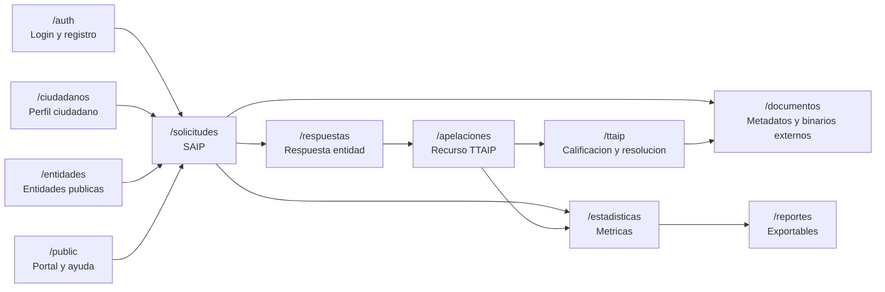
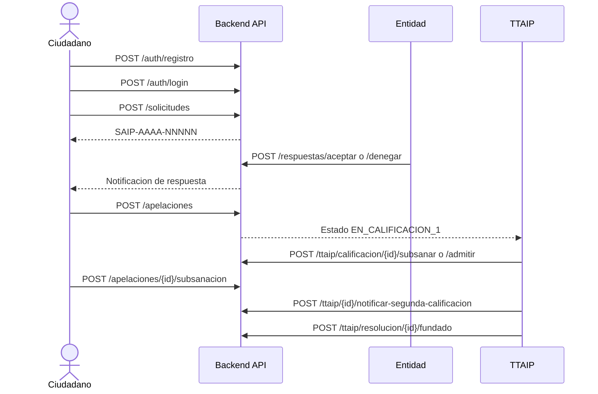

import { Tabs, TabItem, Badge, Card, CardGrid, LinkCard } from '@astrojs/starlight/components';

## Base URL

```http
http://localhost:8080/api
```

El backend Spring Boot publica el contrato vivo en:

```http
GET http://localhost:8080/v3/api-docs
GET http://localhost:8080/swagger-ui/index.html
```

:::tip[Fuente de verdad]
Esta página resume el contrato actual implementado en `backend/src/main/java/pe/gob/saip/backend/controller`.
Para pruebas manuales completas usar también la colección Postman documentada en [Postman y Environments](/api/postman/).
:::

## Mapa de Controladores



## Catálogo

<Tabs>
  <TabItem label="Auth">
    **`AuthRestController`** — `/api/auth`

    | Método | Ruta | Uso principal | Auth |
    | --- | --- | --- | --- |
    | `POST` | `/auth/login` | Autentica con email, DNI o identificador y retorna JWT. | Público |
    | `POST` | `/auth/registro` | Auto-registro público de ciudadano. | Público |
    | `GET` | `/auth/verificar-email?email=` | Verifica disponibilidad de email. | Público |
    | `GET` | `/auth/verificar-dni?dni=` | Verifica disponibilidad de DNI. | Público |
    | `GET` | `/auth/me/{usuarioId}` | Datos básicos del usuario autenticado. | JWT |

    ```json
    // POST /api/auth/login
    {
      "identificador": "70000001",
      "password": "Password123!"
    }
    ```

    ```json
    // 200 OK
    {
      "success": true,
      "token": "eyJhbGciOiJIUzI1NiJ9...",
      "usuarioId": 1,
      "email": "ciudadano01@example.com",
      "tipoUsuario": "CIUDADANO",
      "nombre": "Ciudadano Demo 01",
      "dni": "70000001",
      "ciudadanoId": 1,
      "redirectUrl": "/ciudadano/dashboard"
    }
    ```
  </TabItem>

  <TabItem label="SAIP">
    **`SolicitudRestController`** — `/api/solicitudes`

    | Método | Ruta | Uso principal | Auth |
    | --- | --- | --- | --- |
    | `GET` | `/solicitudes` | Lista global de solicitudes. | JWT |
    | `GET` | `/solicitudes/paginadas?pagina=&tamano=` | Lista global liviana paginada. | TTAIP / ADMIN |
    | `GET` | `/solicitudes/publica/expediente/{expediente}` | Consulta pública por expediente SAIP. | Público |
    | `GET` | `/solicitudes/{id}` | Detalle por ID. | JWT |
    | `GET` | `/solicitudes/expediente/{expediente}` | Detalle por número SAIP. | JWT |
    | `GET` | `/solicitudes/ciudadano/{ciudadanoId}` | Bandeja del ciudadano. | JWT |
    | `GET` | `/solicitudes/ciudadano/{ciudadanoId}/paginadas?pagina=&tamano=` | Bandeja ciudadana liviana paginada. | JWT |
    | `GET` | `/solicitudes/entidad/{entidadId}` | Bandeja de la entidad pública. | JWT |
    | `GET` | `/solicitudes/entidad/{entidadId}/paginadas?pagina=&tamano=` | Bandeja institucional liviana paginada. | JWT |
    | `GET` | `/solicitudes/estado/{estado}` | Filtro por estado. | JWT |
    | `GET` | `/solicitudes/estado/{estado}/paginadas?pagina=&tamano=` | Filtro por estado liviano paginado. | TTAIP / ADMIN |
    | `POST` | `/solicitudes` | Crea una SAIP. | CIUDADANO |
    | `PUT` | `/solicitudes/{id}` | Actualiza datos permitidos. | JWT |
    | `PATCH` | `/solicitudes/{id}/estado` | Cambio controlado de estado. | JWT |
    | `GET` | `/solicitudes/estadisticas` | Estadísticas generales SAIP. | JWT |
    | `GET` | `/solicitudes/ciudadano/{id}/estadisticas` | Métricas por ciudadano. | JWT |
    | `GET` | `/solicitudes/entidad/{id}/estadisticas` | Métricas por entidad. | JWT |
    | `DELETE` | `/solicitudes/{id}` | Eliminación administrativa. | ADMIN |

    ```json
    // POST /api/solicitudes
    {
      "asunto": "Presupuesto institucional 2026",
      "descripcion": "Solicito el presupuesto ejecutado y sus anexos.",
      "ciudadanoId": 1,
      "entidadId": 3,
      "formatoDigital": true,
      "copiaSimple": true
    }
    ```

    ```json
    // 201 Created
    {
      "id": 42,
      "expediente": "SAIP-2026-00042",
      "estado": "RECEPCIONADA",
      "fechaPresentacion": "2026-05-19T10:30:00",
      "fechaLimite": "2026-06-02",
      "diasRestantes": 10,
      "semaforoEstado": "VERDE"
    }
    ```
  </TabItem>

  <TabItem label="Respuesta">
    **`RespuestaRestController`** — `/api/respuestas`

    | Método | Ruta | Uso principal | Auth |
    | --- | --- | --- | --- |
    | `GET` | `/respuestas` | Lista respuestas registradas. | JWT |
    | `GET` | `/respuestas/{id}` | Detalle de una respuesta. | JWT |
    | `GET` | `/respuestas/solicitud/{solicitudId}` | Respuesta asociada a una SAIP. | JWT |
    | `POST` | `/respuestas` | Crea respuesta general. | FUNCIONARIO |
    | `POST` | `/respuestas/aceptar` | Responde con entrega de información. | FUNCIONARIO |
    | `POST` | `/respuestas/denegar` | Responde con denegatoria y causal. | FUNCIONARIO |
    | `GET` | `/respuestas/causales-denegacion` | Catálogo de causales bajo Ley 27806. | JWT |

    ```json
    // POST /api/respuestas/aceptar
    {
      "solicitudId": 42,
      "funcionarioId": 5,
      "contenido": "Se entrega la información solicitada.",
      "fundamentoLegal": "Ley N. 27806",
      "documentos": []
    }
    ```
  </TabItem>

  <TabItem label="Apelaciones">
    **`ApelacionRestController`** — `/api/apelaciones`

    | Método | Ruta | Uso principal | Auth |
    | --- | --- | --- | --- |
    | `GET` | `/apelaciones` | Lista global de apelaciones. | JWT |
    | `GET` | `/apelaciones/paginadas?pagina=&tamano=` | Lista global liviana paginada. | TTAIP / ADMIN |
    | `GET` | `/apelaciones/{id}` | Detalle por ID. | JWT |
    | `GET` | `/apelaciones/expediente?numero=` | Búsqueda por expediente TTAIP. | JWT |
    | `GET` | `/apelaciones/expediente/{expediente}` | Búsqueda por expediente TTAIP en ruta. | JWT |
    | `GET` | `/apelaciones/estado/{estado}` | Filtro por estado. | TTAIP |
    | `GET` | `/apelaciones/estado/{estado}/paginadas?pagina=&tamano=` | Filtro por estado liviano paginado. | TTAIP / ADMIN |
    | `GET` | `/apelaciones/ciudadano/{ciudadanoId}` | Bandeja del ciudadano. | JWT |
    | `GET` | `/apelaciones/ciudadano/{ciudadanoId}/paginadas?pagina=&tamano=` | Bandeja ciudadana liviana paginada. | JWT |
    | `POST` | `/apelaciones` | Crea apelación vinculada a una SAIP. | CIUDADANO |
    | `POST` | `/apelaciones/externa` | Crea apelación por SAIP tramitada fuera de la plataforma. | CIUDADANO |
    | `PUT` | `/apelaciones/{id}` | Actualización administrativa. | JWT |
    | `PATCH` | `/apelaciones/{id}/estado` | Cambio controlado de estado. | JWT |
    | `POST` | `/apelaciones/{id}/subsanacion` | Presenta subsanación ciudadana. | CIUDADANO |
    | `GET` | `/apelaciones/estadisticas` | Métricas de apelaciones. | JWT |
    | `DELETE` | `/apelaciones/{id}` | Eliminación administrativa. | ADMIN |

    :::caution[Flujos vigentes]
    La apelación directa entra en `EN_CALIFICACION_1`. El flujo alternativo
    presentado ante entidad usa `/apelaciones/ante-entidad` y conserva
    trazabilidad de elevación en dos días hábiles antes de ingresar al TTAIP.
    :::

    ```json
    // POST /api/apelaciones
    {
      "solicitudId": 42,
      "ciudadanoId": 1,
      "fundamentos": "La entidad no entregó la información solicitada dentro del plazo legal."
    }
    ```

    ```json
    // 201 Created
    {
      "id": 7,
      "expediente": "00007-2026-JUS/TTAIP",
      "estado": "EN_CALIFICACION_1",
      "fundamentos": "La entidad no entregó la información solicitada dentro del plazo legal."
    }
    ```

    ```json
    // POST /api/apelaciones/externa
    {
      "ciudadanoId": 1,
      "entidadId": 2,
      "numeroSolicitudExterna": "MPV-2026-00421",
      "fechaPresentacionSolicitudExterna": "2026-05-12",
      "fechaRespuestaEntidad": "2026-05-21",
      "tipoDenegatoria": "EXPRESA",
      "resumenSolicitudOriginal": "Solicitud de contratos y órdenes de servicio.",
      "resumenRespuestaEntidad": "La entidad denegó el acceso solicitado.",
      "referenciaDocumentoSolicitud": "solicitud-original.pdf",
      "referenciaRespuestaEntidad": "respuesta-entidad.pdf",
      "fundamentos": "La denegatoria no acredita una excepción legal aplicable."
    }
    ```
  </TabItem>

  <TabItem label="TTAIP">
    **`TTAIPRestController`** — `/api/ttaip`

    | Método | Ruta | Uso principal | Auth |
    | --- | --- | --- | --- |
    | `GET` | `/ttaip/estadisticas` | Indicadores del tribunal. | TTAIP |
    | `GET` | `/ttaip/pendientes` | Apelaciones pendientes de primera calificación. | TTAIP |
    | `GET` | `/ttaip/en-calificacion` | Apelaciones en `EN_CALIFICACION_1`. | TTAIP |
    | `GET` | `/ttaip/subsanacion` | Apelaciones en subsanación. | TTAIP |
    | `GET` | `/ttaip/segunda-calificacion` | Apelaciones en segunda calificación. | TTAIP |
    | `GET` | `/ttaip/en-resolucion` | Apelaciones listas para resolución final. | TTAIP |
    | `GET` | `/ttaip/resueltas` | Apelaciones con estado terminal. | TTAIP |
    | `POST` | `/ttaip/calificacion/{apelacionId}/admitir` | Primera calificación admisible. | TTAIP |
    | `POST` | `/ttaip/calificacion/{apelacionId}/subsanar` | Requiere subsanación al ciudadano. | TTAIP |
    | `POST` | `/ttaip/calificacion/{apelacionId}/inadmitir` | Rechazo por improcedencia. | TTAIP |
    | `POST` | `/ttaip/calificacion/{apelacionId}/rechazar` | Alias de rechazo. | TTAIP |
    | `POST` | `/ttaip/calificacion/{apelacionId}/no-presentado` | Cierra por falta de subsanación. | TTAIP |
    | `POST` | `/ttaip/{apelacionId}/notificar-segunda-calificacion` | Notifica segunda calificación e inicia resolución final. | TTAIP |
    | `POST` | `/ttaip/resolucion/{apelacionId}/fundado` | Resolución final fundada. | TTAIP |
    | `POST` | `/ttaip/resolucion/{apelacionId}/fundada` | Alias femenino. | TTAIP |
    | `POST` | `/ttaip/resolucion/{apelacionId}/infundado` | Resolución final infundada. | TTAIP |
    | `POST` | `/ttaip/resolucion/{apelacionId}/infundada` | Alias femenino. | TTAIP |
    | `POST` | `/ttaip/resolucion/{apelacionId}/fundado-en-parte` | Fundado parcial. | TTAIP |
    | `POST` | `/ttaip/resolucion/{apelacionId}/infundado-en-parte` | Infundado parcial. | TTAIP |
    | `POST` | `/ttaip/resolucion/{apelacionId}/improcedente` | Improcedente final. | TTAIP |
    | `POST` | `/ttaip/resolucion/{apelacionId}/sustraccion-materia` | Conclusión por sustracción de materia. | TTAIP |
    | `POST` | `/ttaip/resolucion/{apelacionId}/desistimiento` | Conclusión por desistimiento. | TTAIP |

    ```json
    // POST /api/ttaip/calificacion/7/subsanar
    {
      "miembroId": 3,
      "fundamentos": "Faltan datos mínimos para evaluar la apelación.",
      "observaciones": "Debe precisar el documento solicitado y adjuntar sustento."
    }
    ```
  </TabItem>

  <TabItem label="Catálogos">
    **Ciudadanos, Entidades, Funcionarios y Usuarios**

    | Controlador | Método | Ruta | Uso principal |
    | --- | --- | --- | --- |
    | `CiudadanoRestController` | `GET` | `/ciudadanos` | Lista ciudadanos. |
    | `CiudadanoRestController` | `GET` | `/ciudadanos/{id}` | Detalle ciudadano. |
    | `CiudadanoRestController` | `GET` | `/ciudadanos/dni/{dni}` | Búsqueda por DNI. |
    | `CiudadanoRestController` | `GET` | `/ciudadanos/{id}/estadisticas` | Métricas personales. |
    | `CiudadanoRestController` | `POST` | `/ciudadanos` | Alta administrativa. |
    | `CiudadanoRestController` | `PUT` | `/ciudadanos/{id}` | Actualización. |
    | `CiudadanoRestController` | `PATCH` | `/ciudadanos/{id}/estado` | Activar/desactivar. |
    | `CiudadanoRestController` | `DELETE` | `/ciudadanos/{id}` | Eliminación administrativa. |
    | `EntidadRestController` | `GET` | `/entidades` | Lista entidades. |
    | `EntidadRestController` | `GET` | `/entidades/activas` | Entidades activas. |
    | `EntidadRestController` | `GET` | `/entidades/{id}` | Detalle entidad. |
    | `EntidadRestController` | `GET` | `/entidades/{id}/estadisticas` | Indicadores por entidad. |
    | `EntidadRestController` | `GET` | `/entidades/buscar?nombre=` | Búsqueda por nombre. |
    | `EntidadRestController` | `POST` | `/entidades` | Crear entidad. |
    | `EntidadRestController` | `PUT` | `/entidades/{id}` | Actualizar entidad. |
    | `EntidadRestController` | `PATCH` | `/entidades/{id}/estado` | Activar/desactivar. |
    | `EntidadRestController` | `DELETE` | `/entidades/{id}` | Eliminación administrativa. |
    | `FuncionarioRestController` | `GET` | `/funcionarios` | Lista funcionarios. |
    | `FuncionarioRestController` | `GET` | `/funcionarios/{id}` | Detalle funcionario. |
    | `FuncionarioRestController` | `GET` | `/funcionarios/entidad/{entidadId}` | Funcionarios por entidad. |
    | `FuncionarioRestController` | `POST` | `/funcionarios` | Alta administrativa. |
    | `FuncionarioRestController` | `PUT` | `/funcionarios/{id}` | Actualización. |
    | `FuncionarioRestController` | `PATCH` | `/funcionarios/{id}/estado` | Activar/desactivar. |
    | `FuncionarioRestController` | `DELETE` | `/funcionarios/{id}` | Eliminación administrativa. |
    | `UsuarioRestController` | `GET` | `/usuarios` | Administración de usuarios. |
    | `UsuarioRestController` | `POST` | `/usuarios` | Crear usuario por rol. |
    | `UsuarioRestController` | `PATCH` | `/usuarios/{id}/estado` | Activar/desactivar usuario. |
    | `UsuarioRestController` | `DELETE` | `/usuarios/{id}` | Eliminar usuario. |
  </TabItem>

  <TabItem label="Documentos">
    **`DocumentoRestController`** — `/api/documentos`

    | Método | Ruta | Uso principal | Auth |
    | --- | --- | --- | --- |
    | `POST` | `/documentos/upload` | Carga un archivo y registra metadatos asociados a un único recurso. | JWT + ownership |
    | `GET` | `/documentos?{relacionId}=...` | Lista documentos activos por una única relación funcional. | JWT + ownership |
    | `GET` | `/documentos/{id}/metadata` | Consulta metadatos sin exponer ruta, bucket ni clave interna. | JWT + ownership |
    | `GET` | `/documentos/{id}/download` | Descarga autenticada del binario. | JWT + ownership |
    | `DELETE` | `/documentos/{id}` | Elimina el objeto y conserva el metadato como `ELIMINADO`. | ADMIN |

    La carga usa `multipart/form-data`: parte `file`, parámetro
    `tipoDocumento` y exactamente uno entre `solicitudId`, `respuestaId`,
    `apelacionId`, `expedienteTtaipId`, `resolucionId` o
    `cedulaNotificacionId`.

    El listado usa los mismos identificadores de relación y exige exactamente
    uno. Devuelve `DocumentoMetadataDTO` con `id`, nombre original, MIME type,
    tamaño, SHA-256, estado, fecha, tipo documental e identificadores
    funcionales. No devuelve el provider, actor creador, bucket, endpoint,
    `storageKey`, ruta física ni URL S3.

    Los detalles `SolicitudDTO`, `RespuestaDTO` y `ApelacionDTO` conservan el
    campo legacy `documentos` y agregan `documentosMetadata` como contrato
    recomendado. `ExpedienteTtaipDTO`, `ResolucionDTO` y
    `CedulaNotificacionDTO` exponen metadata segura en `documentos`.
    `NotificacionTtaipDTO` expone `cedulaId` y `documentosCedula`, sin crear una
    relación documental artificial con la notificación.

    :::caution[Storage interno]
    PostgreSQL almacena solo metadatos y SHA-256. Las respuestas nunca incluyen
    `storageKey`, bucket, endpoint, provider ni rutas físicas. El provider
    activo puede ser local o S3-compatible, pero el backend siempre intermedia
    las descargas y no entrega URLs públicas o presigned.
    :::
  </TabItem>

  <TabItem label="Analítica">
    **Estadísticas, reportes y portal público**

    | Controlador | Método | Ruta | Uso principal |
    | --- | --- | --- | --- |
    | `EstadisticasRestController` | `GET` | `/estadisticas/general` | Resumen ejecutivo global. |
    | `EstadisticasRestController` | `GET` | `/estadisticas/periodo` | Métricas por rango temporal. |
    | `EstadisticasRestController` | `GET` | `/estadisticas/entidad/{entidadId}` | Indicadores por entidad. |
    | `EstadisticasRestController` | `GET` | `/estadisticas/ranking/entidades` | Ranking de cumplimiento. |
    | `EstadisticasRestController` | `GET` | `/estadisticas/distribucion/estados` | Distribución por estados. |
    | `EstadisticasRestController` | `GET` | `/estadisticas/tendencias/mensual` | Tendencia mensual. |
    | `EstadisticasRestController` | `GET` | `/estadisticas/mensual` | Alias de tendencia mensual. |
    | `ReportesRestController` | `GET` | `/reportes/solicitudes` | Reporte de solicitudes. |
    | `ReportesRestController` | `GET` | `/reportes/apelaciones` | Reporte de apelaciones. |
    | `ReportesRestController` | `GET` | `/reportes/entidades` | Reporte de entidades. |
    | `ReportesRestController` | `GET` | `/reportes/funcionarios` | Reporte de funcionarios. |
    | `ReportesRestController` | `GET` | `/reportes/ciudadanos` | Reporte de ciudadanos. |
    | `ReportesRestController` | `GET` | `/reportes/resumen-ejecutivo` | Resumen ejecutivo. |
    | `PortalPublicoRestController` | `GET` | `/public/portal` | Datos públicos de portada. |
    | `AyudaPublicaRestController` | `GET` | `/public/ayuda` | Contenido de ayuda pública. |
  </TabItem>
</Tabs>

## Ciclo End-to-End



## Convenciones

### Ownership y listados

- El ciudadano solo consulta recursos propios.
- El funcionario solo consulta solicitudes, respuestas, elevaciones y métricas
  de su entidad cuando corresponda.
- TTAIP y administración conservan visibilidad amplia en sus superficies
  operativas.
- Los listados globales pesados mantienen compatibilidad, pero clientes nuevos y
  Newman deben preferir las rutas `/paginadas`, con `tamano` entre `1` y `100`.

<CardGrid>
  <Card title="Autenticación" icon="lock">
    Usar `Authorization: Bearer <token>` en toda operación protegida.
  </Card>
  <Card title="Errores" icon="warning">
    Los errores se centralizan en `GlobalExceptionHandler`; ver [Códigos de Error](/api/codigos-error/).
  </Card>
  <Card title="Contrato" icon="puzzle">
    Si cambian DTOs o rutas, regenerar OpenAPI y sincronizar consumidores.
  </Card>
  <LinkCard title="Postman" href="/api/postman/" description="Colección completa, ambientes y ejemplos documentados." />
</CardGrid>
