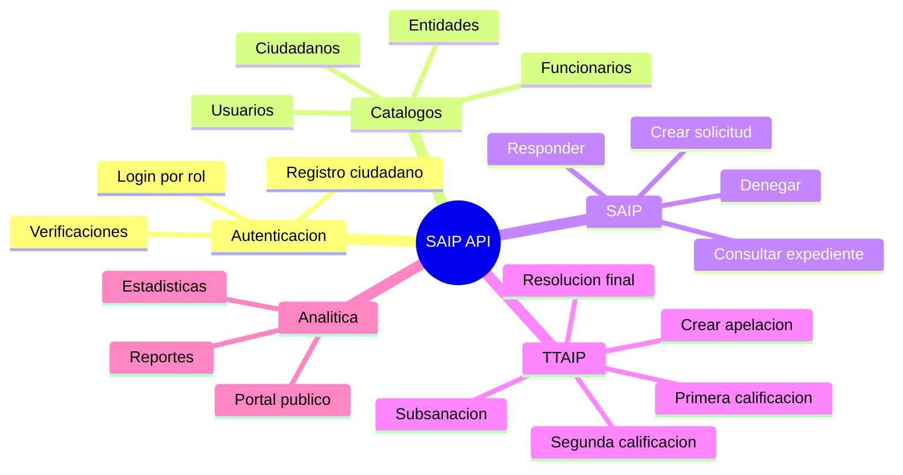
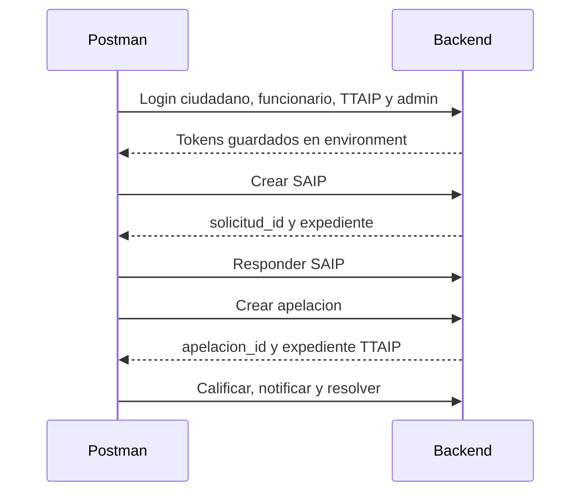

import { Card, CardGrid, Steps, Tabs, TabItem, Badge } from '@astrojs/starlight/components';

La carpeta `postman/` contiene la colección operativa para probar manualmente el backend y documentar escenarios de negocio de extremo a extremo.

## Archivos

| Archivo | Propósito |
| --- | --- |
| `postman/SAIP-API-Collection-Complete.json` | Colección completa con 254 requests, ejemplos y documentación de flujos. |
| `postman/SAIP-API-Environment-Complete.json` | Environment con 127 variables para URLs, tokens, IDs y expedientes dinámicos. |

## Estructura de la Colección



## Carpetas y Cobertura

| Carpeta | Requests | Cobertura |
| --- | ---: | --- |
| `01. Autenticación` | 8 | Login, registro ciudadano, verificación de email/DNI y perfil. |
| `02. Ciudadanos` | 8 | CRUD administrativo y estadísticas ciudadanas. |
| `03. Entidades Públicas` | 9 | Catálogo de entidades, búsqueda y métricas. |
| `04. Funcionarios` | 7 | Gestión de funcionarios por entidad. |
| `05. Solicitudes SAIP` | 45 | Creación, consulta, estados y estadísticas de solicitudes. |
| `06. Respuestas` | 7 | Entrega, denegatoria y causales legales. |
| `07. Apelaciones` | 28 | Creación interna/externa, elevación, consulta, subsanación y estados TTAIP. |
| `08. Tribunal TTAIP` | 114 | Calificación, notificación, resoluciones, suspensiones y cumplimiento. |
| `09. Estadísticas` | 8 | Indicadores generales, ranking y tendencias. |
| `10. Reportes` | 7 | Reportes por módulo y resumen ejecutivo. |
| `11. Portal Público` | 2 | Home público y ayuda. |
| `12. Administración de Usuarios` | 4 | Administración transversal de usuarios. |
| `13. Push FCM Mobile` | 7 | Estado seguro, registro, refresh, rechazo por flavor, listado propio y revocación con token ficticio. |

## Variables Principales

<Tabs>
  <TabItem label="Entorno">
    | Variable | Ejemplo | Uso |
    | --- | --- | --- |
    | `base_url` | `http://localhost:8080/api` | Base REST para todos los requests. |
    | `openapi_url` | `http://localhost:8080/v3/api-docs` | Validación del contrato publicado. |
    | `frontend_url` | `http://localhost:4200` | Referencia para flujos manuales web. |
  </TabItem>
  <TabItem label="Tokens">
    | Variable | Uso |
    | --- | --- |
    | `ciudadano_token` | Bearer token para SAIP, seguimiento y apelaciones. |
    | `funcionario_token` | Bearer token para bandeja de entidad y respuestas. |
    | `ttaip_token` | Bearer token para calificaciones y resoluciones. |
    | `admin_token` | Bearer token para catálogos y administración. |
  </TabItem>
  <TabItem label="IDs">
    | Variable | Uso |
    | --- | --- |
    | `ciudadano_id` | Relaciona solicitudes y apelaciones con ciudadano. |
    | `entidad_id` | Asigna SAIP a entidad pública. |
    | `funcionario_id` | Registra la respuesta de entidad. |
    | `miembro_ttaip_id` | Registra calificaciones y resoluciones. |
    | `solicitud_id` | Encadena respuesta y apelación. |
    | `apelacion_id` | Encadena calificaciones y resolución. |
  </TabItem>
</Tabs>

## Flujo Recomendado

<Steps>
1. Importar `SAIP-API-Environment-Complete.json`.
2. Importar `SAIP-API-Collection-Complete.json`.
3. Seleccionar el environment importado en Postman.
4. Ejecutar login por rol para llenar tokens.
5. Crear o reutilizar una SAIP con `POST /solicitudes`.
6. Responder la SAIP como funcionario.
7. Crear apelación interna o externa como ciudadano.
8. Ejecutar calificación TTAIP, subsanación cuando aplique y resolución final.
</Steps>



## Estándar de Documentación

Cada request de la colección debe mantener:

| Elemento | Regla |
| --- | --- |
| Descripción | Explicar el caso de negocio y el actor que ejecuta la operación. |
| Headers | Incluir `Content-Type: application/json` y `Authorization` cuando aplique. |
| Params | Documentar path/query params con ejemplo realista. |
| Body | Incluir payload mínimo válido y payload de borde cuando aplique. |
| Tests | Guardar IDs/tokens útiles en variables del environment. |
| Examples | Cubrir éxito (`200`, `201`) y errores relevantes (`400`, `401`, `403`, `404`, `409`, `422`, `500`). |

## Mantenimiento

:::caution[Contrato primero]
Si se agrega, elimina o cambia un endpoint en backend, la colección Postman y esta documentación deben actualizarse en el mismo cambio documental.
:::

Antes de ejecutar Newman, iniciar el backend local con el proveedor controlado:

```powershell
$env:APP_NOTIFICATIONS_MODE='MOCK'
cd backend
.\mvnw.cmd spring-boot:run
```

La colección valida que `/api/notificaciones/motor/estado` responda `modo = MOCK`. También valida estado seguro, registro, refresh idempotente y revocación FCM con un token ficticio. Newman no usa SMTP o Firebase reales, no requiere secretos y no debe persistir JWT reales en el environment versionado.

## Ejecución reproducible

Newman crea SAIP, apelaciones y registros TTAIP runtime para validar flujos
reales. Cuando el entorno local acumuló fixtures, usar el reset explícito y
volver a cargar `database/script_saip_db.sql`:

```powershell
.\scripts\reset-local-db.ps1 -ConfirmReset
cd backend
.\mvnw.cmd spring-boot:run
# Detener backend después de crear el schema.
Get-Content ..\database\script_saip_db.sql -Raw | mysql -u root -p saip_db
```

El script solo permite hosts locales, exige confirmación y nunca se ejecuta de
forma implícita. Después del seed, iniciar el backend con
`APP_NOTIFICATIONS_MODE=MOCK` y ejecutar:

```powershell
cd postman
npm run test:api:diagnostic
```

Los JWT permanecen vacíos en el environment versionado y se capturan en memoria
durante cada ejecución. Los listados globales validados por Newman usan DTOs
livianos paginados para evitar respuestas innecesariamente pesadas.

Checklist de mantenimiento:

- Comparar controladores con `rg -n "@(Get|Post|Put|Patch|Delete|Request)Mapping" backend/src/main/java`.
- Validar que el endpoint esté en `/v3/api-docs`.
- Agregar request en la carpeta Postman correcta.
- Documentar ejemplos de request y response.
- Actualizar variables si el flujo necesita nuevos IDs.
- Ejecutar al menos el flujo feliz de SAIP y TTAIP.
