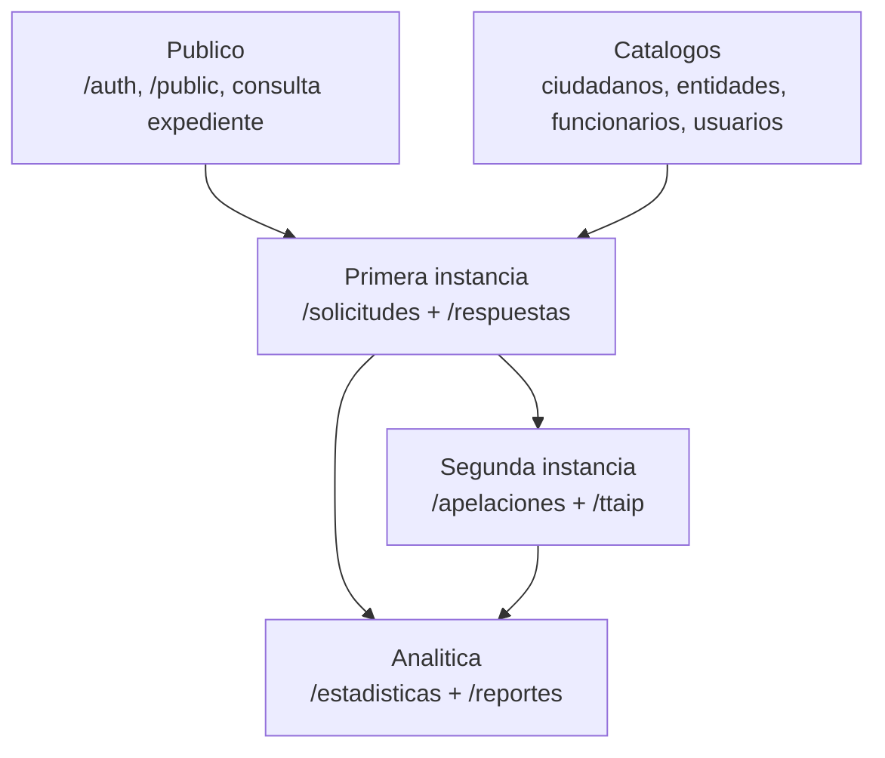

import { Card, CardGrid, LinkCard, Tabs, TabItem, Badge } from '@astrojs/starlight/components';

El backend expone la API REST pública y autenticada de la plataforma desde `backend/src/main/java/pe/gob/saip/backend/controller`.

:::tip[Referencia detallada]
El catálogo exhaustivo de rutas, ejemplos y flujo end-to-end vive en [API Endpoints](/api/endpoints/). Esta página explica la responsabilidad técnica de cada controlador.
:::

## Resumen

| Controller | Base path | Endpoints aprox. | Responsabilidad |
| --- | --- | ---: | --- |
| `AuthRestController` | `/api/auth` | 5 | Login JWT, registro ciudadano y verificaciones públicas. |
| `CiudadanoRestController` | `/api/ciudadanos` | 8 | Gestión de perfiles ciudadanos y métricas. |
| `EntidadRestController` | `/api/entidades` | 9 | Catálogo de entidades públicas, búsqueda y estado activo. |
| `FuncionarioRestController` | `/api/funcionarios` | 7 | Gestión de funcionarios de entidades públicas. |
| `SolicitudRestController` | `/api/solicitudes` | 14 | Ciclo de vida SAIP, consultas y estadísticas. |
| `RespuestaRestController` | `/api/respuestas` | 7 | Respuestas de entidad, entrega, denegación y causales. |
| `ApelacionRestController` | `/api/apelaciones` | 13 | Creación interna/externa, consulta, subsanación y estados de apelaciones. |
| `TTAIPRestController` | `/api/ttaip` | 22 | Calificación, notificación y resolución final TTAIP. |
| `EstadisticasRestController` | `/api/estadisticas` | 7 | Indicadores globales, ranking y tendencias. |
| `ReportesRestController` | `/api/reportes` | 6 | Reportes operativos y resumen ejecutivo. |
| `PortalPublicoRestController` | `/api/public/portal` | 1 | Datos de portada pública. |
| `AyudaPublicaRestController` | `/api/public/ayuda` | 1 | Contenido público de ayuda. |
| `UsuarioRestController` | `/api/usuarios` | 4 | Administración transversal de usuarios. |

## Separación por Dominio



## Detalle por Área

<Tabs>
  <TabItem label="Acceso">
    ### Auth y portal público

    | Controlador | Regla principal |
    | --- | --- |
    | `AuthRestController` | `POST /auth/login` emite JWT con `usuarioId`, rol y URL sugerida. `POST /auth/registro` solo registra ciudadanos públicos. |
    | `PortalPublicoRestController` | Entrega información agregada para la portada pública sin requerir sesión. |
    | `AyudaPublicaRestController` | Entrega contenido público de ayuda. |

    ```json
    {
      "identificador": "70000001",
      "password": "Password123!"
    }
    ```
  </TabItem>

  <TabItem label="SAIP">
    ### Solicitudes y respuestas

    `SolicitudRestController` administra la primera instancia:

    - Genera expediente `SAIP-AAAA-NNNNN`.
    - Calcula plazos de 10 días hábiles.
    - Expone consulta pública por expediente.
    - Permite filtros por ciudadano, entidad y estado.

    `RespuestaRestController` registra la actuación de la entidad:

    - Respuesta general con `POST /respuestas`.
    - Entrega con `POST /respuestas/aceptar`.
    - Denegatoria con `POST /respuestas/denegar`.
    - Catálogo de causales con `GET /respuestas/causales-denegacion`.
  </TabItem>

  <TabItem label="TTAIP">
    ### Apelaciones y tribunal

    `ApelacionRestController` crea apelaciones ciudadanas vinculadas a una SAIP local o a una solicitud tramitada fuera de la plataforma mediante `POST /api/apelaciones/externa`. El estado inicial funcional es `EN_CALIFICACION_1`.

    :::caution[Sin elevación funcional]
    No existe endpoint operativo de elevación. Las nuevas apelaciones no pasan por `PENDIENTE_ELEVACION`.
    :::

    `TTAIPRestController` cubre:

    - Bandejas por estado: pendientes, subsanación, segunda calificación, resolución y resueltas.
    - Primera calificación: admitir, requerir subsanación, inadmitir/rechazar.
    - Subsanación vencida: tener por no presentado.
    - Notificación de segunda calificación.
    - Resolución final: fundado, infundado, parcial, improcedente, sustracción de materia o desistimiento.
  </TabItem>

  <TabItem label="Administración">
    ### Catálogos y usuarios

    Los controladores de ciudadanos, entidades, funcionarios y usuarios sostienen las bandejas por rol y la administración operativa.

    | Recurso | Validaciones esperadas |
    | --- | --- |
    | Ciudadano | DNI único, email único y estado activo. |
    | Entidad | Nombre/acrónimo, estado activo y estadísticas de cumplimiento. |
    | Funcionario | Entidad asociada, cargo, área y estado activo. |
    | Usuario | Rol, activación/desactivación y eliminación controlada. |
  </TabItem>

  <TabItem label="Analítica">
    ### Estadísticas y reportes

    `EstadisticasRestController` entrega indicadores para dashboards. `ReportesRestController` entrega vistas filtrables para análisis operativo.

    Los reportes no deben calcular reglas de negocio nuevas: deben consultar datos ya persistidos o agregados por los servicios.
  </TabItem>
</Tabs>

## Reglas de Implementación

<CardGrid>
  <Card title="DTOs" icon="document">
    Los controladores deben recibir y devolver DTOs; las entidades JPA no deben filtrarse al cliente como contrato estable.
  </Card>
  <Card title="Validación" icon="approve-check">
    Usar Jakarta Bean Validation y errores centralizados en `GlobalExceptionHandler`.
  </Card>
  <Card title="OpenAPI" icon="puzzle">
    Toda ruta nueva debe aparecer en `/v3/api-docs` y en la colección Postman.
  </Card>
  <LinkCard title="Catálogo de Endpoints" href="/api/endpoints/" description="Rutas, ejemplos y flujo end-to-end." />
</CardGrid>
