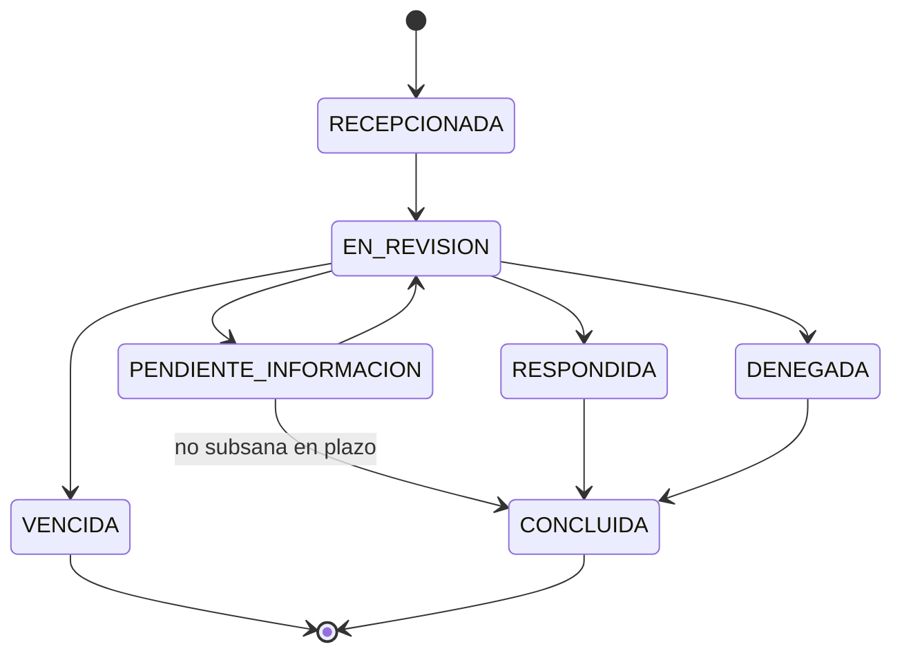
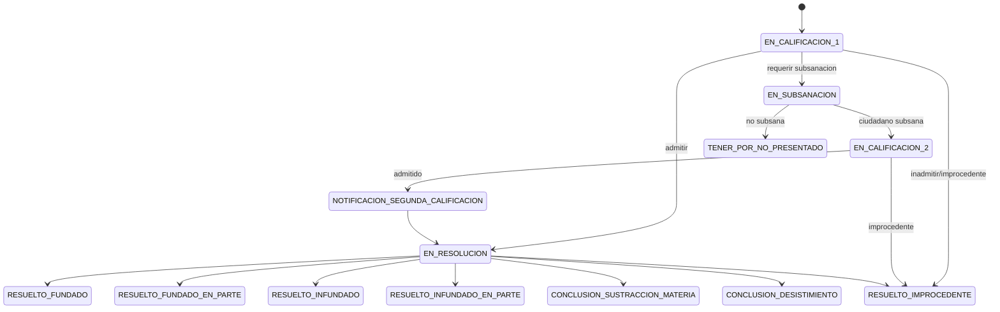

import { Tabs, TabItem, Steps, Badge } from '@astrojs/starlight/components';

## Solicitud SAIP

<Steps>
1. **RECEPCIONADA**: solicitud ingresada y asignada a entidad.
2. **EN_REVISION**: funcionario evalúa la solicitud.
3. **PENDIENTE_INFORMACION**: existe una observación formal y el ciudadano debe subsanar dentro de 2 días hábiles.
4. **RESPONDIDA**: entidad entrega total o parcialmente la información.
5. **DENEGADA**: entidad deniega con causal y fundamento legal.
6. **CONCLUIDA**: solicitud cerrada administrativamente.
7. **VENCIDA**: opera silencio administrativo negativo por falta de respuesta en plazo.
</Steps>



| Estado origen | Destinos válidos |
| --- | --- |
| `RECEPCIONADA` | `EN_REVISION` |
| `EN_REVISION` | `RESPONDIDA`, `DENEGADA`, `PENDIENTE_INFORMACION`, `VENCIDA` |
| `PENDIENTE_INFORMACION` | `EN_REVISION`, `CONCLUIDA` |
| `RESPONDIDA` | `CONCLUIDA` |
| `DENEGADA` | `CONCLUIDA` |
| `VENCIDA` | Terminal |
| `CONCLUIDA` | Terminal |

## Apelación TTAIP

El flujo funcional vigente inicia directamente en `EN_CALIFICACION_1`.

:::note[Compatibilidad técnica]
El documento oficial contempla elevación por entidad en 2 días hábiles. El enum backend aún declara `PENDIENTE_ELEVACION` por compatibilidad histórica, pero el flujo funcional ciudadano actual no debe crear ni depender de esa etapa hasta que se apruebe su implementación.
:::

<Tabs>
  <TabItem label="Flujo principal">
    <Steps>
    1. **EN_CALIFICACION_1**: primera calificación del TTAIP.
    2. **EN_SUBSANACION**: ciudadano debe corregir observaciones en 2 días hábiles.
    3. **EN_CALIFICACION_2**: revisión posterior a la subsanación.
    4. **NOTIFICACION_SEGUNDA_CALIFICACION**: notificación de la segunda calificación.
    5. **EN_RESOLUCION**: tribunal prepara resolución final luego de admisibilidad o segunda calificación notificada.
    6. **RESUELTO / estados finales**: resultado final o cierre del procedimiento.
    </Steps>
  </TabItem>

  <TabItem label="Estados finales">
    | Estado | Significado |
    | --- | --- |
    | `RESUELTO_FUNDADO` | Recurso amparado. |
    | `RESUELTO_FUNDADO_EN_PARTE` | Recurso amparado parcialmente. |
    | `RESUELTO_INFUNDADO` | Recurso desestimado. |
    | `RESUELTO_INFUNDADO_EN_PARTE` | Recurso desestimado parcialmente. |
    | `RESUELTO_IMPROCEDENTE` | Recurso rechazado por improcedencia. |
    | `CONCLUSION_SUSTRACCION_MATERIA` | Entidad entregó la información durante el trámite. |
    | `CONCLUSION_DESISTIMIENTO` | Ciudadano desistió voluntariamente. |
    | `TENER_POR_NO_PRESENTADO` | Ciudadano no subsanó dentro del plazo. |
  </TabItem>
</Tabs>



## Enumeraciones Backend

<Tabs>
  <TabItem label="EstadoSolicitud">
    ```java
    public enum EstadoSolicitud {
        RECEPCIONADA,
        EN_REVISION,
        PENDIENTE_INFORMACION,
        RESPONDIDA,
        DENEGADA,
        CONCLUIDA,
        VENCIDA
    }
    ```
  </TabItem>
  <TabItem label="EstadoApelacion">
    ```java
    public enum EstadoApelacion {
        PENDIENTE_ELEVACION, // legacy: no usar en el flujo funcional nuevo
        EN_CALIFICACION_1,
        EN_SUBSANACION,
        EN_CALIFICACION_2,
        NOTIFICACION_SEGUNDA_CALIFICACION,
        EN_RESOLUCION,
        RESUELTO,
        TENER_POR_NO_PRESENTADO,
        CONCLUSION_SUSTRACCION_MATERIA,
        CONCLUSION_DESISTIMIENTO,
        RESUELTO_FUNDADO,
        RESUELTO_FUNDADO_EN_PARTE,
        RESUELTO_INFUNDADO,
        RESUELTO_INFUNDADO_EN_PARTE,
        RESUELTO_IMPROCEDENTE,
        RESUELTO_ESTESE_A_LO_RESUELTO,
        RESUELTO_NULIDAD_ACTO
    }
    ```
  </TabItem>
  <TabItem label="Resolución">
    ```java
    public enum TipoResolucion {
        PRIMERA_CALIFICACION,
        SEGUNDA_CALIFICACION,
        RESOLUCION_FINAL
    }

    public enum DecisionResolucion {
        ADMISIBLE,
        INADMISIBLE,
        IMPROCEDENTE,
        ADMITIDO,
        TENER_POR_NO_PRESENTADO,
        FUNDADO,
        FUNDADO_EN_PARTE,
        INFUNDADO,
        INFUNDADO_EN_PARTE,
        CONCLUSION_SUSTRACCION_MATERIA,
        CONCLUSION_DESISTIMIENTO,
        ESTESE_A_LO_RESUELTO,
        NULIDAD_DEL_ACTO
    }
    ```
  </TabItem>
</Tabs>

:::caution[INADMISIBLE vs IMPROCEDENTE]
`INADMISIBLE` significa que la apelación puede subsanarse. El rechazo definitivo debe expresarse con `IMPROCEDENTE` o con el estado final que corresponda.
:::

:::note[Brechas oficiales]
Las decisiones finales `ESTESE_A_LO_RESUELTO` y `NULIDAD_DEL_ACTO` ya están modeladas operativamente. La integración real con proveedores de correo/casilla electrónica sigue fuera del alcance actual; las constancias, acuses, validación manual de notificación TTAIP y seguimiento de cumplimiento de resolución fundada ya existen como soporte operativo.
:::
