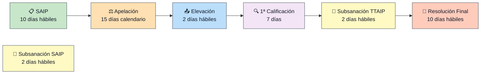

import { Card, CardGrid, Tabs, TabItem, Badge } from '@astrojs/starlight/components';

## Términos Legales y Administrativos

| Término | Definición | Base Legal |
|---------|-----------|-----------|
| **Administrado** | Toda persona natural o jurídica, nacional o extranjera, que participa en un procedimiento administrativo como titular de derechos o intereses legítimos. | Ley N.° 27444, Art. 55 |
| **Acceso a la Información Pública** | Derecho fundamental que permite a cualquier ciudadano solicitar y obtener información pública generada o administrada por las entidades del Estado, sin necesidad de expresar causa o motivación. | Ley N.° 27806 |
| **SAIP** | Solicitud de Acceso a la Información Pública — mecanismo mediante el cual cualquier persona puede requerir información en poder de una entidad pública. | Ley N.° 27806, Art. 7 |
| **Apelación** | Recurso administrativo que se interpone contra un acto administrativo emitido en primera instancia, cuando el administrado considera que dicho acto vulnera sus derechos. | Ley N.° 27444, Art. 209 |
| **Recurrente** | Administrado que interpone un recurso de apelación contra un acto administrativo que considera le causa agravio o afecta sus derechos o intereses legítimos. | Ley N.° 27444 |
| **Primera Instancia** | Etapa inicial en la que una entidad pública recibe, evalúa y resuelve una solicitud presentada por un administrado, emitiendo el acto administrativo primario. | Ley N.° 27444 |
| **Segunda Instancia** | Etapa en la que una autoridad jerárquicamente superior (TTAIP) revisa el acto administrativo emitido en primera instancia, a raíz de un recurso de apelación. | D.S. N.° 019-2017-JUS |
| **Silencio Administrativo Negativo** | Se entiende como denegada la solicitud si la entidad no responde dentro del plazo legal de 10 días hábiles. | Ley N.° 27806, Art. 11 |

---

## Instituciones y Organismos

| Sigla | Nombre Completo | Rol |
|-------|----------------|-----|
| **TTAIP** | Tribunal de Transparencia y Acceso a la Información Pública | Órgano resolutivo del MINJUSDH que resuelve en última instancia administrativa las controversias vinculadas a transparencia |
| **ANTAIP** | Autoridad Nacional de Transparencia y Acceso a la Información Pública | Organismo encargado de supervisar y garantizar el cumplimiento del derecho de acceso a la información pública |
| **MINJUSDH** | Ministerio de Justicia y Derechos Humanos | Ministerio del cual depende el TTAIP |
| **PTE** | Portal de Transparencia Estándar | Canal digital estandarizado de información de las entidades públicas |

---

## Términos de Dominio del Sistema

<Tabs>
  <TabItem label="Estados SAIP">
    | Estado | Descripción |
    |--------|-------------|
    | `RECEPCIONADA` | Solicitud ingresada al sistema |
    | `EN_REVISION` | Funcionario asignado revisa la solicitud |
    | `PENDIENTE_INFORMACION` | Se requiere subsanación del ciudadano (2 primeros días) |
    | `RESPONDIDA` | Entrega total o parcial de información |
    | `DENEGADA` | Denegación total con fundamento legal |
    | `CONCLUIDA` | Solicitud cerrada administrativamente |
    | `VENCIDA` | Silencio administrativo negativo (>10 días hábiles) |
  </TabItem>
  <TabItem label="Estados Apelación">
    | Estado | Descripción |
    |--------|-------------|
    | `PENDIENTE_ELEVACION` | Apelación creada, esperando elevación |
    | `EN_CALIFICACION_1` | Primera calificación por TTAIP |
    | `EN_SUBSANACION` | Ciudadano debe subsanar (2 días hábiles) |
    | `EN_CALIFICACION_2` | Segunda calificación tras subsanación |
    | `NOTIFICACION_SEGUNDA_CALIFICACION` | Notificando resolución de 2ª calificación |
    | `EN_RESOLUCION` | TTAIP deliberando resolución final (10 días) |
    | `RESUELTO_FUNDADO` | Recurso amparado |
    | `RESUELTO_INFUNDADO` | Recurso desestimado |
    | `RESUELTO_IMPROCEDENTE` | No cumple requisitos formales |
    | `TENER_POR_NO_PRESENTADO` | No subsanó en plazo |
  </TabItem>
  <TabItem label="Decisiones TTAIP">
    | Decisión | Descripción |
    |----------|-------------|
    | `ADMISIBLE` | Recurso cumple requisitos formales |
    | `INADMISIBLE` | Defectos formales que requieren subsanación |
    | `IMPROCEDENTE` | No procede por motivos de fondo |
    | `FUNDADO` | Se ampara el recurso y se ordena entregar la información |
    | `INFUNDADO` | Se desestima el recurso |
    | `CONCLUSION_SUSTRACCION_MATERIA` | La entidad corrigió durante el trámite |
    | `CONCLUSION_DESISTIMIENTO` | El ciudadano desistió voluntariamente |
  </TabItem>
</Tabs>

---

## Formatos de Referencia

| Tipo | Formato | Ejemplo |
|------|---------|---------|
| **Solicitud SAIP** | `SAIP-YYYY-NNNNN` | `SAIP-2025-00512` |
| **Expediente TTAIP** | `NNNNN-YYYY-JUS/TTAIP` | `01560-2025-JUS/TTAIP` |
| **Cédula de Notificación** | `CÉDULA N.° NNNNN-YYYY-JUS/TTAIP` | `15203-2025-JUS/TTAIP` |
| **Resolución** | `RESOLUCIÓN N.° NNNNNN-YYYY-JUS/TTAIP-[SALA]` | `001595-2025-JUS/TTAIP-PRIMERA SALA` |

---

## Plazos Legales

---

## Términos Técnicos

| Término | Definición |
|---------|-----------|
| **API-First Contract** | Estrategia de desarrollo donde el contrato OpenAPI del backend es la fuente única de verdad para la comunicación entre módulos |
| **JWT** | JSON Web Token — estándar para autenticación stateless entre cliente y servidor |
| **BCrypt** | Algoritmo de hashing de contraseñas basado en Blowfish, resistente a ataques de fuerza bruta |
| **RBAC** | Role-Based Access Control — control de acceso basado en roles (CIUDADANO, FUNCIONARIO, TTAIP, ADMIN) |
| **OpenAPI** | Especificación estándar para describir APIs REST (antes Swagger) |
| **Offline-first** | Arquitectura donde la app móvil prioriza datos locales (SQLDelight) y sincroniza con el servidor cuando hay conectividad |
| **WCAG 2.1 AA** | Web Content Accessibility Guidelines — estándares de accesibilidad nivel AA que garantizan acceso para personas con discapacidad |

---

## Referencias Bibliográficas

- **ANTAIP (2024)**. Obligaciones de los Gobiernos Regionales y Locales en materia de Transparencia y Acceso a la Información Pública. Lima: MINJUSDH.
- **Banco Mundial (2025)**. El Banco Mundial en Perú: Panorama General.
- **Congreso de la República del Perú (2001)**. Ley N.° 27444 — Ley del Procedimiento Administrativo General.
- **Congreso de la República del Perú (2002)**. Ley N.° 27806 — Ley de Transparencia y Acceso a la Información Pública.
- **Defensoría del Pueblo (2023)**. Transparencia Activa en los Gobiernos Locales. Lima.
- **MINJUSDH (2024)**. Texto Único Ordenado de la Ley N.° 27806 (TUO aprobado por D.S. 021-2019-JUS). Lima.
- **MINJUSDH (2024)**. Reglamento de Acceso a la Información Pública. Lima.
- **Social Progress Imperative (2025)**. Índice de Progreso Social Mundial — IPSM 2025.

