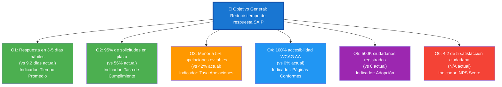
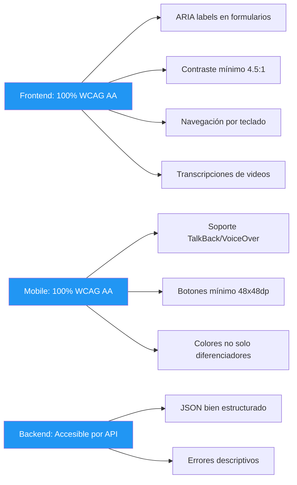
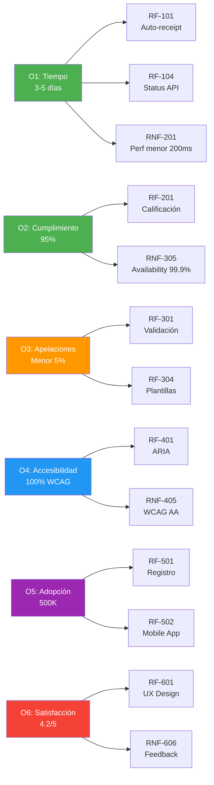

import { Card, CardGrid, Aside, Badge } from '@astrojs/starlight/components';

## Visión y Objetivos Estratégicos

La Plataforma SAIP tiene como propósito transformar el sistema peruano de acceso a la información pública mediante:

1. **Modernización tecnológica** — Reemplazar procesos manuales con plataforma digital integrada
2. **Mejora de cumplimiento legal** — Asegurar respuesta en plazos (10 días hábiles SAIP, 7+2+10 TTAIP)
3. **Transparencia radical** — Reducir tiempos de respuesta de 9.2 a 3-5 días en promedio
4. **Justicia accesible** — Simplificar apelaciones ante TTAIP con interfaz intuitiva
5. **Datos abiertos** — Publicar información en formato reutilizable (CSV, JSON, Open Data)
6. **Inclusión digital** — Accesibilidad WCAG AA para ciudadanos con discapacidades

### Objetivos SMART del Proyecto

<CardGrid>
  <Card title="Objetivo 1: Plataforma Digital Integral" icon="rocket">
    Desarrollar una plataforma digital integral de gestión de solicitudes y recursos de acceso a la información pública, que permita a los ciudadanos registrar, consultar y apelar solicitudes en línea, incrementando en un **60%** la eficiencia del proceso administrativo.
  </Card>
  <Card title="Objetivo 2: Automatización de Atención" icon="setting">
    Automatizar el proceso de atención de solicitudes de acceso a la información en las entidades públicas, reduciendo los tiempos de respuesta en un **50%**, garantizando la trazabilidad y transparencia de cada expediente.
  </Card>
  <Card title="Objetivo 3: Seguimiento Ciudadano" icon="person">
    Desarrollar un módulo de seguimiento ciudadano que permita la consulta en **tiempo real** del estado de solicitudes y apelaciones, asegurando una disponibilidad del sistema del **98%**.
  </Card>
  <Card title="Objetivo 4: UI/UX Accesible" icon="star">
    Diseñar e integrar interfaces UI/UX accesibles y responsivas para el **100%** de los módulos del sistema, garantizando que al menos el **85%** de los usuarios reporten una experiencia satisfactoria en las pruebas de usabilidad.
  </Card>
  <Card title="Objetivo 5: Reportes Estadísticos" icon="list">
    Generar reportes estadísticos sobre las solicitudes y recursos atendidos mensualmente, permitiendo a las entidades evaluar su nivel de cumplimiento y mejorar en un **30%** los indicadores de transparencia.
  </Card>
</CardGrid>

---

## Objetivos SMART (Específicos, Medibles, Alcanzables, Relevantes, Limitados en Tiempo)

### O1: Reducir Tiempo Promedio de Respuesta

<Badge text="Q1 - Q3 AÑO 3" variant="success" size="large" />

| Dimensión | Línea Base | Año 1 | Año 2 | Año 3 (Target) | Métrica |
|-----------|-----------|-------|-------|--------------|---------|
| **Solicitud SAIP** | 9.2 días | 7.5 días | 5.0 días | 3-5 días | días hábiles |
| **Primera Calificación TTAIP** | Sin datos | 7 días | 6 días | 5 días | días solicitante |
| **Segunda Calificación TTAIP** | Sin datos | 4 días | 3 días | 2 días | días solicitante |
| **Resolución Final TTAIP** | Sin datos | 10 días | 8 días | 6-8 días | días hábiles |

**Mecanismo**: Automatización de validación, paralelización de procesos, dashboards en tiempo real para entidades.

---

### O2: Asegurar 95% de Cumplimiento Normativo

<Badge text="Q2 - Q4 AÑO 2" variant="success" size="large" />

| Factor | Línea Base | Año 1 | Año 2 (Target) | Métrica |
|--------|-----------|-------|----------------|---------|
| **Entidades SAIP en plazo** | 56% | 75% | Mayor a 95% | porcentaje |
| **Entidades TTAIP en plazo** | Sin datos | 80% | Mayor a 95% | porcentaje |
| **Cédulas notificadas correctamente** | Sin datos | 90% | Mayor a 95% | porcentaje |
| **Resoluciones en tiempo** | Sin datos | 88% | Mayor a 95% | porcentaje |

**Mecanismo**: Alertas automáticas 2 días antes del vencimiento, recordatorios por email, reportes de incumplimiento en dashboard de TTAIP.

---

### O3: Reducir Apelaciones Innecesarias a Menor a 5%

<Badge text="Q1 - Q2 AÑO 3" variant="caution" size="large" />

| Causa | Línea Base | Target | Solución |
|-------|-----------|--------|----------|
| **Respuesta incompleta** | 18% de apelaciones | 1% | Validación de completitud antes de envío |
| **Formato incorrecto** | 12% | 1% | Wizard de respuesta con validación paso a paso |
| **Información confusa** | 8% | 2% | Plantillas estandarizadas, ejemplos |
| **Plazo incorrecto** | 4% | Menor a 1% | Cálculo automático de plazos |

**Meta**: De 42% apelaciones evitables → Menor a 5 porciento en Year 3.

---

### O4: Lograr 100% Accesibilidad WCAG AA

<Badge text="Q4 AÑO 1" variant="note" size="large" />

---

### O5: Adopción de 500K Ciudadanos Registrados

<Badge text="Q3 AÑO 2 - Q2 AÑO 3" variant="success" size="large" />

| Canal | Año 1 | Año 2 | Año 3 (Target) | Estrategia |
|-------|-------|-------|----------------|-----------|
| **Website (ciudadano)** | 50K | 150K | 250K | Marketing digital, redes |
| **App Mobile (ciudadano)** | 20K | 80K | 150K | Store optimization, ratings |
| **Entidades públicas** | 300 | 450 | 600 | Capacitación, incentivos |
| **Funcionarios SAIP** | 2K | 4.5K | 7K | Cursos obligatorios |
| **Miembros TTAIP** | 20 | 25 | 30 | Sistema crítico |

**Mecanismo**: Campañas de comunicación, tutoriales en video, soporte por chat, integración con DireccionesWeb del Estado.

---

### O6: Alcanzar 4.2 de 5 de Satisfacción Ciudadana (NPS Score)

<Badge text="Q4 AÑO 2 - Q1 AÑO 3" variant="success" size="large" />

| Grupo | Métrica | Año 1 | Año 2 | Año 3 (Target) |
|-------|---------|-------|-------|----------------|
| **Ciudadanos** | NPS Score (Net Promoter Score) | 35 | 38 | Mayor a 45 (Excelente) |
| **Entidades** | CSAT (Customer Satisfaction) | 3.5 de 5 | 3.8 de 5 | Mayor a 4.2 de 5 |
| **TTAIP** | Usabilidad (System Usability Scale) | 65 | 72 | Mayor a 80 |
| **Ciudadanía** | Confianza en transparencia | 42% | 58% | Mayor a 75% |

**Mecanismo**: Encuestas trimestrales, focus groups, análisis de palabras clave en feedback, mejora continua.

---

## Alineación de Objetivos con Requisitos

---

## Iniciativas Estratégicas

### Sprint 1: Prototipo Funcional (Enero–Marzo AÑO 1)

**Objetivo**: Demostrar viabilidad con flujo SAIP completo.

- ✅ Backend REST API con 50+ endpoints
- ✅ Frontend web responsive (validación, envío, tracking)
- ✅ Integración con 10 entidades piloto
- ✅ TTAIP dashboard básico (calificación manual)
- 🎯 Métrica: 5,000 solicitudes procesadas

### Sprint 2: Escalabilidad (Abril–Junio AÑO 1)

**Objetivo**: Preparar para 100+ entidades.

- ✅ Optimización de base de datos (índices, particiones)
- ✅ Cache distribuido (Redis)
- 🟡 Correo SMTP configurable; SMS pendiente de integrar
- ✅ Reportes de estadísticas
- 🎯 Métrica: menor a 200ms latencia p99

### Sprint 3: Accesibilidad (Julio–Septiembre AÑO 1)

**Objetivo**: Cumplir WCAG AA 100%.

- ✅ Auditoría de accesibilidad completa
- ✅ ARIA labels, semantic HTML
- ✅ Navegación por teclado (Tab, Enter, Esc)
- ✅ Soporte lector de pantalla (NVDA, JAWS)
- 🎯 Métrica: 0 violaciones Axe DevTools

### Sprint 4: App Mobile (Octubre–Diciembre AÑO 1)

**Objetivo**: Ciudadanos puedan usar desde Android.

- ✅ App nativa Kotlin/Compose
- ✅ Offline-first (SQLDelight)
- ✅ Push notifications con Firebase Cloud Messaging
- ✅ Biometric auth (Face/Fingerprint)
- 🎯 Métrica: 20K descargas

### Sprint 5: TTAIP Automatizado (Enero–Marzo AÑO 2)

**Objetivo**: Eliminar procesos manuales en segunda instancia.

- ✅ Workflow engine para calificaciones
- 🟡 Motor común con SMTP configurable; casilla electrónica pendiente de contrato oficial
- ✅ Resoluciones con templates
- ✅ Analytics para salas y vocales
- 🎯 Métrica: 7 días promedio calificación

### Sprint 6: Go-Live Nacional (Abril–Junio AÑO 2)

**Objetivo**: Implementación total en todas las entidades.

- ✅ Capacitación masiva (200+ horas)
- ✅ Migración de datos históricos
- ✅ Cutover plan y rollback procedures
- ✅ 24/7 soporte técnico
- 🎯 Métrica: 500 entidades activas

---

## Matriz de Decisiones Estratégicas

| Decisión | Opción A | Opción B | **Seleccionado** | Justificación |
|---------|----------|----------|-------------------|--------------|
| **Base de datos** | PostgreSQL | PostgreSQL | **PostgreSQL** | Runtime principal validado para local, staging y producción |
| **Cloud Provider** | AWS | Microsoft Azure | **AWS** | Menor costo para startups, más servicios PaaS |
| **Frontend** | React | **Angular** | **Angular** | Mayor adopción en proyectos peruanos gov, TypeScript nativo |
| **Mobile** | Flutter | **Kotlin** | **Kotlin** | App nativa Android, Compose, FCM push y control por flavors |
| **Auth** | OAuth2 | **JWT** | **JWT** | Control total, offline-capable, idempotente |
| **Deployment** | Docker Swarm | **Kubernetes** | **Kubernetes** | Escalabilidad horizontal, auto-healing, industry standard |
| **CI/CD** | Jenkins | **GitHub Actions** | **GitHub Actions** | Gratuito en GitHub, menos overhead operativo |

---

## Criterios de Éxito (Success Criteria)

### Técnicos

- ✅ Build y tests pasan al 100% antes de cada deploy
- ✅ Uptime 99.9% en producción (máximo 8.76 horas downtime/año)
- ✅ Latencia p95 menor a 500ms para búsquedas, menor a 2s para upload de documentos
- ✅ CPU menor a 60%, Memoria menor a 80%, DB connections menor a 70% capacidad
- ✅ Cobertura de tests >80% en capa de negocio
- ✅ Cobertura de tests mayor a 80% en capa de negocio
- ✅ 0 vulnerabilidades críticas/altas en OWASP Top 10

### Funcionales

- ✅ 100% de casos de uso SAIP + TTAIP implementados (13+7 = 20 UC)
- ✅ Tiempo respuesta 3-5 días (reducción de 9.2)
- ✅ 95% de solicitudes en plazo
- ✅ Menor a 5% apelaciones evitables
- ✅ Todas las entidades capacitadas y certificadas

### Operacionales

- ✅ 150+ horas de documentación (wikis, videos, guías)
- ✅ SLA de soporte: resp 4h, resolución 24h (críticos)
- ✅ Auditoría de seguridad anual por terceros
- ✅ Plan de disaster recovery con RTO menor a 4h, RPO menor a 1h

### Experiencia de Usuario

- ✅ 100% WCAG AA conformance (sin restricciones de acceso)
- ✅ NPS mayor a 45 (Excelente)
- ✅ CSAT mayor a 4.2 de 5
- ✅ System Usability Scale mayor a 80 de 100
- ✅ Menor a 2% abandon rate en solicitud SAIP

---

## Riesgos y Mitigaciones

| Riesgo | Probabilidad | Impacto | Mitigación |
|--------|-------------|--------|-----------|
| **Entidades no adoptan plataforma** | Media | Alto | Capacitación intensiva, incentivos de ranking, ley de mandato |
| **Vulnerabilidad de seguridad descubierta** | Baja | Crítico | Auditorías trimestrales, bug bounty program, incident response plan |
| **TTAIP no aprueba funcionalidad** | Baja | Alto | Validación temprana, proto-feedback loop mensual |
| **Demanda mayor a capacidad (5M solicitudes por año)** | Baja | Medio | Arquitectura escalable, testing de carga, AutoScaling en cloud |
| **Cambio de gobierno (2026)** | Media | Medio | Documentación excelente, equipo continuidad, ley de permanencia |

---

## Conclusiones

Los **6 objetivos SMART** ofrecen clara guía para las 6 sprints del proyecto (2 años) y métricas concretas para evaluar éxito. La alineación con requisitos funcionales asegura que cada característica serve un objetivo de negocio específico.

El **NPS target de 4.2 de 5** es aspiracional pero alcanzable mediante diseño centrado en usuario, accesibilidad radical, y soporte excepcional. El proyecto está posicionado para convertir el sistema peruano de transparencia en referencia regional.

---

## Referencias

- IEEE Guide to Software Requirements Specifications
- Agile Project Management (Manifesto 2001)
- SMART Goals Framework
- Balanced Scorecard Methodology
