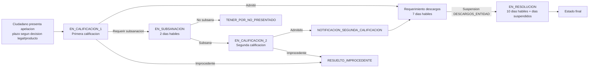

import { Card, CardGrid, Tabs, TabItem, Steps, Badge } from '@astrojs/starlight/components';

## Proceso Vigente

Cuando un ciudadano no está conforme con la respuesta de una entidad pública, con una denegatoria o con el silencio administrativo negativo, puede presentar una apelación ante el **Tribunal de Transparencia y Acceso a la Información Pública (TTAIP)**.

:::caution[Fuente oficial mandatoria]
El documento `Flujo SAIP Y TTAIP_081942.docx` es la referencia oficial de reglas de negocio. La versión consolidada vive en `docs/business-rules/SAIP_TTAIP_REGLAS_NEGOCIO.md` y las brechas contra el sistema actual en `docs/business-rules/SAIP_TTAIP_BRECHAS.md`.
:::

:::danger[Regla funcional actual]
El documento oficial contempla elevación por entidad en 2 días hábiles, pero el proyecto **no usa etapa funcional de elevación TTAIP** en el flujo ciudadano actual. Al crear una apelación desde el ciudadano, el expediente entra directamente en `EN_CALIFICACION_1`.
:::



## Reglas de Negocio

### BR-TTAIP-001 — Plazo para apelar

El documento oficial contiene una diferencia interna: una tabla menciona **15 días calendario**, pero el Art. 34.2 citado en el mismo documento establece **15 días hábiles** para denegatoria expresa. Ante denegatoria tácita o silencio administrativo negativo no existe plazo perentorio.

### BR-TTAIP-002 — Inicio directo en primera calificación

Toda apelación nueva se registra con expediente `NNNNN-AAAA-JUS/TTAIP` y estado `EN_CALIFICACION_1`. Ningún cliente debe esperar, crear ni mostrar una etapa funcional de elevación.

### BR-TTAIP-003 — Primera calificación

El TTAIP revisa admisibilidad formal dentro del plazo operativo definido para la etapa.

| Acción API | Decisión | Resultado | Estado |
| --- | --- | --- | --- |
| `/ttaip/calificacion/{id}/admitir` | `ADMISIBLE` | Pasa a resolución final tras notificación válida, descargos y suspensión de plazo si aplica. | `EN_RESOLUCION` |
| `/ttaip/calificacion/{id}/subsanar` | `INADMISIBLE` | Requiere subsanación ciudadana. | `EN_SUBSANACION` |
| `/ttaip/calificacion/{id}/inadmitir` | `IMPROCEDENTE` | Rechazo definitivo. | `RESUELTO_IMPROCEDENTE` |
| `/ttaip/calificacion/{id}/rechazar` | `IMPROCEDENTE` | Alias de rechazo definitivo. | `RESUELTO_IMPROCEDENTE` |

### BR-TTAIP-004 — Subsanación

El ciudadano tiene **2 días hábiles** para subsanar las observaciones. Si subsana, la apelación pasa a `EN_CALIFICACION_2`; si no subsana, el TTAIP puede declararla `TENER_POR_NO_PRESENTADO`.

### BR-TTAIP-005 — Segunda calificación

La segunda calificación confirma si la apelación queda apta para resolución final.

| Decisión | Resultado | Estado |
| --- | --- | --- |
| `ADMITIDO` | Recurso apto para continuar. | `NOTIFICACION_SEGUNDA_CALIFICACION` |
| `IMPROCEDENTE` | Rechazo definitivo. | `RESUELTO_IMPROCEDENTE` |

### BR-TTAIP-006 — Notificación post segunda calificación

La segunda calificación debe notificarse al ciudadano antes de iniciar el plazo de resolución final. El endpoint operativo es:

```http
POST /api/ttaip/{apelacionId}/notificar-segunda-calificacion
```

### BR-TTAIP-007 — Descargos de entidad y suspensión

Cuando el TTAIP admite una apelación, puede requerir a la entidad pública sus descargos y/o el expediente administrativo. La entidad tiene **7 días hábiles** para presentar el descargo y ese periodo suspende el plazo de resolución final.

El expediente TTAIP registra:

- `DescargoEntidadTtaip`: expediente, apelación, entidad, fechas de requerimiento/límite/presentación, estado, resumen, documento o referencia, responsable, observación y trazabilidad.
- `SuspensionPlazoTtaip`: motivo `DESCARGOS_ENTIDAD`, fecha de inicio, fecha de fin planificada o real, días suspendidos, estado y referencia al descargo.

| Endpoint | Rol principal | Uso |
| --- | --- | --- |
| `POST /api/ttaip/expedientes/{expedienteId}/descargos/requerir` | TTAIP/Admin | Requiere descargos después de una admisión válida. |
| `GET /api/ttaip/expedientes/{expedienteId}/descargos` | TTAIP/Funcionario/Admin | Lista descargos del expediente. |
| `GET /api/ttaip/expedientes/{expedienteId}/descargos/activo` | TTAIP/Funcionario/Admin | Consulta el requerimiento activo. |
| `POST /api/ttaip/expedientes/{expedienteId}/descargos/{descargoId}/presentar` | Funcionario/Admin | Presenta el descargo de la entidad. |
| `POST /api/ttaip/descargos/vencidos/procesar` | TTAIP/Admin | Marca descargos vencidos sin presentación. |
| `GET /api/ttaip/expedientes/{expedienteId}/suspensiones` | TTAIP/Funcionario/Admin | Lista suspensiones del expediente. |

Validaciones obligatorias:

- No requerir descargos antes de una admisión válida.
- No permitir más de un descargo activo `REQUERIDO` por expediente.
- Presentar descargos solo sobre el requerimiento activo del expediente.
- Si el descargo vence sin presentación, queda `VENCIDO_SIN_PRESENTACION` y el expediente puede continuar.
- La fecha límite de resolución se recalcula desde la base de 10 días hábiles y suma las suspensiones registradas.

### BR-TTAIP-008 — Resolución final

Tras la notificación válida de admisibilidad o de segunda calificación, la apelación entra en `EN_RESOLUCION`. La resolución final puede cerrar el expediente con cualquiera de estos resultados:

<CardGrid>
  <Card title="Fundado" icon="approve-check">
    Se ampara el recurso y se ordena entregar la información.
  </Card>
  <Card title="Fundado en parte" icon="approve-check">
    Se ampara parcialmente y se ordena una entrega parcial o acotada.
  </Card>
  <Card title="Infundado" icon="close">
    Se desestima el recurso y se confirma la posición de la entidad.
  </Card>
  <Card title="Infundado en parte" icon="close">
    Se desestima parcialmente.
  </Card>
</CardGrid>

| Decisión adicional | Estado final |
| --- | --- |
| `IMPROCEDENTE` | `RESUELTO_IMPROCEDENTE` |
| `CONCLUSION_SUSTRACCION_MATERIA` | `CONCLUSION_SUSTRACCION_MATERIA` |
| `CONCLUSION_DESISTIMIENTO` | `CONCLUSION_DESISTIMIENTO` |

:::note[Decisiones pendientes del documento oficial]
El documento oficial también menciona `ESTESE_A_LO_RESUELTO` y `NULIDAD_DEL_ACTO`. Aún no están modeladas en el backend y figuran como brecha documentada.
:::

## Mapping de Resoluciones

<Tabs>
  <TabItem label="Primera">
    **TipoResolucion**: `PRIMERA_CALIFICACION`

    | Decisión | Estado resultante |
    | --- | --- |
    | `ADMISIBLE` | `EN_RESOLUCION` |
    | `INADMISIBLE` | `EN_SUBSANACION` |
    | `IMPROCEDENTE` | `RESUELTO_IMPROCEDENTE` |
    | `TENER_POR_NO_PRESENTADO` | `TENER_POR_NO_PRESENTADO` |
  </TabItem>
  <TabItem label="Segunda">
    **TipoResolucion**: `SEGUNDA_CALIFICACION`

    | Decisión | Estado resultante |
    | --- | --- |
    | `ADMITIDO` | `NOTIFICACION_SEGUNDA_CALIFICACION` |
    | `IMPROCEDENTE` | `RESUELTO_IMPROCEDENTE` |

    :::note
    La segunda calificación usa la resolución de primera calificación y las observaciones subsanadas para decidir si el recurso continúa.
    :::
  </TabItem>
  <TabItem label="Final">
    **TipoResolucion**: `RESOLUCION_FINAL`

    | Decisión | Estado resultante |
    | --- | --- |
    | `FUNDADO` | `RESUELTO_FUNDADO` |
    | `FUNDADO_EN_PARTE` | `RESUELTO_FUNDADO_EN_PARTE` |
    | `INFUNDADO` | `RESUELTO_INFUNDADO` |
    | `INFUNDADO_EN_PARTE` | `RESUELTO_INFUNDADO_EN_PARTE` |
    | `IMPROCEDENTE` | `RESUELTO_IMPROCEDENTE` |
    | `CONCLUSION_SUSTRACCION_MATERIA` | `CONCLUSION_SUSTRACCION_MATERIA` |
    | `CONCLUSION_DESISTIMIENTO` | `CONCLUSION_DESISTIMIENTO` |
  </TabItem>
</Tabs>

:::caution[INADMISIBLE vs IMPROCEDENTE]
`INADMISIBLE` significa que hay defectos subsanables. `IMPROCEDENTE` es rechazo definitivo. No usar `INADMISIBLE` como cierre final.
:::

## Formatos de Numeración

| Tipo | Formato | Ejemplo |
| --- | --- | --- |
| Expediente TTAIP | `NNNNN-AAAA-JUS/TTAIP` | `01560-2026-JUS/TTAIP` |
| Cédula de notificación | `CEDULA DE NOTIFICACION N. NNNNN-AAAA-JUS/TTAIP` | `15203-2026-JUS/TTAIP` |
| Resolución | `RESOLUCION N. NNNNNN-AAAA-JUS/TTAIP-[SALA]` | `001595-2026-JUS/TTAIP-PRIMERA SALA` |

## Cedulas y Notificaciones

- Regla general: cada resolución TTAIP genera cédula para ciudadano y cédula para entidad pública.
- Excepción oficial: la inadmisibilidad se notifica solo al recurrente/ciudadano.
- Si existe reproceso, no se borra ni reemplaza la cédula original; se genera una nueva cédula y una nueva notificación para el mismo destinatario afectado.
- La colección Postman/Newman captura dinámicamente una cédula/notificación real emitida durante el flujo TTAIP antes de ejecutar el reproceso, por lo que no depende de números fijos del seed o environment.

:::note[Reproceso validado]
El reproceso conserva `cedulaOriginalId` y `notificacionOriginalId`, genera `cedulaNuevaId` y `notificacionNuevaId`, mantiene el mismo destinatario (`CIUDADANO` o `ENTIDAD_PUBLICA`) y registra trazabilidad en el expediente.
:::

## Validaciones Obligatorias

| Validación | Motivo |
| --- | --- |
| No crear apelación si la SAIP ya tiene apelación asociada. | Evita doble expediente TTAIP. |
| No permitir subsanación fuera de `EN_SUBSANACION`. | Protege la máquina de estados. |
| No pasar a resolución final sin notificar segunda calificación. | Protege plazo legal y trazabilidad. |
| No usar elevación como etapa funcional nueva. | El flujo actual inicia directo en primera calificación. |
