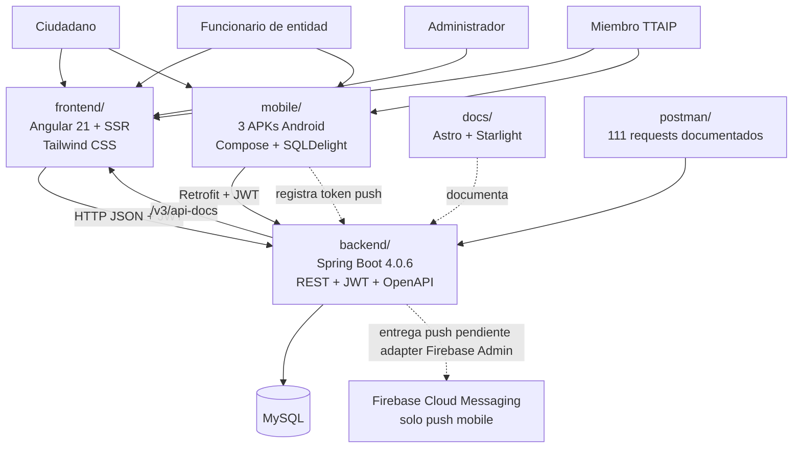
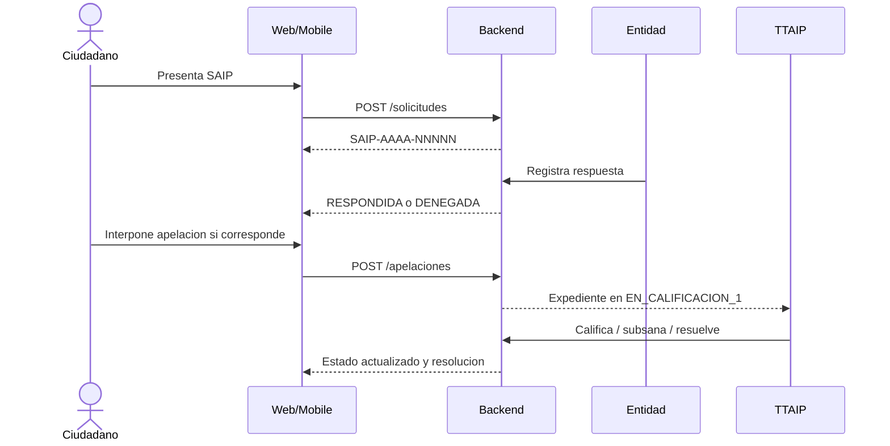

import { Card, CardGrid, LinkCard } from '@astrojs/starlight/components';

Esta documentación es la **fuente de verdad del proyecto**. Debe mantenerse alineada con el backend Spring Boot, el frontend Angular, las apps Android, la colección Postman, el contrato OpenAPI y las reglas de negocio SAIP/TTAIP.

## Mapa del Sistema

## Módulos Principales

<CardGrid stagger>
  <Card title="Backend" icon="setting">
    Spring Boot 4.0.6 con Java 25, Spring Data JPA, MySQL, Spring Security,
    JWT, OpenAPI y reglas transaccionales del dominio.
  </Card>

  <Card title="Frontend" icon="laptop">
    Angular 21.2, TypeScript 5.9, Tailwind CSS 4.1, SSR con Express,
    guards por rol, interceptor JWT y UI multirol.
  </Card>

  <Card title="Mobile" icon="rocket">
    Tres APKs por flavor: Ciudadano, Funcionario y TTAIP. Kotlin 2.3,
    Jetpack Compose, Navigation 3, SQLDelight, Retrofit y FCM.
  </Card>

  <Card title="API y Documentación" icon="document">
    OpenAPI como contrato formal, Postman con ejemplos completos y Starlight
    como documentación navegable del proyecto.
  </Card>
</CardGrid>

## Flujos Críticos

:::note[Regla vigente]
El proyecto **no usa elevación TTAIP como etapa funcional**. Cuando el ciudadano presenta una apelación válida, el expediente entra directamente a `EN_CALIFICACION_1`.
:::

## Accesos Rápidos

<CardGrid>
  <LinkCard title="Descripción general" href="/introduccion/descripcion-general/" description="Objetivo, alcance, stakeholders, módulos y decisiones de producto." />
  <LinkCard title="Arquitectura" href="/introduccion/arquitectura/" description="Diagrama API-first, monorepo, contratos y responsabilidades por módulo." />
  <LinkCard title="Guía de inicio" href="/introduccion/comenzar/" description="Cómo ejecutar backend, frontend, mobile, docs y sincronizar OpenAPI." />
  <LinkCard title="Reglas SAIP" href="/dominio/reglas-saip/" description="Plazos, estados y reglas de primera instancia." />
  <LinkCard title="Reglas TTAIP" href="/dominio/reglas-ttaip/" description="Apelación, calificación, subsanación, notificación y resolución." />
  <LinkCard title="Endpoints API" href="/api/endpoints/" description="Catálogo actualizado de endpoints REST del backend." />
  <LinkCard title="Postman" href="/api/postman/" description="Colección, environment, variables, ejemplos y estrategia de validación." />
  <LinkCard title="Mobile" href="/mobile/" description="Apps por rol, Clean Architecture, REST + JWT y FCM." />
</CardGrid>
