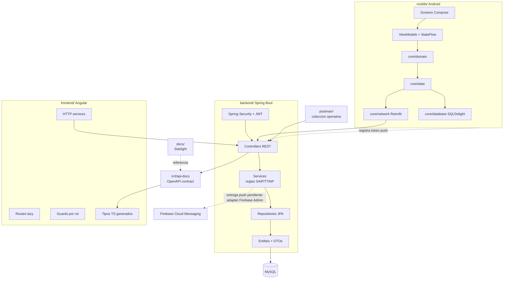
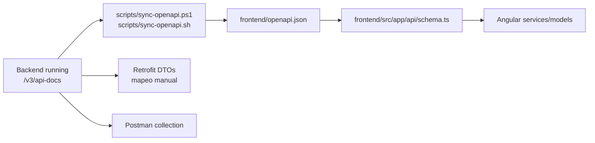

import { Tabs, TabItem, Card, CardGrid, FileTree } from '@astrojs/starlight/components';

## Principio Arquitectónico

La plataforma sigue una arquitectura **API-first**: el backend es la fuente de verdad para datos persistentes, reglas de negocio y seguridad; los clientes web y mobile consumen el contrato REST publicado por `/v3/api-docs`.



:::note[Regla de independencia]
Cada módulo se construye, testea y despliega por separado. No hay código fuente compartido entre backend, frontend y mobile; el contrato compartido es la API REST.
:::

## Estructura del Monorepo

<FileTree>

- plataforma-saip-apelaciones/
  - backend/ API REST Spring Boot 4.0.6 + Java 25
    - src/main/java/pe/gob/saip/backend/
      - controller/ endpoints REST
      - service/ reglas de negocio
      - repository/ Spring Data JPA
      - model/entity/ entidades JPA
      - model/dto/ records de entrada/salida
      - security/ JWT, filtros y roles
      - exception/ manejo global de errores
  - frontend/ Angular 21 + SSR
    - src/app/pages/ public, auth, ciudadano, funcionario, ttaip, admin
    - src/app/services/ clientes HTTP
    - src/app/guards/ control de acceso por rol
    - src/app/api/ tipos generados desde OpenAPI
  - mobile/ Android Kotlin + Compose
    - app/ entrypoint, screens, viewmodels, messaging, flavors
    - core/domain/ modelos, use cases e interfaces
    - core/data/ repositorios, mappers y cache orchestration
    - core/network/ Retrofit + OkHttp
    - core/database/ SQLDelight
  - docs/ esta documentacion Astro + Starlight
  - postman/ coleccion y environment documentados
  - database/ scripts SQL
  - scripts/ sync OpenAPI

</FileTree>

## Capas por Módulo

<Tabs>
  <TabItem label="Backend">
    ```text
    Controller  -> expone endpoints REST y valida entrada HTTP
    Service     -> aplica reglas SAIP/TTAIP y transiciones de estado
    Repository  -> consultas y persistencia con Spring Data JPA
    Entity/DTO   -> modelo persistente y contrato JSON
    Security    -> JWT, CORS, roles y filtro stateless
    ```

    El backend centraliza:

    - generación de expediente SAIP y TTAIP;
    - cálculo de plazos;
    - autenticación y autorización;
    - respuestas de entidad;
    - calificaciones y resoluciones TTAIP;
    - estadísticas, reportes y datos públicos.
  </TabItem>

  <TabItem label="Frontend">
    ```text
    Pages        -> pantallas por rol
    Services     -> HttpClient + RxJS
    Guards       -> authGuard y tipoUsuarioGuard
    Interceptor  -> Authorization Bearer token
    API schema   -> tipos generados desde OpenAPI
    ```

    Rutas principales:

    - publicas: `/`, `/login`, `/registro`, `/consultar`, `/ayuda`;
    - ciudadano: `/ciudadano`, `/ciudadano/nueva-saip`, `/ciudadano/nueva-apelacion`, `/ciudadano/subsanacion/:expediente`;
    - funcionario: `/funcionario`, `/funcionario/solicitud/:expediente`, `/funcionario/responder/:expediente`;
    - TTAIP: `/ttaip`, `/ttaip/calificar/:expediente`, `/ttaip/segunda-calificacion/:expediente`, `/ttaip/resolver/:expediente`;
    - admin: `/admin`.
  </TabItem>

  <TabItem label="Mobile">
    ```text
    app/            -> MainActivity, screens, viewmodels, role policy
    core/domain/    -> Kotlin puro, use cases, repository contracts
    core/data/      -> repository implementations y mappers
    core/network/   -> Retrofit + OkHttp + Auth interceptor
    core/database/  -> SQLDelight cache local
    ```

    El mobile se distribuye como tres APKs:

    | Flavor | ApplicationId | Uso |
    | --- | --- | --- |
    | `ciudadano` | `com.gestion.misaip.ciudadano` | App publica para ciudadanos. |
    | `funcionario` | `com.gestion.misaip.funcionario` | App interna para entidades. |
    | `ttaip` | `com.gestion.misaip.ttaip` | App restringida para miembros TTAIP. |
  </TabItem>
</Tabs>

## Contratos y Sincronización



Reglas:

- Si cambian endpoints, DTOs o estados expuestos, actualizar OpenAPI y documentación.
- El frontend genera tipos con `npm run generate:api:live`.
- Mobile no genera código automáticamente; sus DTOs deben mantenerse alineados manualmente.
- Postman debe cubrir nuevos endpoints con ejemplos de éxito y error.

## Stack Actual

| Capa | Backend | Frontend | Mobile | Docs |
| --- | --- | --- | --- | --- |
| Lenguaje | Java 25 | TypeScript 5.9 | Kotlin 2.3.10 | MDX |
| Framework | Spring Boot 4.0.6 | Angular 21.2 | Jetpack Compose | Astro 6 |
| UI | Swagger UI | Tailwind CSS 4.1 + Lucide + GSAP | Material 3 | Starlight |
| Persistencia | MySQL + JPA | - | SQLDelight 2.2.1 | - |
| Seguridad | Spring Security + JWT | Guards + interceptor | JWT + role policy | - |
| Red | REST JSON | HttpClient | Retrofit 3 + OkHttp 5 | - |
| Push | - | - | Firebase Cloud Messaging | - |

## Decisiones de Diseño

<CardGrid>
  <Card title="Source of truth backend" icon="setting">
    Las reglas legales, estados y persistencia viven en Spring Boot, no en clientes.
  </Card>
  <Card title="Clientes desacoplados" icon="laptop">
    Web y mobile consumen la API de forma independiente y pueden evolucionar por separado.
  </Card>
  <Card title="Mobile por rol" icon="rocket">
    Los flavors impiden mezclar funcionalidades de ciudadano, funcionario y TTAIP.
  </Card>
  <Card title="Documentación viva" icon="document">
    Starlight, Postman y OpenAPI deben actualizarse junto con el código.
  </Card>
</CardGrid>
