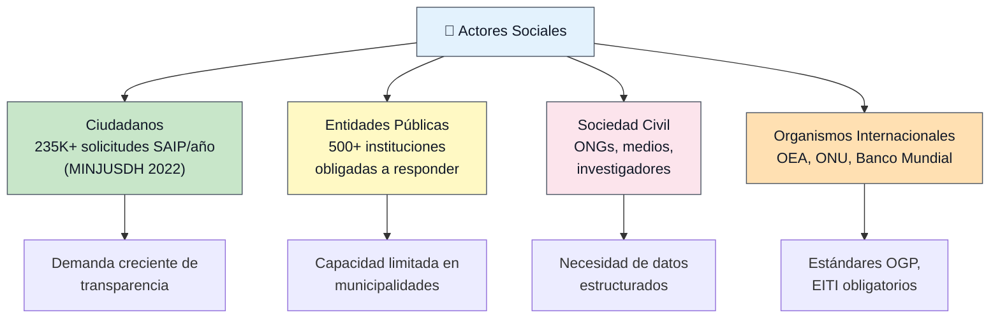
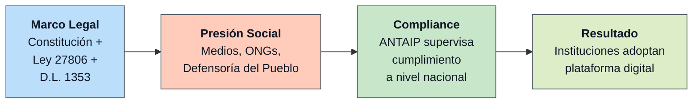
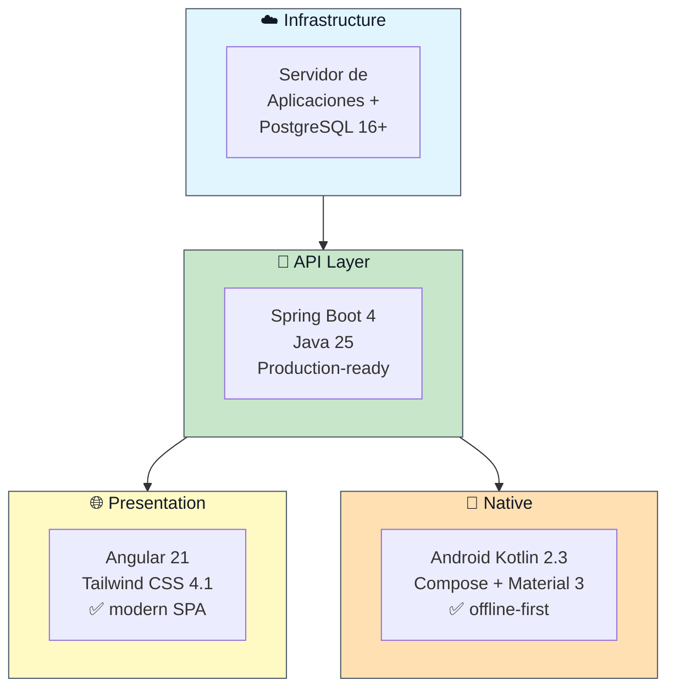
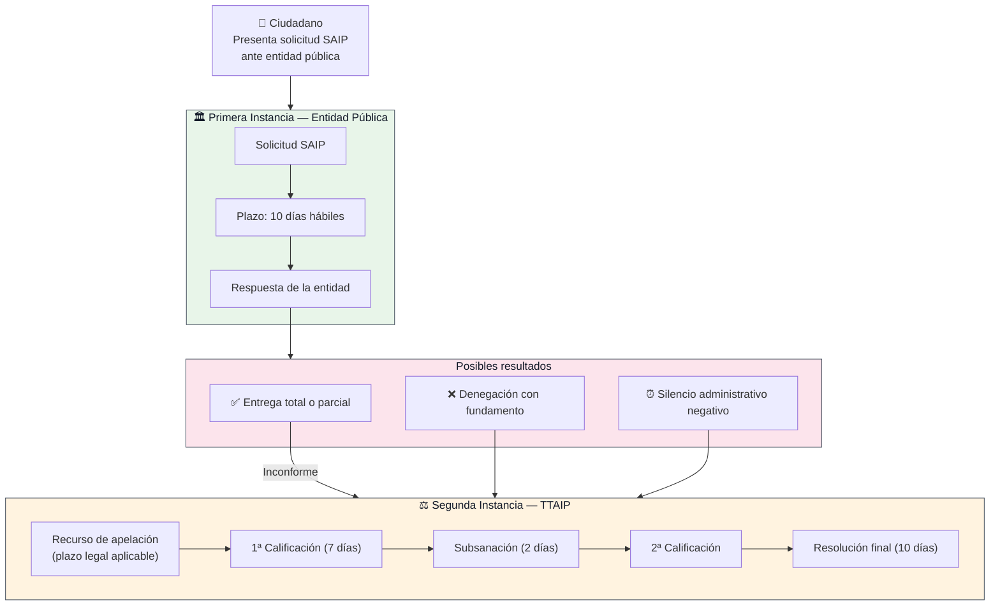
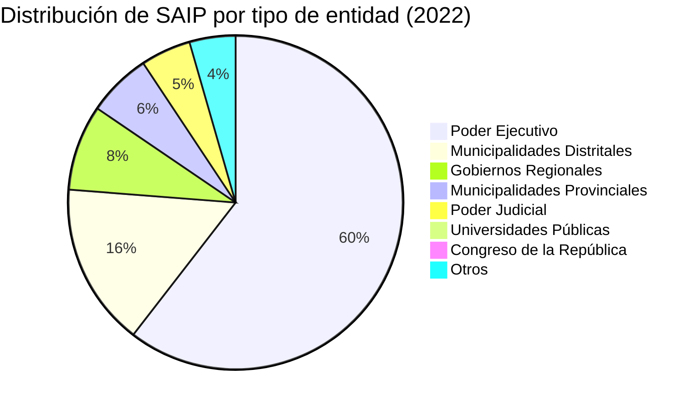
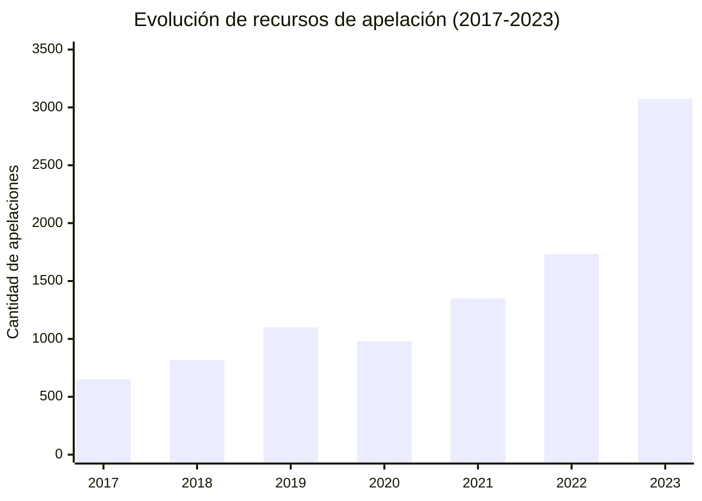
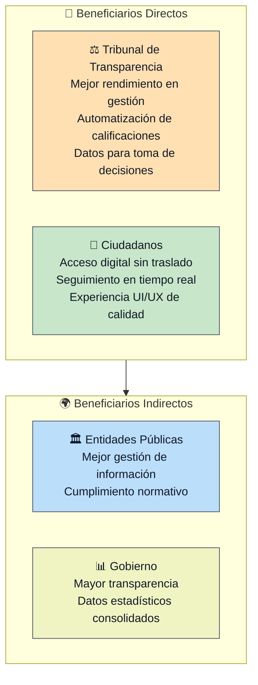

import { Card, CardGrid, Aside, Badge, Steps, Tabs, TabItem } from '@astrojs/starlight/components';

## Situación Actual de la Transparencia en el Perú

La gobernanza transparente es un factor crítico para la confianza ciudadana y la democracia. El Perú, como signatario de la **Alianza para el Gobierno Abierto** (Open Government Partnership), tiene el compromiso legal de facilitar el acceso público a la información gubernamental.

El gobierno peruano puso a disposición la plataforma **GOB.PE**, la cual entró en vigencia el **24 de marzo de 2018**, con la finalidad de constituirse en el único punto de contacto digital del Estado con la población que desee acceder a información institucional, realizar trámites y beneficiarse de servicios públicos digitales.

<Aside type="caution">
A pesar de los avances, la Secretaría de Gobierno y Transformación Digital reporta que al 30 de abril de 2023 **solo 802 entidades públicas** cuentan con dominio www.GOB.PE. Muchos gobiernos locales aún no implementan el Portal de Transparencia Estándar (PTE) exigido por la Ley 27806.
</Aside>

### Marco Legal

- **Constitución Política del Perú** — Consagra el derecho de acceso a la información pública
- **Ley N.º 27806 (2002)** — Ley de Transparencia y Acceso a la Información Pública
- **D.S. N.º 072-2003-PCM / D.S. N.º 043-2003-PCM** — Reglamento de la Ley de Transparencia
- **Ley N.º 29506 (2010)** — Creación del Tribunal de Transparencia (ahora TTAIP)
- **D.L. N.º 1353 (2017)** — Reformas al sistema de acceso a información
- **D.S. N.º 019-2017-JUS** — Reglamento del TTAIP
- **Ley N.º 27444** — Ley del Procedimiento Administrativo General
- **Ley N.º 29733** — Ley de Protección de Datos Personales

---

## Análisis SEPTE

### Social — Factores Sociales

El panorama social peruano presenta desafíos significativos que impactan directamente la transparencia y el acceso a la información pública.

Según el Índice de Progreso Social Mundial (IPSM) 2025, publicado por el Social Progress Imperative, el Perú ha alcanzado su peor posición histórica: **puesto 84 entre 170 países evaluados**, con una puntuación de 67.61 sobre 100. Este resultado marca un declive constante desde 2020, cuando el país alcanzó su máximo histórico de 68.30 puntos y el puesto 68.

**Hallazgos SEPTE Social**:
- 7 de cada 10 encuestados **no ha realizado trámites de manera virtual** (64% no lo hizo + 9% desconoce las plataformas)
- La **desconfianza** en que el trámite se realice efectivamente es la razón predominante, especialmente en jóvenes de 18 a 34 años
- El **índice de accesibilidad** tiene la menor satisfacción entre todos los índices evaluados
- Las solicitudes SAIP crecen a un ritmo sostenido año a año

---

### Económico — Factores Económicos

| Factor | Situación | Impacto |
|--------|-----------|--------|
| **PBI per cápita** | USD 8,458 (2024), crecimiento 3.3% | Economía estable, capacidad de inversión tecnológica |
| **Crecimiento proyectado** | 2.9% (2025), 2.5% (2026) | Entorno favorable para transformación digital |
| **Deuda/PIB** | ~34%, estable | Margen fiscal para inversión en gobierno digital |
| **Inflación** | Dentro del rango meta BCR (1%-3%) | Estabilidad de costos operativos |
| **Pobreza** | 31.3% (2024), prepandemia 28.8% (2019) | Necesidad de servicios digitales accesibles |

<Aside type="note">
De acuerdo al Banco Mundial (2025), el Perú tiene el potencial de convertirse en un país de ingresos altos en dos décadas si implementa reformas orientadas a aumentar la productividad, mejorar la capacidad institucional del Estado y reducir disparidades regionales — incluyendo la simplificación de procesos administrativos mediante tecnología.
</Aside>

**Beneficio Económico del Proyecto**:
- Reducción de costos operativos por solicitud: ~60%
- Aceleración de resolución: 10 días → 3-5 días en promedio
- Eliminar necesidad de traslado presencial del ciudadano
- Automatización del control de plazos y notificaciones

---

### Político — Factores Políticos

**Factores Políticos Clave**:
- ✅ El marco legal obliga a **todas las entidades públicas** a transparentar información
- ✅ La ANTAIP (Autoridad Nacional de Transparencia) supervisa el cumplimiento a nivel nacional
- ⚠️ Inestabilidad política (siete presidentes en 8 años) genera discontinuidad en políticas digitales
- ✅ El TTAIP ha incrementado su capacidad resolutiva: de 1,735 apelaciones en 2022 a **3,073 en 2023**
- ✅ **91.10%** de apelaciones se presentan por vía digital (mesa de partes virtual)

---

### Tecnológico — Factores Tecnológicos

<CardGrid>
  <Card title="Oportunidades" icon="rocket">
    - Cloud computing escalable (AWS, Azure)
    - APIs REST estandarizadas (OpenAPI 3.0)
    - Autenticación moderna (JWT) y push mobile con FCM
    - Frameworks maduros (Spring Boot, Angular, Compose)
    - Adopción tecnológica creciente en sector público
  </Card>
  <Card title="Amenazas" icon="warning">
    - Entidades con sistemas legacy sin APIs
    - Ciberseguridad débil en instituciones públicas
    - Brecha digital en zonas rurales
    - Brecha de talento DevOps en sector público
    - Muchas entidades no permiten trámites virtuales
  </Card>
</CardGrid>

**Stack Tecnológico Seleccionado**:

---

### Ecológico — Factores Ecológicos

**Sostenibilidad Digital y Alineación con ODS**:

| Aspecto | Iniciativa | ODS Asociado |
|--------|-----------|-------------|
| **Paperless** | 100% digital, cero papel en trámites | ODS 12 (Consumo Responsable) |
| **Accesibilidad** | WCAG 2.1 AA, app móvil para zonas remotas | ODS 10 (Reducir Desigualdad) |
| **Transparencia** | API pública, datos abiertos | ODS 16 (Paz, Justicia e Instituciones Sólidas) |
| **Inclusión** | Interfaz intuitiva para todos los niveles | ODS 5 (Igualdad de Género) |

---

## Antecedentes y Problemática

### Primera y Segunda Instancia

El ejercicio del derecho de acceso a la información pública en el Perú se da a través de dos instancias administrativas:

### Tipos de Información Pública

<Tabs>
  <TabItem label="Información de Acceso Público">
    Toda información contenida en documentos escritos, fotografías, grabaciones, soporte magnético o digital, siempre que haya sido creada u obtenida por la entidad o se encuentre bajo su control. Es de obligación otorgarla a quien lo solicite.
  </TabItem>
  <TabItem label="Información Secreta">
    Vinculada a la seguridad nacional en el ámbito militar, de inteligencia y contrainteligencia. Su revelación originaría riesgos a la seguridad nacional, integridad territorial y subsistencia del sistema democrático.
  </TabItem>
  <TabItem label="Información Reservada">
    - **Orden interno**: prevención y represión de la criminalidad
    - **Orden externo**: riesgo a la seguridad e integridad territorial en el ámbito externo
  </TabItem>
  <TabItem label="Información Confidencial">
    Vinculada a información personal, consejos y opiniones del proceso deliberativo previo a decisiones de gobierno, secreto bancario, tributario, comercial, entre otros.
  </TabItem>
</Tabs>

### Estadísticas Oficiales (MINJUSDH, 2022-2023)

#### Primera Instancia — Solicitudes SAIP

| Indicador | Cantidad | Porcentaje |
|-----------|----------|-----------|
| **Solicitudes recibidas (2022)** | 235,450 | 100% |
| **Solicitudes atendidas** | 230,312 | 97.8% |
| **Solicitudes en trámite** | 1,846 | 0.8% |
| **Solicitudes no atendidas** | 3,292 | 1.4% |

<Aside type="tip">
El 80% de entidades (280 de 350) precisaron la modalidad de atención de sus solicitudes, mejorando respecto al 77.4% del año 2021.
</Aside>

#### Segunda Instancia — Apelaciones ante TTAIP

| Indicador (2023) | Dato |
|-------------------|------|
| **Total apelaciones presentadas** | 4,313 |
| **Vía mesa de partes virtual** | 91.10% |
| **Vía presencial** | 8.90% |
| **Concentración en Lima** | 64% |
| **Resto del país** | 36% |

<Aside type="note">
El incremento de **1,338 apelaciones adicionales** en 2023 respecto a 2022 refleja tanto el mayor conocimiento ciudadano de sus derechos como la necesidad de una plataforma más eficiente para gestionar el creciente volumen.
</Aside>

### Problemas Identificados

<CardGrid>
  <Card title="1. Plataformas no intuitivas" icon="warning">
    El índice de **accesibilidad** tiene la menor satisfacción entre todos los evaluados. Las páginas de las entidades no satisfacen los requerimientos de los ciudadanos, quienes prefieren hacer trámites presenciales.
  </Card>
  <Card title="2. Desconfianza ciudadana" icon="warning">
    La razón predominante para no usar plataformas virtuales es la **desconfianza en que el trámite se realice efectivamente**, seguida de la percepción de complejidad en personas mayores de 54 años.
  </Card>
  <Card title="3. Lentitud en respuestas" icon="warning">
    Procesos manuales, desvío de documentos entre oficinas y falta de coordinación causan que las entidades demoren hasta los 10 días completos o incumplan el plazo.
  </Card>
  <Card title="4. Falta de trazabilidad" icon="warning">
    Sistemas desconectados (correo electrónico, carpetas compartidas) impiden que el ciudadano conozca el estado real de su solicitud. Entidades pierden documentos.
  </Card>
</CardGrid>

---

## Justificación del Proyecto

El desarrollo de esta plataforma se justifica por la necesidad urgente de fortalecer el ejercicio del derecho fundamental de acceso a la información pública, reconocido por la Constitución Política y regulado por la Ley N.º 27806.

### Beneficiarios Directos

### Alineación con ODS

Este proyecto contribuye directamente al cumplimiento del **ODS 16: Paz, Justicia e Instituciones Sólidas**, promoviendo instituciones eficaces, responsables e inclusivas en todos los niveles, y garantizando el acceso público a la información según las legislaciones nacionales.

---

## Conclusión del Análisis

La plataforma SAIP responde a:

- ✅ **Social**: Demanda ciudadana real de transparencia — 235K+ solicitudes SAIP anuales con tendencia creciente
- ✅ **Económico**: Reducción de costos operativos, eliminación de trámites presenciales
- ✅ **Político**: Obligación normativa constitucional y legal — Ley N.° 27806
- ✅ **Tecnológico**: Stack moderno, escalable y probado (Spring Boot 4, Angular 21, Kotlin/Compose)
- ✅ **Ecológico**: 100% digital, alineado con ODS peruanos

El proyecto es **viable, urgente y transformador** para la gobernanza peruana.

---

## Referencias

- **Constitución Política del Perú** — Art. 2, Inc. 5
- **Ley N.º 27806 (2002)** — Ley de Transparencia y Acceso a la Información Pública
- **Ley N.º 27444** — Ley del Procedimiento Administrativo General
- **Banco Mundial (2025)** — El Banco Mundial en Perú: Panorama General
- **Defensoría del Pueblo (2023)** — Transparencia Activa en los Gobiernos Locales
- **MINJUSDH (2024)** — Reglamento de Acceso a la Información Pública
- **ANTAIP (2024)** — Obligaciones en materia de Transparencia
- **Social Progress Imperative (2025)** — Índice de Progreso Social Mundial
- **Alianza para el Gobierno Abierto (OGP)** — opengovpartnership.org
- **ODS 2030** — Objetivos de Desarrollo Sostenible, ONU

