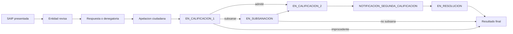

import { Card, CardGrid, LinkCard, Steps } from '@astrojs/starlight/components';

## Qué es la Plataforma SAIP

La **Plataforma SAIP** es un sistema integral para gestionar digitalmente las Solicitudes de Acceso a la Información Pública en el Perú y las apelaciones ante el Tribunal de Transparencia y Acceso a la Información Pública.

El sistema cubre dos instancias:

1. **Primera instancia SAIP**: el ciudadano presenta una solicitud ante una entidad pública y la entidad responde dentro del plazo legal.
2. **Segunda instancia TTAIP**: el ciudadano interpone apelación cuando no está conforme con la respuesta, cuando hay denegatoria o cuando opera el silencio administrativo.

:::tip[Concepto clave]
Una **SAIP no es un expediente TTAIP**. La SAIP usa formato `SAIP-AAAA-NNNNN`. El expediente TTAIP existe solo cuando se presenta una apelación y usa formato `NNNNN-AAAA-JUS/TTAIP`.
:::

## Objetivos del Producto

<CardGrid>
  <Card title="Transparencia" icon="open-book">
    Facilitar que cualquier ciudadano pueda pedir información pública y hacer seguimiento del trámite.
  </Card>
  <Card title="Trazabilidad" icon="document">
    Registrar estados, respuestas, apelaciones, calificaciones y resoluciones con evidencia auditable.
  </Card>
  <Card title="Cumplimiento de plazos" icon="clock">
    Controlar plazos SAIP y TTAIP con estados claros y alertas operativas.
  </Card>
  <Card title="Operación multirol" icon="user">
    Separar accesos de ciudadano, funcionario, miembro TTAIP y administrador.
  </Card>
</CardGrid>

## Actores

| Actor | Responsabilidad | Superficies |
| --- | --- | --- |
| Ciudadano | Presenta SAIP, consulta estado, apela y subsana observaciones. | Web pública, App Ciudadano |
| Funcionario de entidad | Gestiona bandeja de la entidad, revisa solicitudes y emite respuestas. | Web interna, App Funcionario |
| Miembro TTAIP | Califica apelaciones, revisa subsanaciones y emite resoluciones. | Web interna, App TTAIP |
| Administrador | Mantiene usuarios, catálogos, reportes e indicadores generales. | Web admin |

## Módulos del Monorepo

| Carpeta | Stack real | Responsabilidad |
| --- | --- | --- |
| `backend/` | Spring Boot 4.0.6, Java 25, Maven, MySQL | API REST, seguridad, reglas de negocio, OpenAPI. |
| `frontend/` | Angular 21.2, TypeScript 5.9, Tailwind CSS 4.1, SSR | Experiencia web pública e interna multirol. |
| `mobile/` | Kotlin 2.3, Compose, Navigation 3, SQLDelight, Retrofit | Tres APKs por rol: ciudadano, funcionario y TTAIP. |
| `docs/` | Astro 6, Starlight, Mermaid | Documentación técnica y funcional del proyecto. |
| `postman/` | Postman Collection + Environment | Validación operativa de API con ejemplos de request/response. |
| `database/` | SQL | Scripts de apoyo y datos semilla para MySQL. |
| `scripts/` | PowerShell/Bash | Sincronización del contrato OpenAPI. |

## Flujo End-to-End

<Steps>
1. El ciudadano se registra o inicia sesión con credenciales validadas por el backend.
2. Presenta una SAIP contra una entidad pública.
3. El backend genera el expediente `SAIP-AAAA-NNNNN`, registra fecha de presentación y calcula plazo.
4. El funcionario de la entidad revisa la solicitud y responde con entrega total, entrega parcial o denegación fundamentada.
5. Si corresponde, el ciudadano interpone apelación dentro del plazo legal.
6. El backend crea el expediente TTAIP directamente en `EN_CALIFICACION_1`.
7. El TTAIP puede admitir, requerir subsanación, declarar no presentado, notificar segunda calificación o resolver.
8. La resolución final cierra el proceso con resultado fundado, infundado, improcedente, sustracción de materia o desistimiento.
</Steps>

## Decisiones Actuales

| Decisión | Estado |
| --- | --- |
| Backend como fuente de verdad | Vigente. Autenticación, datos y reglas se resuelven en Spring Boot. |
| OpenAPI como contrato | Vigente. Frontend genera tipos desde `/v3/api-docs`; mobile consume REST con Retrofit. |
| Mobile sin Firebase como backend | Vigente. Firebase queda limitado a FCM para push. No se usa Firebase Auth ni Firestore como fuente de datos. |
| Tres APKs mobile | Vigente. `ciudadano`, `funcionario` y `ttaip` tienen applicationId propio y reglas por rol. |
| Sin etapa funcional de elevación TTAIP | Vigente. La apelación entra directo a primera calificación. |

## Co-creadores

| Nombre | Rol | Contribución |
| --- | --- | --- |
| Kelly Medalit De La Cruz Lopez | Co-creadora, análisis funcional | Ideación, levantamiento funcional, reglas de negocio, dominio SAIP/TTAIP y criterios de validación. |
| Daniel Angel Leon Salazar | Co-creador, arquitectura y desarrollo | Backend, frontend, mobile, integración API, seguridad, automatización y despliegue técnico. |

## Siguientes Lecturas

<CardGrid>
  <LinkCard title="Arquitectura" href="/introduccion/arquitectura/" description="Cómo se conectan backend, frontend, mobile, OpenAPI y Postman." />
  <LinkCard title="Comenzar" href="/introduccion/comenzar/" description="Configuración local y comandos por módulo." />
  <LinkCard title="Reglas TTAIP" href="/dominio/reglas-ttaip/" description="Proceso vigente de apelaciones sin elevación funcional." />
  <LinkCard title="Endpoints" href="/api/endpoints/" description="Contrato REST actualizado por controller." />
</CardGrid>
