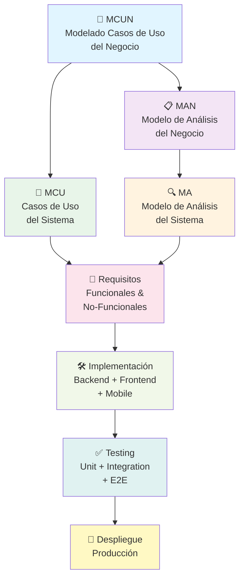
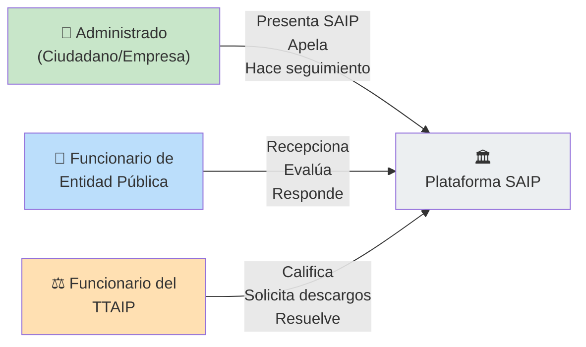
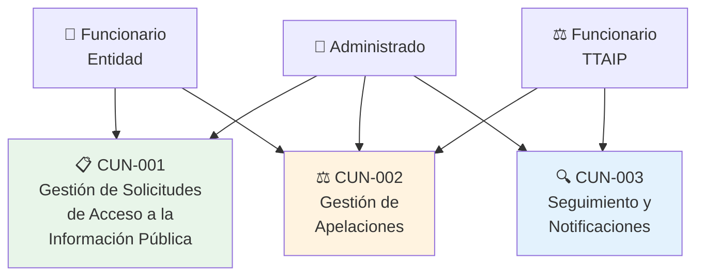
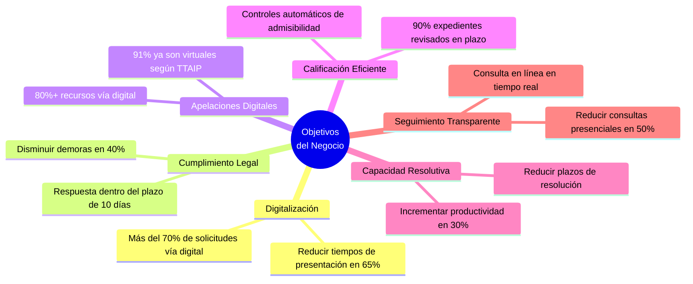
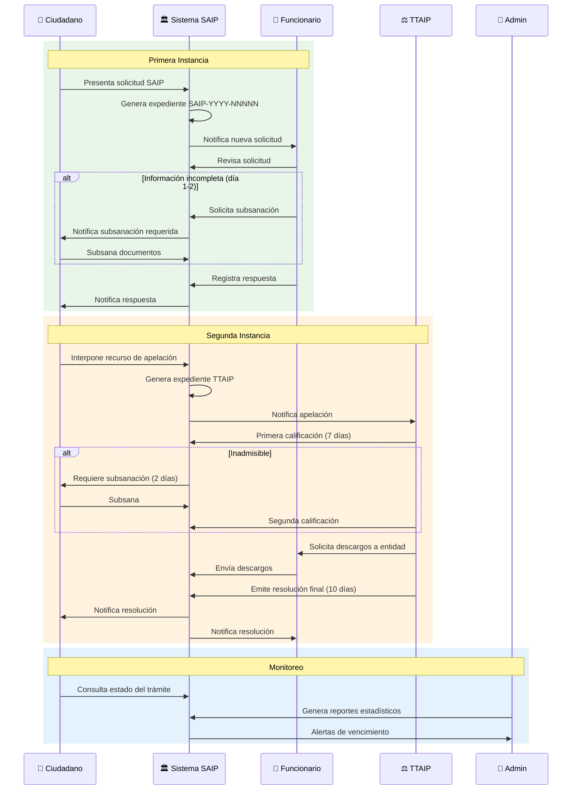
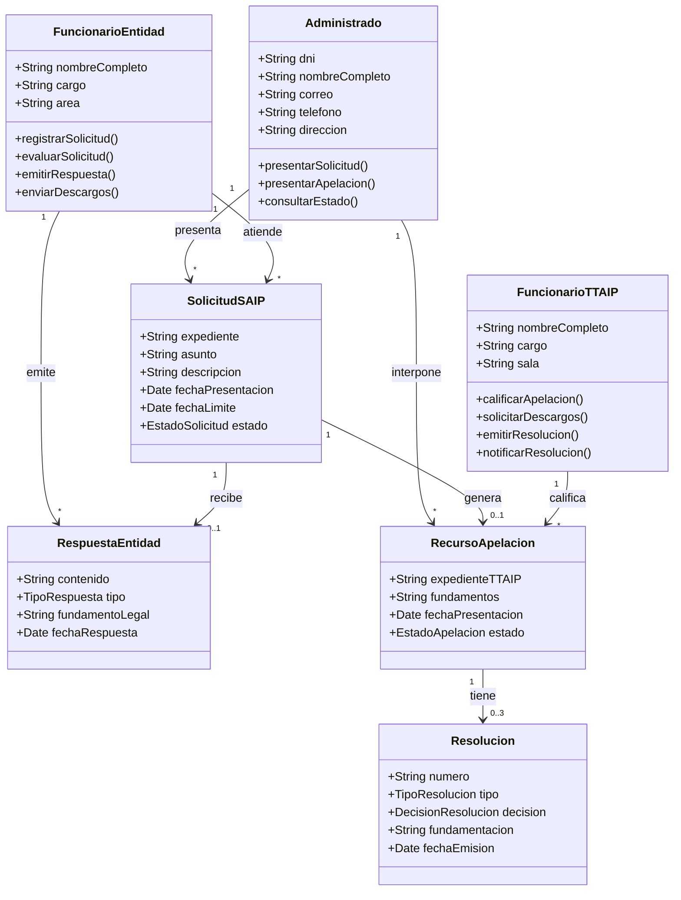
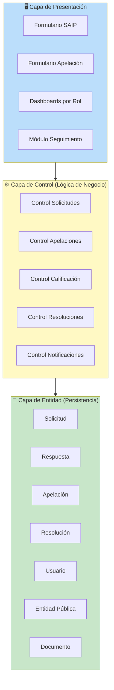
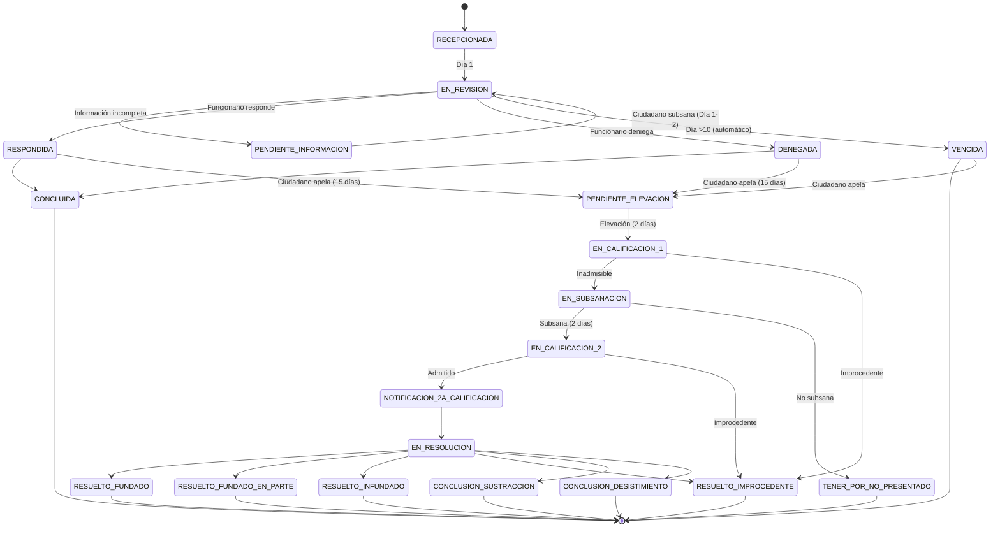
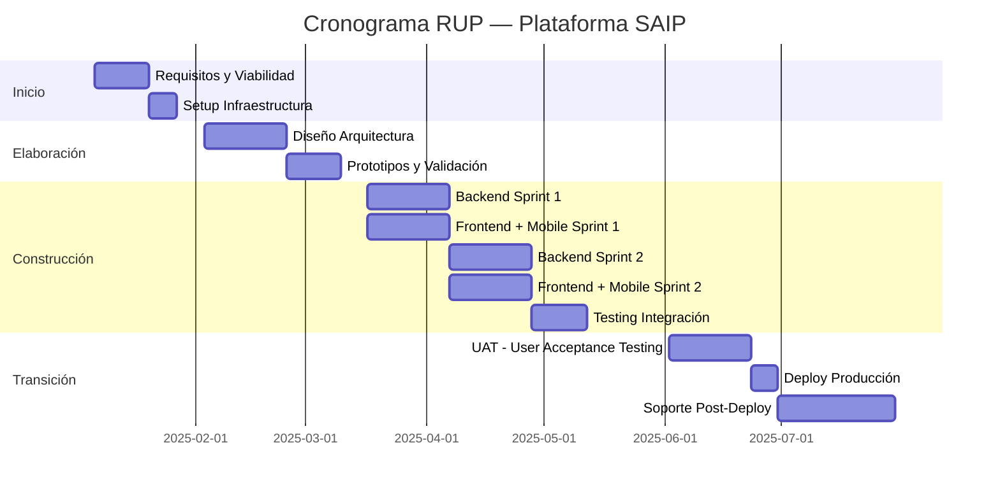

import { Card, CardGrid, Badge, Aside, Steps, Tabs, TabItem } from '@astrojs/starlight/components';

## Visión General

La plataforma **SAIP y Apelaciones** sigue la metodología **RUP (Rational Unified Process)** — un proceso iterativo e incremental que organiza el desarrollo por fases (Inicio, Elaboración, Construcción, Transición) y disciplinas (Requerimientos, Análisis, Diseño, Implementación, Testing, Despliegue).

Este proyecto implementa una **arquitectura API-first** donde el backend (Spring Boot) es la fuente única de verdad, y los consumidores (frontend Angular, móvil Android) se integran independientemente a través de un contrato OpenAPI.

---

## Estructura de Artefactos RUP

---

## MCUN — Modelo de Casos de Uso de Negocio

### Actores del Negocio

| Actor del Negocio | Rol Principal | Funciones |
|---|---|---|
| **Administrado** (Ciudadano/Empresa) | Solicitante de información pública | Presenta SAIP, revisa respuestas, interpone apelación, realiza seguimiento |
| **Funcionario de Entidad Pública** | Responsable de atención (1ª instancia) | Recibe y registra solicitudes, evalúa disponibilidad, emite respuesta, remite descargos al TTAIP |
| **Funcionario del TTAIP** | Evaluador y resolutor (2ª instancia) | Califica admisibilidad, solicita descargos, emite resolución final, comunica y publica resoluciones |

### Casos de Uso de Negocio

<Tabs>
  <TabItem label="CUN-001: Gestión SAIP">
    **Flujo Básico:**
    <Steps>
    1. El ciudadano accede a la plataforma
    2. Registra sus datos y los de la solicitud
    3. Envía la solicitud a la entidad pública correspondiente
    4. El sistema genera un número de expediente para seguimiento
    5. El funcionario recibe la solicitud registrada
    6. Verifica la disponibilidad de la información
    7. Emite la respuesta (entrega o deniega)
    8. Registra la respuesta y notifica al ciudadano
    </Steps>
  </TabItem>
  <TabItem label="CUN-002: Gestión Apelaciones">
    **Flujo Básico:**
    <Steps>
    1. El ciudadano selecciona la solicitud que desea apelar
    2. Registra los fundamentos y documentos requeridos
    3. Envía el recurso al Tribunal de Transparencia
    4. El sistema genera constancia de recepción
    5. El Tribunal recibe y revisa requisitos de admisibilidad
    6. Si falta información, solicita subsanación (2 días hábiles)
    7. Declara admisible, inadmisible o improcedente
    8. Solicita descargos a la entidad
    9. Analiza el fondo del recurso
    10. Emite resolución final
    11. Notifica al administrado y a la entidad
    </Steps>
  </TabItem>
  <TabItem label="CUN-003: Seguimiento">
    **Flujo Básico:**
    <Steps>
    1. El ciudadano accede al módulo de seguimiento
    2. Ingresa el número de expediente o sus credenciales
    3. Visualiza el estado actual y las fechas de actuación
    4. Descarga la resolución o respuesta final
    </Steps>
  </TabItem>
</Tabs>

### Objetivos del Negocio

---

## MAN — Modelo de Análisis de Negocio

### Actores Internos del Sistema

| Actor Interno | Rol en el Sistema | Funciones Específicas |
|---|---|---|
| **Funcionario de Entidad Pública** | Tramitador de SAIP | Registra solicitudes, evalúa admisibilidad, genera informe de respuesta, notifica al ciudadano, envía descargos |
| **Funcionario del TTAIP** | Gestor de apelaciones | Registra apelaciones, evalúa requisitos formales, solicita descargos, emite resolución final, gestiona notificación electrónica |
| **Administrador del Sistema** | Gestor técnico | Administra usuarios y roles, gestiona respaldos y auditorías, actualiza catálogos, supervisa métricas y seguridad |

### Flujo General de Interacción (Proceso TO-BE)

### Diagrama de Clases de Negocio

---

## MCU — Modelo de Casos de Uso del Sistema

### Primera Instancia: SAIP (Ley N.° 27806)

| Caso de Uso | Actor(es) | Descripción |
|---|---|---|
| **UC-001: Presentar Solicitud SAIP** | Ciudadano | Ciudadano crea una solicitud con datos personales, entidad, asunto y descripción |
| **UC-002: Revisar Solicitudes** | Funcionario, Sistema | Funcionario visualiza listado de solicitudes pendientes con días restantes |
| **UC-003: Responder Solicitud** | Funcionario | Funcionario registra respuesta como Aprobada, Denegada o Silencio Administrativo |
| **UC-004: Solicitar Subsanación** | Funcionario | Funcionario solicita subsanación del ciudadano en los 2 primeros días hábiles |
| **UC-005: Aplicar Silencio Administrativo** | Sistema | Sistema marca solicitud como VENCIDA si pasan >10 días hábiles sin respuesta |

### Segunda Instancia: Apelación TTAIP

| Caso de Uso | Actor(es) | Descripción |
|---|---|---|
| **UC-006: Presentar Apelación** | Ciudadano | Ciudadano apela solo si la solicitud fue denegada o está en silencio administrativo |
| **UC-007: Calificar Apelación** | TTAIP | TTAIP califica como Admisible, Inadmisible o Improcedente |
| **UC-008: Subsanar Documentos** | Ciudadano | Ciudadano sube documentos cuando la apelación es declarada Inadmisible |
| **UC-009: Emitir Resolución Final** | TTAIP | TTAIP emite resolución final: Fundado, Infundado, Fundado en Parte, etc. |

### Seguimiento y Administración

| Caso de Uso | Actor(es) | Descripción |
|---|---|---|
| **UC-010: Consultar Estado** | Ciudadano | Consultar estado ingresando número de expediente o DNI |
| **UC-011: Recibir Notificaciones** | Todos | Notificaciones por email en cada cambio de estado del expediente |
| **UC-012: Gestionar Usuarios** | Admin | Administra usuarios, roles y permisos del sistema |
| **UC-013: Generar Reportes** | Admin, TTAIP | Genera reportes estadísticos de solicitudes por estado, entidad y período |

---

## Requisitos Funcionales

### Módulo de Solicitudes SAIP

| Código | Requerimiento | Caso de Uso | Prioridad |
|---|---|---|---|
| RF001 | Permitir al administrado registrar solicitud con datos personales, entidad, asunto y descripción | UC-001 | Alta |
| RF002 | Generar número de expediente único (SAIP-YYYY-NNNNN) y calcular fecha límite (10 días hábiles) | UC-001 | Alta |
| RF003 | Enviar notificación de confirmación por email con número de expediente | UC-001 | Alta |
| RF004 | Notificar a la entidad cuando reciba nueva solicitud | UC-002 | Alta |
| RF005 | Mostrar listado de solicitudes pendientes con días restantes y alertar 3 días antes del vencimiento | UC-002 | Alta |
| RF006 | Permitir registrar respuesta como Aprobada, Denegada o Silencio Administrativo | UC-003 | Alta |
| RF007 | Requerir fundamento legal obligatorio en caso de denegación | UC-003 | Alta |
| RF008 | Marcar automáticamente como Silencio Administrativo si no hay respuesta en 10 días hábiles | UC-003 | Alta |

### Módulo de Apelaciones TTAIP

| Código | Requerimiento | Caso de Uso | Prioridad |
|---|---|---|---|
| RF009 | Permitir presentar apelación solo si la solicitud fue denegada o está en silencio administrativo | UC-006 | Alta |
| RF010 | Generar número de apelación (TTAIP-YYYY-NNNNN) y calcular fecha límite | UC-006 | Alta |
| RF011 | Notificar al TTAIP y al solicitante sobre la recepción de la apelación | UC-006 | Alta |
| RF012 | Permitir calificar apelación como Admisible, Inadmisible o Improcedente | UC-007 | Alta |
| RF013 | Si es Inadmisible, especificar documentos faltantes para subsanación | UC-007 | Alta |
| RF014 | Generar número de resolución automático (RES-TTAIP-YYYY-NNNNN) | UC-007 | Alta |
| RF015 | Permitir al ciudadano subir documentos cuando la apelación es Inadmisible | UC-008 | Alta |
| RF016 | Actualizar estado a "En Subsanación" y notificar al TTAIP al recibir documentos | UC-008 | Alta |
| RF017 | Permitir emitir resolución final solo para apelaciones Admisibles | UC-009 | Alta |
| RF018 | Seleccionar sentido como Fundado, Infundado o Fundado en Parte con fundamento legal | UC-009 | Alta |
| RF019 | Notificar al solicitante y a la entidad sobre la resolución final emitida | UC-009 | Alta |

### Módulo de Seguimiento y Notificaciones

| Código | Requerimiento | Caso de Uso | Prioridad |
|---|---|---|---|
| RF020 | Permitir consultar estado ingresando número de expediente o DNI | UC-010 | Alta |
| RF021 | Mostrar historial completo con timeline visual y permitir descargar documentos | UC-010 | Alta |
| RF022 | Enviar notificación por email en cada cambio de estado del expediente | UC-011 | Alta |
| RF023 | Mantener buzón de notificaciones dentro de la plataforma con estado leído/no leído | UC-011 | Media |

---

## Requisitos No Funcionales

| Código | Categoría | Requerimiento | Métrica |
|---|---|---|---|
| RNF001 | Seguridad | Autenticación segura con encriptación de contraseñas (BCrypt) y protocolo HTTPS | OWASP Top 10 compliant |
| RNF002 | Seguridad | Control de acceso basado en roles (RBAC) diferenciando permisos por tipo de usuario | 4 roles definidos |
| RNF003 | Seguridad | Cumplir con la Ley de Protección de Datos Personales N.° 29733 | Auditoría anual |
| RNF004 | Rendimiento | Soportar al menos 1,000 usuarios concurrentes sin degradación | API p95 menor a 200ms |
| RNF005 | Rendimiento | Tiempo de respuesta para consultas no debe exceder 3 segundos | Menor a 3s en frontend |
| RNF006 | Disponibilidad | Disponibilidad del 99.5% mensual con respaldo automático diario | Menor a 3.6h downtime/mes |
| RNF007 | Usabilidad | Interfaz responsive adaptable a móviles, tablets y escritorio | Cross-browser |
| RNF008 | Usabilidad | Cumplir con estándares WCAG 2.1 nivel AA para accesibilidad | 0 violaciones Axe |
| RNF009 | Normatividad | Cumplir con la Ley de Transparencia N.° 27806 y plazos legales | Automatizado |
| RNF010 | Compatibilidad | Compatible con Chrome, Firefox, Safari y Edge (últimas 2 versiones) | Testing automatizado |

---

## MA — Modelo de Análisis del Sistema

### Arquitectura de Análisis por Capas

### Mapeo de Requisitos a Componentes

```mermaid
graph TB
    subgraph Backend["🔧 Backend (Spring Boot)"]
        BE_Auth["Auth Service<br/>JWT + BCrypt"]
        BE_SAIP["SAIP Service<br/>Crear, Responder, Vencer"]
        BE_TTAIP["TTAIP Service<br/>Calificar, Resolver"]
        BE_Data["Data Layer<br/>JPA + MySQL"]
    end
    
    subgraph Frontend["🌐 Frontend (Angular)"]
        FE_Auth["Login + Register<br/>Responsive Forms"]
        FE_Dashboard["Dashboards<br/>by Role"]
        FE_Forms["SAIP Form<br/>Apelación Form"]
        FE_State["State Management<br/>Signals + HTTP"]
    end
    
    subgraph Mobile["📱 Mobile (Android)"]
        MB_Auth["Firebase Auth<br/>Biometric"]
        MB_Screen["Screens<br/>Compose UI"]
        MB_VM["ViewModels<br/>StateFlow"]
        MB_DB["SQLDelight<br/>Offline Storage"]
    end
    
    RF_001["RF001:<br/>Crear Solicitud"]
    RF_006["RF006:<br/>Responder"]
    RF_009["RF009:<br/>Crear Apelación"]
    RF_012["RF012:<br/>Calificar"]
    
    RF_001 --> FE_Forms
    RF_001 --> BE_SAIP
    RF_001 --> MB_Screen
    
    RF_006 --> BE_SAIP
    RF_006 --> FE_Dashboard
    
    RF_009 --> FE_Forms
    RF_009 --> BE_TTAIP
    RF_009 --> MB_Screen
    
    RF_012 --> BE_TTAIP
    RF_012 --> FE_Dashboard
    
    style Backend fill:#c8e6c9
    style Frontend fill:#bbdefb
    style Mobile fill:#ffe0b2
```

---

## Plazos Legales — Máquina de Estados Completa

---

## Matriz de Trazabilidad (RTM)

| ID Requisito | MCUN | MCU | Componente Backend | Componente Frontend | Componente Mobile | Test Case |
|---|---|---|---|---|---|---|
| RF001 | CUN-001 | UC-001 | SolicitudService | SAIPFormComponent | SolicitudCreationScreen | IT-001 |
| RF006 | CUN-001 | UC-003 | RespuestaService | ResponderComponent | — | IT-006 |
| RF009 | CUN-002 | UC-006 | ApelacionService | ApelacionFormComponent | ApelacionScreen | IT-009 |
| RF012 | CUN-002 | UC-007 | CalificacionService | CalificacionComponent | — | IT-012 |
| RF017 | CUN-002 | UC-009 | ResolucionService | ResolverComponent | — | IT-017 |
| RF020 | CUN-003 | UC-010 | SolicitudController | DashboardComponent | TrackingScreen | IT-020 |

---

## Cronograma de Fases RUP

---

## Artefactos Generados

<Aside type="tip">
Todos los artefactos RUP están versionados en el repositorio principal y pueden ser consultados en cualquier momento.
</Aside>

- ✅ **Modelo de Casos de Uso de Negocio (MCUN)** — 3 casos de uso de negocio, 3 actores identificados
- ✅ **Modelo de Análisis de Negocio (MAN)** — Diagramas de clases de negocio, flujos de interacción, proceso TO-BE
- ✅ **Modelo de Casos de Uso del Sistema (MCU)** — 13 casos de uso del sistema con requisitos funcionales y no funcionales
- ✅ **Modelo de Análisis del Sistema (MA)** — Arquitectura por capas (Boundary-Control-Entity), diagrama de comunicaciones
- ✅ **Especificación de Requisitos (SRS)** — 23 requisitos funcionales + 10 no funcionales
- ✅ **Modelo Conceptual** — Entidades de dominio con atributos y relaciones
- ✅ **Especificación de Diseño** — Backend (Spring Boot 4), Frontend (Angular 21), Mobile (Kotlin/Compose)
- ✅ **Plan de Testing** — TDD workflow con target de cobertura 80%+

---

## Referencias

- **RUP (Rational Unified Process)** — Proceso iterativo e incremental de IBM/Rational
- **IEEE 830** — Estándar para especificación de requisitos de software
- **OpenAPI 3.0** — Especificación para contratos REST API
- **Ley N.º 27806** — Ley de Transparencia y Acceso a la Información Pública (Perú)
- **Ley N.º 27444** — Ley del Procedimiento Administrativo General
- **WCAG 2.1** — Estándares de accesibilidad web
