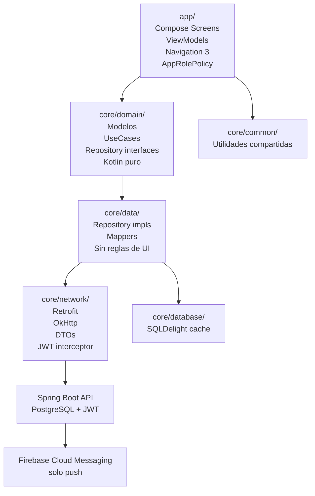

import { Card, CardGrid, Tabs, TabItem, Steps, Badge } from '@astrojs/starlight/components';

La arquitectura mobile separa presentación, dominio, datos e infraestructura para que las apps `ciudadano`, `funcionario` y `ttaip` compartan base técnica sin mezclar permisos ni pantallas de roles.

## Capas



## Módulos Gradle

<Tabs>
  <TabItem label="app">
    ### `app/` <Badge text="Android app" variant="tip" />

    Responsabilidades:

    - Declarar flavors `ciudadano`, `funcionario` y `ttaip`.
    - Inicializar Koin.
    - Renderizar pantallas Compose.
    - Validar acceso por rol con `AppRolePolicy`.
    - Gestionar FCM mediante `MiSaipMessagingService`.

    ```kotlin
    enum class AppRole {
        CIUDADANO,
        FUNCIONARIO,
        TTAIP,
    }
    ```
  </TabItem>
  <TabItem label="domain">
    ### `core/domain` <Badge text="Kotlin puro" variant="success" />

    No depende de Android, Retrofit, SQLDelight ni Firebase. Contiene:

    - Modelos de dominio (`Solicitud`, `Apelacion`, `Usuario`, `EntidadPublica`).
    - Use cases con `operator fun invoke()`.
    - Interfaces de repositorio.

    ```kotlin
    class CrearSolicitudUseCase(
        private val repository: SolicitudRepository,
    ) {
        suspend operator fun invoke(params: Params): Solicitud =
            repository.crearSolicitud(params)
    }
    ```
  </TabItem>
  <TabItem label="data">
    ### `core/data` <Badge text="orquestación" variant="note" />

    Implementa repositorios y decide cómo combinar cache local con backend.

    - Lee primero SQLDelight cuando existe dato local útil.
    - Sincroniza con Retrofit cuando hay conectividad.
    - Mapea DTOs y entidades locales a modelos de dominio.
  </TabItem>
  <TabItem label="network">
    ### `core/network` <Badge text="REST" variant="tip" />

    Red exclusivamente contra el backend Spring Boot:

    - Retrofit 3 para API services.
    - OkHttp 5 para timeouts, logging `BASIC` solo en debug e interceptor JWT.
    - Snapshot `mobile/openapi.json` como referencia del contrato publicado.
    - Sin Firebase Auth.
    - Sin Firestore.

    ```kotlin
    interface SolicitudApiService {
        @GET("solicitudes/ciudadano/{id}")
        suspend fun getByCiudadanoId(@Path("id") ciudadanoId: Long): List<SolicitudDto>

        @POST("solicitudes")
        suspend fun crear(@Body request: CrearSolicitudRequest): SolicitudDto
    }
    ```
  </TabItem>
  <TabItem label="database">
    ### `core/database` <Badge text="SQLDelight" variant="success" />

    Cache local para mejorar experiencia offline y reducir latencia. No reemplaza al backend como fuente de verdad.

    | Tabla conceptual | Uso |
    | --- | --- |
    | `Usuario` | Sesión y perfil cacheado. |
    | `Solicitud` | Bandeja y seguimiento SAIP. |
    | `Apelacion` | Seguimiento TTAIP. |
    | `EntidadPublica` | Catálogo para formularios. |
    | `Notificacion` | Push y estado de lectura local. |
  </TabItem>
</Tabs>

## Inyección de Dependencias

<Steps>
1. **databaseModule** — SQLDelight driver y base local.
2. **networkModule** — Retrofit, OkHttp, ApiServices e interceptores.
3. **dataModule** — repositorios concretos y mappers.
4. **domainModule** — use cases como factories.
5. **appModule** — almacenamiento seguro, helpers y políticas de rol.
6. **presentationModule** — ViewModels por pantalla.
</Steps>

## Seguridad Mobile

| Regla | Implementación esperada |
| --- | --- |
| Token JWT | Guardar en `EncryptedSharedPreferences`, fallar cerrado si no puede inicializarse y enviarlo por `Authorization: Bearer`. |
| Roles | Validar sesión contra `BuildConfig.APP_ROLE` y `AppRolePolicy`. |
| Logs | No registrar tokens, contraseñas, DNI completo ni payloads sensibles. |
| FCM | Registrar, renovar y revocar token push contra backend autenticado; no escribir tokens en logs ni Firestore. |
| Offline | El cache local no decide reglas de negocio finales. |
| Backup | No respaldar preferencias cifradas ni base local con datos del trámite. |

## Restricciones

| Restricción | Motivo |
| --- | --- |
| No usar Firebase Auth | La autenticación oficial es Spring Boot + JWT. |
| No usar Firestore | PostgreSQL detrás del backend es la fuente de verdad. |
| No app administrador | Admin se gestiona en frontend web. |
| No XML Views | UI en Jetpack Compose. |
| No múltiples Activities por flujo | Navegación single-Activity con Navigation 3. |
| No Android en `core/domain` | Mantiene dominio testeable y portable. |
