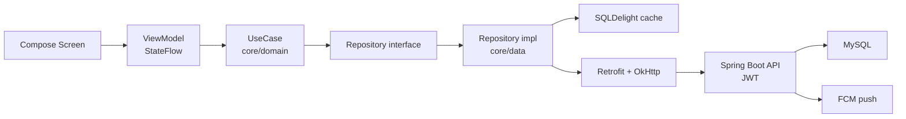

import { Card, CardGrid, LinkCard, Tabs, TabItem, FileTree, Badge } from '@astrojs/starlight/components';

El módulo `mobile/` es una aplicación Android nativa en Kotlin que se distribuye como **tres APKs independientes** mediante flavors Gradle. Las tres apps comparten módulos comunes de red, dominio, datos, diseño y utilidades, pero cada APK expone únicamente las features permitidas para su rol.

<CardGrid>
  <Card title="Tres APKs" icon="mobile">
    `ciudadano`, `funcionario` y `ttaip`, cada uno con su propio `applicationId`.
  </Card>
  <Card title="Backend propio" icon="server">
    Autenticación, datos y reglas de negocio vienen de Spring Boot + JWT.
  </Card>
  <Card title="Firebase limitado" icon="bell">
    Firebase se conserva únicamente para Cloud Messaging (FCM).
  </Card>
  <Card title="Compose + Material 3" icon="puzzle">
    UI declarativa, single-Activity y Navigation 3.
  </Card>
</CardGrid>

## Stack Técnico

| Tecnología | Versión | Propósito |
| --- | --- | --- |
| Kotlin | 2.3.21 | Lenguaje principal |
| Android Gradle Plugin | 9.2.1 | Build Android |
| Gradle Wrapper | 9.4.1 | Build reproducible |
| Jetpack Compose BOM | 2026.05.01 | UI declarativa |
| Material 3 | BOM Compose | Design system |
| Navigation 3 | 1.1.2 | Navegación single-Activity |
| Koin | 4.2.1 | Inyección de dependencias |
| SQLDelight | 2.3.2 | Cache local |
| Retrofit | 3.0.0 | Cliente REST |
| OkHttp | 5.3.2 | Transporte HTTP e interceptores |
| Firebase BOM | 34.13.0 | Solo FCM push |
| compileSdk | 36 | SDK de compilación |
| minSdk | 24 | Android 7.0+ |

## APKs por Rol

| Flavor | Application ID | Distribución | Funcionalidad permitida |
| --- | --- | --- | --- |
| `ciudadano` | `com.gestion.misaip.ciudadano` | Pública, Google Play | Registro, login ciudadano, SAIP, seguimiento, apelaciones y subsanaciones. |
| `funcionario` | `com.gestion.misaip.funcionario` | Interna | Bandeja de entidad, atención y respuesta de solicitudes. |
| `ttaip` | `com.gestion.misaip.ttaip` | Restringida | Primera calificación, subsanación, segunda calificación y resolución. |

:::caution[Sin APK admin]
La app mobile no genera aplicación de administrador. Los accesos `ADMINISTRADOR` se gestionan desde el frontend web.
:::

## Arquitectura Multi-Módulo

<FileTree>
- mobile/
  - app/
    - src/main/java/com/gestion/misaip/
      - MainActivity.kt
      - config/AppRolePolicy.kt
      - messaging/MiSaipMessagingService.kt
      - navigation/
      - screen/
      - viewmodel/
      - theme/
      - di/
  - core/
    - domain/
      - model/
      - usecase/
      - repository/
    - data/
      - repository/
      - mapper/
    - database/
      - SQLDelight schemas
    - network/
      - Retrofit ApiServices
      - OkHttp interceptors
      - DTOs
    - common/
  - gradle/
    - libs.versions.toml
</FileTree>

## Flujo de Datos



## Build y Validación

```powershell
cd mobile
.\gradlew.bat :app:compileCiudadanoDebugKotlin
.\gradlew.bat :app:compileFuncionarioDebugKotlin
.\gradlew.bat :app:compileTtaipDebugKotlin
.\gradlew.bat test
.\gradlew.bat assembleCiudadanoDebug assembleFuncionarioDebug assembleTtaipDebug
.\gradlew.bat lint
```

:::tip[Regla de backend]
No usar Firebase Auth ni Firestore como backend de datos. La app consume autenticación, consulta de datos y lógica de negocio desde Spring Boot + JWT. FCM solo entrega notificaciones push.
:::

:::note[Contrato API]
El snapshot `mobile/openapi.json` se sincroniza desde `/v3/api-docs` mediante `scripts/sync-openapi.ps1`. Retrofit todavía cubre un subconjunto del contrato; la matriz de migración vive en `mobile/MOBILE_SYNC_AUDIT.md`.

La creación SAIP básica de App Ciudadano ya captura consentimiento expreso de datos personales y canal formal de notificación, envía ambos campos al backend y conserva el canal en el seguimiento local. Los subflujos de observación, ampliación, encauzamiento y liquidación se incorporarán por verticales posteriores.
:::

## Subsecciones

<CardGrid>
  <LinkCard title="Arquitectura" href="/mobile/arquitectura/" description="Clean Architecture, capas, Koin DI, Retrofit y SQLDelight." />
  <LinkCard title="Navegación" href="/mobile/navegacion/" description="Navigation 3 con NavDisplay y NavKey." />
  <LinkCard title="ViewModels" href="/mobile/viewmodels/" description="UiState, eventos y StateFlow." />
  <LinkCard title="Datos Offline" href="/mobile/datos-offline/" description="Cache local y sincronización REST." />
  <LinkCard title="Testing" href="/mobile/testing/" description="JUnit, MockK, Turbine y Compose testing." />
</CardGrid>
